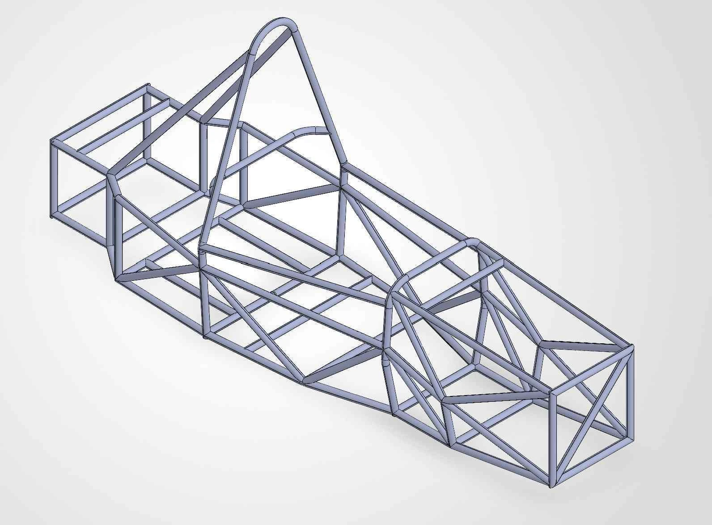

# Yongmin Kwon | Engineering Portfolio
<!-- casebook-index -->

## Detailed project records

20 projects now include a three-chapter record and a PDF of at least three pages. [Browse the detailed casebook](CASEBOOK.md) and [A-FA design dossier](docs/afa-design/README.md). The expanded technical documentation is in Korean.

<!-- /casebook-index -->

**Vehicle testing · Suspension design · Fabrication · Technical documentation**

[Live portfolio](https://yongmin.gardengnat12.chatgpt.site) · [Bilingual profile PDF](site/assets/yongmin-profile.pdf) · [한국어](README.md)

I study Mechanical Engineering with a double major in Future Automotive Engineering at Ajou University. Through Formula Student team A-FA, I have worked as a driver, team leader and suspension lead. I build, test on track, and document the reasoning behind design decisions so the next team can continue the work.



## Selected projects

| Case study | Contribution / scope |
|---|---|
| [Track testing and suspension setup](projects/roll/README.en.md) | 7 runs; about 7.4% lower front roll gradient in the representative comparison |
| [Topology optimization, structural checks and fabrication](projects/bellcrank/README.en.md) | CAD mass: front 51.21→26.25 g; rear 58.13→28.27 g |
| [Battery thermal management and fabrication](projects/battery/README.en.md) | Mechanical design, 3D printing, welding, static analysis and report integration |
| [Team leadership and documentation](projects/leadership/README.en.md) | Six technical teams, reports, study sessions and handover |
| [Sponsors, fabrication and test coordination](projects/collaboration/README.en.md) | Requirements, test/fabrication records, season reports and successor handover |

The 7.4% figure is an observed roll-gradient change in the representative sequential-test comparison. It is not presented as a lap-time or grip improvement. Bellcrank CAD mass and physical scale measurements are also distinguished.

## Ideas, competitions and creative work

[Browse 15 entries](ideas/README.en.md), grouped into data evaluation, services and policy, learning content, and video/design. Each case identifies its deliverable, contribution and status.

## Research, writing and awards

- [Research and writing](docs/research.en.md): two accepted KSAE posters scheduled for November 20, 2026; an article published in the October 2026 Auto Journal.
- [Team and individual awards](docs/awards.en.md).
- [Full bilingual profile](site/assets/yongmin-profile.txt).

## In progress

Mechanical design and fabrication for the **0ERROR cooling testbed**. Current records cover design, component review and assembly preparation.

## Repository guide

| Path | Contents |
|---|---|
| [projects/](projects/README.en.md) | Five core case studies, each in Korean and English |
| [ideas/](ideas/README.en.md) | Fifteen competition, proposal and content entries |
| [docs/](docs/README.md) | Research, writing and awards |
| [site/](site/README.md) | Public website source, images, videos and profile |

Run the static site locally and open http://127.0.0.1:8000:

```sh
python -m http.server 8000 --directory site
```

## Contact

[smile10203@ajou.ac.kr](mailto:smile10203@ajou.ac.kr) · [LinkedIn](https://www.linkedin.com/in/%EC%9A%A9%EB%AF%BC-%EA%B6%8C-bb807939b/)

---

As of October 2026. AI assisted the documentation and website implementation. Personal responsibilities and teammates’ contributions are identified in each case.

