# A-FA 설계보고서 상세 기록

[포트폴리오 처음으로](../../README.md) · [웹 상세](https://yongmin.gardengnat12.chatgpt.site/cases/afa-design/) · [상세 PDF · 31쪽](../../site/downloads/afa-design.pdf) · [English summary](README.en.md)

> A-FA / ENGINEERING DESIGN DOSSIER · 개인 담당 영역 중심의 설계 근거 · 팀 도판은 출처와 기여 구분

프레임의 경계조건부터 모션비, 댐퍼 데이터, 벨크랭크의 하중과 제작, 푸시로드 좌굴까지. 원보고서의 계산과 도판으로 설계 판단을 자세히 읽는 자료입니다.

| 항목 | 내용 |
|---|---|
| 8개 | 설계 주제 |
| 22종 | 원보고서 도판 |
| 설계→제작 | 계산·해석·확인 절차 |

## 01장. 설계 조건과 프레임

## 프레임: 기존 구조를 유지하면서 변경된 하중 경로에 대응하기

### 차량의 기준 구조를 설계하는 문제

프레임을 단순히 모든 부품을 담는 틀로 보지 않고, 현가 하드포인트의 위치를 유지하며 구동계·배터리·인버터·냉각계·공력 부품을 연결하는 기준 구조로 다뤘습니다. 현가 설계에서 좋은 좌표를 얻더라도 하드포인트를 지지하는 파이프가 변형되거나 제작 위치가 달라지면 실제 바퀴의 자세와 하중 전달은 설계와 달라집니다. 따라서 전역 강성, 국부 체결부, 제작 오차, 정비 접근성을 같은 설계 문제로 묶었습니다.

AEF-26은 AEF-25의 Space Frame 기본 구조를 활용한 개선형 설계입니다. 전년도 구조에는 실제 제작·조립·검차 과정에서 얻은 경험과 기존 지그가 있었습니다. 전체 프레임을 새로 설계하는 선택은 새로운 패키징 자유도를 주지만, 지그 재제작·용접 순서 재정의·조립 오차·제작 일정의 부담도 함께 만듭니다. 이번 설계에서는 바꿀 필요가 있는 영역과 유지할 수 있는 영역을 구분하는 것이 중요했습니다.

### 유지한 것과 바꾼 것

전후륜 서스펜션 하드포인트가 체결되는 파이프 위치를 변경하고, 전륜 현가 마운트 주변의 보강대 일부 삭제를 반영했습니다. EMRAX 228 적용과 전장·냉각 부품 배치 변경, Full Aero Package를 위한 마운트 조건도 패키징 검토의 입력이 되었습니다. 전체 실루엣이 유사하더라도 하드포인트의 위치와 보강 부재가 달라졌기 때문에, 전년도 비틀림 강성 수치를 새로운 모델의 검증 없이 그대로 사용하는 것은 적절하지 않았습니다.

| 설계 항목 | 판단 기준 | 설계에서 연결한 문제 |
| --- | --- | --- |
| 전체 비틀림 강성 | AEF-25 해석 수준 약 2170 N·m/deg 유지 | 현가 입력에 대한 프레임 전체의 회전 변형 |
| 하드포인트 유지성 | 체결 파이프 위치와 주변 하중 경로 검토 | 설계한 현가 기하의 실제 구현 |
| 패키징 | 모터·인버터·배터리·배관·배선 경로 | 설치 공간과 다른 파트의 인터페이스 |
| 정비성 | 주요 부품 탈거와 점검 접근 공간 | 조립 후 서비스 작업 가능성 |
| 제작 신뢰성 | 기존 지그·제작 경험 활용 | 제작 일정과 위치 오차 관리 |

설계보고서의 기존 목표 약 2200 N·m/deg와 전년도 해석 수준 약 2170 N·m/deg는 구분했습니다. AEF-26의 계산 결과를 2200 목표 초과 성과로 표현하지 않습니다. 기존 수준을 유지하는 개선형 설계라는 판단과, 원래 목표에 소폭 미달한다는 사실을 함께 기록하는 편이 설계 의도를 정확히 설명합니다.

### 재료와 단면을 모델에 옮기기

보고서의 프레임 재료는 STKM-11A 계열 강관입니다. 프레임 해석에서는 탄성계수 200,000 MPa, 포아송비 0.30, 밀도 7.85×10⁻⁶ kg/mm³를 적용했습니다. 강성은 선형 탄성 구간의 변형으로 계산하므로 탄성계수와 파이프 단면이 중요한 입력입니다. 항복강도나 인장강도가 높다는 사실만으로 비틀림 강성이 높아지는 것으로 해석하지 않았습니다.

제출보고서에는 파이프 두께를 적색 1.8t, 청색 1.65t, 녹색 1.25t로 구분한 CAD가 있습니다. 모든 부재를 동일한 실선처럼 취급하지 않고 실제 적용할 단면을 Beam에 지정하는 과정의 근거입니다. 다만 이 그림은 설계 단면을 표시한 CAD이며, 제작된 모든 파이프의 실측 두께 검사표는 아닙니다.

### 개인 기여와 팀 인터페이스

프레임·현가·벨크랭크·지그·제작·정적해석은 제가 직접 참여한 기술 영역입니다. 팀장으로서 구동계와 전장, 냉각, 공력 담당자와 장착 위치·간섭·제작 일정을 맞추고 보고서의 관련 근거를 연결했습니다. 팀 합본의 모터 전기제어, 배터리 전기설계, 공력 해석, 계측 코드 전체까지 개인이 수행한 것으로 확장하지 않습니다. 해당 영역은 프레임이 수용해야 하는 팀 설계 조건이자 협업 인터페이스로 다룹니다.

이 사례가 보여주는 작업은 완전히 새로운 프레임을 제안하는 것보다, 기존 구조의 장점을 남기면서 변경점이 강성과 제작에 미치는 영향을 다시 확인하는 설계 판단입니다. 전체 강성 해석, 체결부 상세 검토, 실측 계획이 서로 다른 검증 단계라는 점도 보고서에 남겼습니다.

> 근거: 개인 섀시 설계보고서 1~3, 5~6, 8쪽; A-FA 팀 제출 설계보고서 13~17, 24쪽.

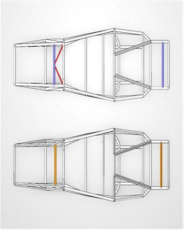

*AEF-25(상)·AEF-26(하) 프레임 비교 CAD. 하드포인트 체결 파이프와 마운트 조건을 변경한 개선형 구조입니다. 실물 사진이 아닙니다. · 3. 설계보고서_A-FA.pdf · 14쪽*

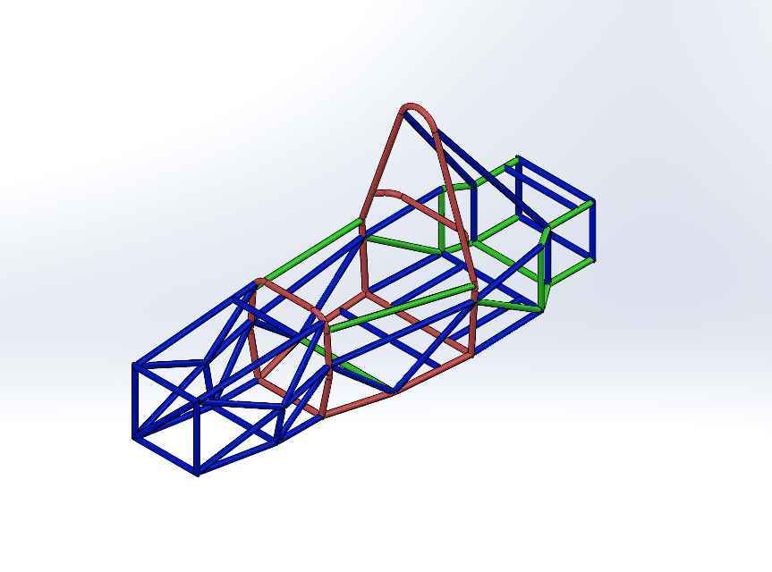

*프레임 파이프 두께 구분 CAD. 보고서 색상 기준 적색 1.8t, 청색 1.65t, 녹색 1.25t. 실제 두께 검사 결과가 아닙니다. · 3. 설계보고서_A-FA.pdf · 16쪽*

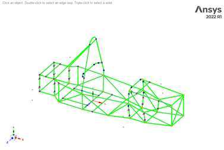

*ANSYS SpaceClaim의 중심선 기반 프레임 Beam 모델. 프레임 전역 비틀림 강성을 비교하기 위한 모델이며 용접부 국부 응력이나 실측 결과를 뜻하지 않습니다. · 3. 설계보고서_A-FA.pdf · 18쪽*

## 프레임: 비틀림 강성 계산에서 실차 검증 계획까지

### 중심선 기반 Beam 모델을 선택한 이유

ANSYS Workbench 2022 R1의 Static Structural 환경에서 SpaceClaim 중심선 기반 Line Body를 구성했습니다. 목적은 프레임 전체의 비틀림 강성을 효율적으로 비교하는 것이므로, 모든 튜브를 3차원 솔리드로 상세 모델링하기보다 실제 파이프 단면을 가진 Beam 모델을 사용했습니다. 부재 연결은 Beam Connect를 통해 동일 노드로 구성하고 Mesh 생성 후 연결 상태를 확인하는 방식입니다.

이 모델의 평가 대상은 프레임 자체입니다. 위시본, 업라이트, 타이로드의 탄성 변형이나 실제 베어링 유격을 함께 계산한 전체 차량 모델은 아닙니다. 용접 비드의 형상, 용접 열영향부, 브라켓의 국부 응력 집중도 이 전역 모델의 직접 평가 범위에 포함하지 않았습니다. 빠르게 비교할 수 있는 모델을 택한 대신, 그 모델로 답할 수 있는 질문을 제한했습니다.

### 경계조건을 정의하고 토크로 환산하기

후륜 좌우 인보드 하드포인트에 구속 조건을 설정하고, 전륜 좌우 인보드 하드포인트에는 반대 방향의 수직 하중을 각각 1000 N 적용했습니다. 프레임 후방의 모든 부재를 고정하면 실제보다 과도한 구속으로 강성이 크게 계산될 수 있으므로, 현가 하중이 전달되는 장착 위치를 기준으로 조건을 정했습니다.

보고서의 하중 작용선 간 거리는 450.21 mm입니다. 커플의 토크는 한쪽 하중 F와 두 작용선의 간격 b의 곱으로 계산합니다.

T = F × b = 1000 N × 0.45021 m = 450.21 N·m

같은 계산을 차량 중심선에서 한쪽 작용선까지 거리 l로 쓸 때는 T = 2Fl이 됩니다. b=2l이므로 두 식은 동일하며, 하중 2개라는 이유로 작용선 간 거리 b를 사용하는 식에 다시 2를 곱하지 않습니다.

### 최대 변위 대신 좌우 평균 방향변위 차이를 사용하기

ANSYS Directional Deformation에서 보고서가 사용한 좌측 전륜 하드포인트 평균 Y변위는 +0.81337 mm, 우측 평균은 -0.81688 mm입니다. 두 값의 차이는 1.63025 mm입니다. 이 차이를 하중점 간 거리로 나누어 비틀림각을 구했습니다.

θ = atan(1.63025 / 450.21) × 180 / π ≈ 0.20747 deg

Kₜ = T / θ = 450.21 / 0.20747 ≈ 2170 N·m/deg

| 항목 | 보고서 값 | 의미 |
| --- | --- | --- |
| 한쪽 하중 | 1000 N | 좌우 반대 방향 커플의 구성 하중 |
| 작용선 간격 | 450.21 mm | 토크와 비틀림각 산정의 기준 거리 |
| 좌우 변위 차이 | 1.63025 mm | 병진 성분을 구분하기 위한 상대 변위 |
| 비틀림각 | 0.20747 deg | mm와 deg 단위를 구분한 계산 결과 |
| 비틀림 강성 | 약 2170 N·m/deg | 해당 경계조건의 선형 정적 해석값 |

결과는 전년도 해석 수준과 동등한 약 2170 N·m/deg입니다. 기존 목표 약 2200 N·m/deg에는 소폭 미달합니다. 후륜 고정 조건, 입력 위치, 부재 단면과 연결 가정이 다른 해석이나 실측 자료와 수치만 직접 비교하지 않습니다.

### 보고서에 남긴 실측 절차

설계보고서 제출 시점에는 프레임 비틀림 강성 실측이 완료되지 않았습니다. 따라서 결과물은 해석 모델과 계산, 그리고 실측 계획입니다. 실측 계획에서는 후방 고정 지그·전방 하중 입력 지그·변위 측정 지그를 구분했습니다. 변위 센서를 프레임과 함께 움직이는 부위에 고정하면 실제 변형을 과소평가할 수 있으므로, 정반 또는 지면에 독립된 기준을 두도록 했습니다.

계획한 입력 단계는 0→500→1000→1500 N이며, 각 단계에서 좌우 수직 변위를 기록한 뒤 하중을 제거하면서 복원을 확인합니다. 최소 3회 이상 반복하여 평균을 비교하고, 가능하면 후방 고정점의 변위도 함께 측정해 지그 자체의 변형을 확인하는 방식입니다. 이는 실제 수행 완료 기록이 아니라 보고서의 검증 계획입니다.

해석과 시험을 비교할 때는 입력 위치·방향·좌우 거리·후방 구속·센서 위치를 맞춰야 합니다. 차이가 생기면 용접부, 체결 유격, 제작 오차, 지그 변형, 경계조건 차이를 원인 후보로 분해합니다. 이후 하드포인트와 모터·배터리·윙 마운트의 국부 해석을 추가하는 것이 전역 Beam 결과를 보완하는 순서입니다.

> 근거: 개인 섀시 설계보고서 5~6, 8, 10~11, 13~14, 17~22쪽; A-FA 팀 제출 설계보고서 17~24쪽.

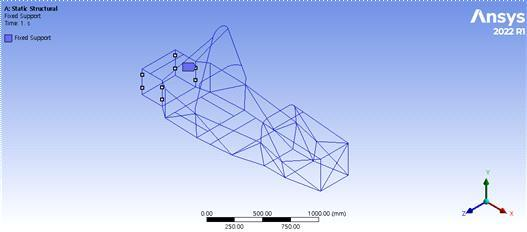

*후륜 인보드 하드포인트의 해석 구속 조건. 실제 비틀림 강성 시험용 지그 사진이 아닙니다. · 3. 설계보고서_A-FA.pdf · 18쪽*

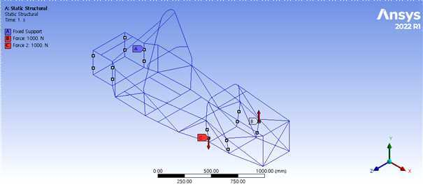

*전륜 좌우 인보드 하드포인트에 반대 방향 1000 N을 적용한 비틀림 해석 하중조건. 하중 작용선 간 거리 450.21 mm를 사용했습니다. · 3. 설계보고서_A-FA.pdf · 19쪽*

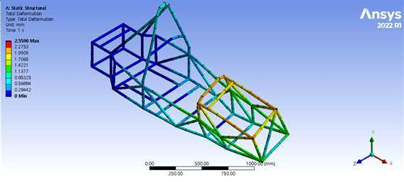

*프레임 Beam 모델의 전체 변형 해석 화면. 약 2170 N·m/deg는 이 경계조건의 선형 정적 해석값이며 실차 실측값이 아닙니다. · 3. 설계보고서_A-FA.pdf · 21쪽*

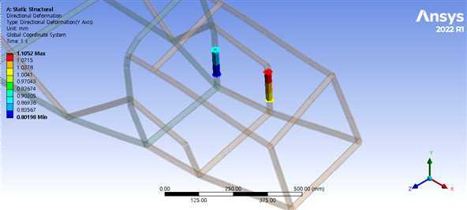

*좌측 전륜 하드포인트 방향변위 결과. 보고서 좌측 평균 +0.81337 mm와 우측 평균 -0.81688 mm의 차이로 비틀림각을 계산했습니다. · 3. 설계보고서_A-FA.pdf · 21쪽*

## 02장. 현가·댐퍼·벨크랭크 설계

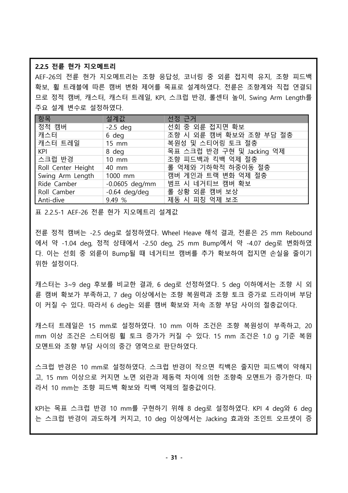

*전륜 현가 지오메트리 설계 제원표와 선정 이유가 담긴 A-FA 제출보고서 p31. 제원은 설계값이며 실차 성능 수치가 아닙니다.*

## 현가 기하: 하드포인트의 작동 범위와 남은 토 변화를 함께 읽기

### 정적 제원보다 작동 범위가 중요한 이유

AEF-26의 Double Wishbone Push-rod 현가는 정적 캠버나 롤센터의 단일 목표값만으로 설명하기 어렵습니다. 범프·리바운드·롤이 발생하면 업라이트 자세, 휠 중심, 캠버, 토, 롤센터와 트랙이 함께 변합니다. 그래서 CAD 하드포인트를 기반으로 한 강체 기구학 해석을 보고서에 정리했습니다. MATLAB 모델에서는 어퍼암·로어암·타이로드 또는 토링크의 길이 제약을 만족하도록 업라이트 위치와 자세를 반복 계산합니다. 프로그래밍은 보조를 받았으며, 모델을 활용한 설계 검토와 독립적인 소프트웨어 개발 역량을 구분합니다.

좌표는 차량 후방 +x, 우측 +y, 상방 +z이며, 휠 중심의 정적 높이를 z=0으로 두었습니다. 타이어 반경 228.6 mm를 반영해 접지점을 설정하고 롤센터 높이를 지면 기준으로 보정했습니다. 해석은 -25 mm 리바운드에서 +25 mm 범프까지입니다. 링크·부싱·업라이트·프레임의 탄성 변형과 Compliance는 포함하지 않았습니다.

### 전륜과 후륜의 다른 설계 의도

전륜은 외륜 캠버 확보와 조향 응답, 후륜은 구동 접지와 완만한 기하 변화에 초점을 뒀습니다. 정적 전륜 캠버 -2.5°, 후륜 -2.0°를 기준으로, 전륜 Swing Arm Length는 1000 mm, 후륜은 2500 mm입니다. 보고서의 전륜 캐스터 6°, 캐스터 트레일 15 mm, KPI 8°, 스크럽 반경 10 mm는 조향 복원성과 조작 부담, 피드백과 킥백 사이의 절충값으로 정리했습니다. 이 값들을 타이어 실측 횡력이나 최종 랩타임으로 최적화한 결과라고 표현하지 않습니다.

| Wheel Heave 항목 | -25 mm Rebound | Static | +25 mm Bump |
| --- | --- | --- | --- |
| 전륜 캠버 | -1.04° | -2.50° | -4.07° |
| 후륜 캠버 | -1.56° | -2.00° | -2.49° |
| 전륜 토 변화 | -0.64° | 0° | +0.67° |
| 후륜 토 변화 | +2.02° | 0° | -1.95° |

정적 부근 캠버 게인은 전륜 -0.0605 deg/mm, 후륜 -0.0187 deg/mm입니다. 전륜은 범프에서 네거티브 캠버가 더 크게 늘고, 후륜은 변화가 완만합니다. 이는 설계 방향과 일치하지만 실제 접지력 증가를 측정한 값은 아닙니다.

### 한 목표를 만족할 때 다른 지표도 확인하기

롤센터 높이는 전륜 목표 40 mm에 대해 39.37 mm, 후륜 목표 70 mm에 대해 72.31 mm로 계산되었습니다. 두 목표와 근접한 것은 정면 기하의 기준점을 확인하는 근거입니다. 반면 +25 mm 대칭 범프에서 트랙 변화는 전륜 -10.25 mm, 후륜 -0.72 mm였습니다. 전륜 캠버 변화를 크게 확보한 기하가 횡방향 휠 이동도 더 크게 만든다는 점을 함께 읽었습니다.

토 변화는 특히 중요한 미해결 항목입니다. 전륜 약 ±0.67°, 후륜 약 ±2°의 변화가 남아 있으며, 후륜 토링크 배치가 휠 트래블에 민감하다는 뜻입니다. 개인 원고는 제작 전 재검토 대상으로 설명하고, 제출 합본은 제작 완료 상태를 반영하여 초기 얼라인먼트와 실차 테스트의 관리 항목으로 정리했습니다. 두 판본의 시점 차이를 지우고 ‘범프스티어를 완전히 해결했다’고 쓰지 않습니다.

### 대칭 범프와 선회 입력을 구분하기

제출보고서의 Lat. 1g Loadcase는 질량 330 kg, CG 높이 289.21 mm, 전후 롤센터 40/70 mm, 전후 Roll Rate 456 N·m/deg를 사용한 준정상 계산입니다. 예상 롤각 약 1.67°와 트랙 1200 mm를 바탕으로 외륜 +17.47 mm, 내륜 -17.47 mm의 비대칭 휠 입력을 설정했습니다. 이 1.67°는 주행 센서가 기록한 롤각이 아닙니다.

해당 조건에서 전륜 외륜 캠버 -3.58°, 후륜 외륜 -2.34°가 계산되었습니다. 롤센터 높이는 전륜 35.51 mm, 후륜 67.51 mm, 횡방향 위치는 각각 -101.27/-100.74 mm입니다. 트랙 변화는 전륜 -0.90 mm, 후륜 -0.96 mm로 대칭 Heave 결과와 달랐습니다. 입력 방식이 다르기 때문에 전륜 -10.25 mm와 -0.90 mm를 성능 개선 전후 값처럼 비교할 수 없습니다.

### 실차에 가져갈 관리 항목

전체 작동 범위에서 타이로드·토링크·로드엔드·스페이서 간섭과 작동각을 확인하고, 제작된 하드포인트 위치와 모델 좌표를 연결하는 것이 다음 단계입니다. 캠버는 초기 목표 네거티브 값을 확보한 뒤 캠버 칩으로 절댓값을 줄이는 방향의 조정 구조이므로, 초기 조립 상태가 조정 가능 범위를 제한합니다. 정적 얼라인먼트, 차고, 코너 웨이트를 먼저 맞춘 뒤 저속 기능 확인과 원선회·슬라럼 등 데이터 검토로 넘어가는 흐름을 보고서에 남겼습니다.

이 기구학 사례의 결과물은 목표값과 작동 범위를 연결한 계산표, 그래프, 그리고 해결되지 않은 토 변화를 후속 검증 항목으로 관리한 기록입니다. 다른 조향 담당자의 Adams 모델이나 별도 판본의 훨씬 작은 토 변화 수치를 이 모델과 섞어 하나의 검증 완료 성과로 만들지 않습니다.

> 근거: 개인 섀시 설계보고서 116~127, 231~232, 235~236쪽; A-FA 팀 제출 설계보고서 31, 36~38쪽.

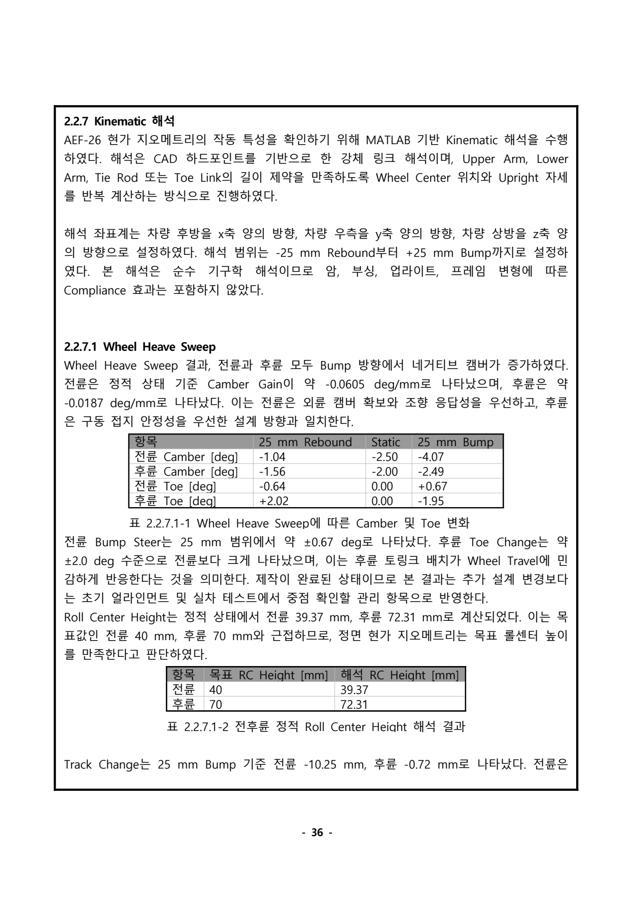

*A-FA 제출보고서 p36의 강체 기구학 해석 결과. ±25 mm 휠 트래블에서 전륜 약 ±0.67°·후륜 약 ±2° 토 변화가 남아 있음을 관리 항목으로 기록했습니다. · 3. 설계보고서_A-FA.pdf · 36쪽*

## MR·스프링·스트로크: 같은 정의로 연결한 설계 계산

### Motion Ratio 정의부터 맞추기

보고서에서 MR은 Damper Travel / Wheel Travel로 정의했습니다. 전륜 0.70은 휠이 1 mm 움직일 때 댐퍼가 0.70 mm 움직인다는 뜻이며, 후륜은 0.80입니다. MR을 역수로 정의하는 자료와 식을 섞으면 스프링과 하중 계산이 뒤집히므로 정의를 먼저 고정했습니다. 이 값은 실제 벨크랭크 회전 구간에서 조금씩 달라지는 순간비를 단순화한 등가 설계 기준값입니다.

AEF-25의 전륜 0.614/후륜 0.543에서 AEF-26의 0.70/0.80으로 목표를 재설정했습니다. 전년도에도 CAD 휠 변위에 따른 댐퍼 변위로 MR을 산정했기 때문에, MR 계산 개념을 처음 도입했다는 성과로 쓰지 않습니다. 변경한 것은 차량 목표와 패키징에 맞춘 기준값과 연결 형상입니다.

### 목표 Ride Frequency를 실제 스프링으로 변환하기

설계 순서는 목표 고유진동수 f → 휠 기준 강성 K_w → MR → 스프링 강성 K_s입니다. 보고서의 식은 f=(1/2π)√(K_w/m_s), K_w=K_s×MR²입니다. 단위는 K_w를 N/m로 사용할지 N/mm로 사용할지 일관되게 변환해야 합니다. 스프링 강성만 비교하면 같은 스프링이 서로 다른 MR에서 다른 휠 기준 강성을 만든다는 점을 놓치게 됩니다.

보고서 초기안은 휠당 상질량 전륜 61.36 kg, 후륜 75.64 kg, 목표 Ride Frequency 2.49/2.74 Hz를 사용합니다. 그 결과 목표 Wheel Rate는 전륜 15.019 N/mm, 후륜 22.419 N/mm입니다.

K_s,F = 15.019 / 0.70² = 30.651 N/mm ≈ 175.02 lb/in

K_s,R = 22.419 / 0.80² = 35.030 N/mm ≈ 200.02 lb/in

초기 선정은 Hyperco 18FS175/18FS200, 즉 175/200 lb/in입니다. 적용 규격으로 되계산한 Wheel Rate는 15.017/22.416 N/mm로 초기 목표와 근접합니다. 이 수치의 의미는 계산값과 상용 규격의 정합입니다. 실제 제작 스프링의 강성 공차나 차량 중량 오차보다 작은 계산 차이를 특별한 물리적 정밀도 성과로 강조하지 않았습니다.

### 더 큰 MR이 항상 좋은 것은 아닌 이유

MR이 작으면 같은 Wheel Rate를 구현하기 위해 더 높은 Spring Rate가 필요하고, 댐퍼 유효 변위가 줄어듭니다. 반대로 MR을 크게 하면 요구 스프링 강성을 낮추고 댐퍼를 더 많이 작동시키지만, 스트로크 사용량·벨크랭크 회전각·주변 간섭과 체결부 하중을 함께 확인해야 합니다. 전륜 0.70은 조향계와 프론트 프레임 공간, 후륜 0.80은 구동축 자세와 리어 댐퍼 배치의 조건을 함께 고려한 설계값입니다.

### 전체 휠 트래블을 댐퍼 사용량으로 바꾸기

| 설계 항목 | 전륜 | 후륜 |
| --- | --- | --- |
| 휠 Rebound / Jounce | 30 / 25 mm | 30 / 30 mm |
| MR | 0.70 | 0.80 |
| 댐퍼 Rebound / Jounce | 21.0 / 17.5 mm | 24.0 / 24.0 mm |
| 총 댐퍼 사용량 | 38.5 mm | 48.0 mm |
| 공칭 댐퍼 스트로크 | 57 mm | 57 mm |
| 공칭 기준 잔여량 | 18.5 mm | 9.0 mm |

후륜은 전륜보다 MR이 커서 같은 휠 변위에서 댐퍼 스트로크를 더 많이 사용합니다. 공칭 잔여량이 9 mm라는 계산은 전체 57 mm 안에 작동 범위가 들어간다는 1차 확인입니다. 정적 설치 위치와 범프 러버, 실제 완전 신장·압축 길이, 제작 오차를 반영한 실차 Bottoming·Top-out 검증을 대신하지 않습니다. 실제 보유 댐퍼가 중고품이므로 조립 전 상태 확인도 별도로 필요합니다.

### 코일이 완전히 붙는 조건도 확인하기

보고서에서는 스프링 사용 가능 변위와 정적 압축량+설계 Jounce를 비교했습니다. 전륜은 정적 스프링 압축 약 28.1 mm와 추가 압축 17.5 mm를 합한 45.6 mm, 후륜은 26.5+24.0=50.5 mm입니다. 해당 스프링 사용 가능 변위 75.7/74.0 mm와 비교한 초기안입니다. 이는 스프링 Solid Height 검토이고, 댐퍼 자체의 기계적 스트로크 검토와는 다른 문제입니다.

Sag라는 용어도 보고서에서는 정적 차고에서 전체 Wheel Travel 중 Rebound가 차지하는 비율로 정의했습니다. 전륜 30/55=54.5%, 후륜 30/60=50.0%입니다. 일반적인 스프링 정적 압축량과 같은 뜻으로 읽지 않도록 정의를 붙였습니다.

### 판본과 시험 조건을 섞지 않기

이 175/200 lb/in 설계안은 별도 롤 분석 프로젝트의 전륜 250→300 lb/in, 후륜 300 lb/in 유지 시험과 다릅니다. 초기 설계 계산을 후속 시험의 실제 세팅이라고 쓰거나, 250→300 결과를 초기안의 주행 검증으로 연결하지 않습니다. 또한 제출보고서 p40은 최종 다운포스 미확정으로 공력 하중을 초기 Spring 계산에 직접 반영하지 않았다고 명시합니다. Full Aero를 고려한 설계 의도와, 최종 공력 하중을 포함한 검증 완료는 구분합니다.

벨크랭크 하중 계산의 330 kg·전후 52.3/47.7%와 스프링 계산의 휠당 상질량은 서로 다른 절의 입력입니다. 모든 수치가 하나의 최종 실차 중량모델로 정합되었다고 주장하지 않고, 통합 검증 시 중량·상질량·하중배분의 판본을 맞춰야 할 항목으로 남겼습니다.

> 근거: 개인 섀시 설계보고서 145~158, 194, 196, 233~234쪽; A-FA 팀 제출 설계보고서 38~42, 51~52쪽.

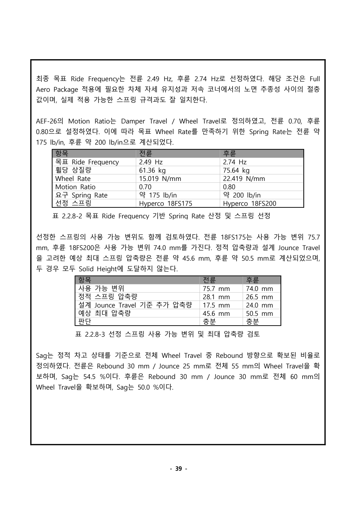

*A-FA 제출보고서 p39의 초기 스프링 선정 및 변위 여유 검토. 이 설계안의 175/200 lb/in은 별도 롤 분석의 250/300 lb/in 시험과 구분합니다. · 3. 설계보고서_A-FA.pdf · 39쪽*

## Shock Dyno: 보유 부품의 실제 데이터를 세팅 근거로 사용하기

### 제조사 제원에서 보유 부품의 상태로

차량에는 2년 이상 사용한 Öhlins TTX25 MkII 중고 댐퍼를 적용했습니다. 같은 모델이라도 사용 이력과 오일·씰·밸브 상태가 다를 수 있으므로, 제조사 카탈로그의 곡선만으로 실제 조절 범위를 가정하기 어렵습니다. 외부 시험기관에서 수행한 Dyno 측정 결과를 받아 분석하고 세팅 근거로 활용했습니다. 제가 직접 시험 장비를 운전하여 측정한 것으로 표현하지 않습니다.

보고서의 평가 대상은 대표 시료입니다. HSC·HSR·LSC·LSR의 Max/Min 조합으로 16개 Case, 각 Case의 8개 속도 조건을 비교했습니다. 이 결과를 차량에 장착하는 4개 댐퍼의 전수 특성 보증으로 일반화하지 않았습니다.

### 그래프가 설명하는 것

F-D 그래프는 힘–변위 히스테리시스, F-V 그래프는 속도에 따른 압축·신장 감쇠력의 변화를 설명하는 자료입니다. 원문 F-V 그래프의 가로축은 ‘Road Velocity’로 표기되어 있으나 본문은 댐퍼 샤프트 속도로 설명합니다. 이 용어 차이를 임의로 차속이라고 해석하거나 원시 축 정의를 확인한 것으로 바꾸지 않습니다. 포트폴리오에서도 보고서의 측정 데이터 그림이라는 맥락과 단위 확인의 필요성을 유지합니다.

보고서의 다이얼별 조절비는 HSC/HSR을 300 mm/s, LSC/LSR을 25 mm/s에서 평가한 값입니다. HSC의 940→128 N, HSR의 785→97 N, LSC의 507→42 N, LSR의 446→51 N은 각 다이얼의 영향을 비교한 대표값이며, 서로 같은 속도의 조절비 표가 아닙니다.

| 조절 항목 | 평가 속도 | 보고서 대표 감쇠력 범위 | 조절비 |
| --- | --- | --- | --- |
| HSC | 300 mm/s | 940→128 N | 약 7.3:1 |
| HSR | 300 mm/s | 785→97 N | 약 8.1:1 |
| LSC | 25 mm/s | 507→42 N | 약 11.9:1 |
| LSR | 25 mm/s | 446→51 N | 약 8.7:1 |

### 전체 MAX/MIN과 한 다이얼 변경을 구분하기

네 다이얼을 모두 MAX로 둔 Case는 300 mm/s에서 압축 940.0 N, 신장 -785.0 N입니다. 모두 MIN인 Case는 압축 78.6 N, 신장 -66.4 N입니다. 반면 HSC만 MIN으로 바꾼 Case의 압축은 128.2 N, 신장은 -758.6 N으로 정리되어 있습니다. HSR만 MIN인 Case는 압축 929.9 N, 신장 -97.1 N입니다. 따라서 ‘HSC MIN 128 N’과 ‘전체 MIN 78.6 N’을 같은 시험 조건인 것처럼 섞지 않았습니다.

해당 비교는 압축과 신장 조절의 방향성을 이해하는 근거입니다. 다만 단일 대표값으로 다이얼이 모든 속도와 온도에서 완전히 독립적이라고 보증하지 않습니다. 실제 세팅에서는 전체 곡선의 변화와 반복성을 함께 확인할 필요가 있습니다.

### 반복성에서 읽은 한계

보고서 기준 총 128개 측정점 중 124개는 CV 7% 미만이었습니다. 일부 저감쇠 조건은 압축 방향 CV 약 7~8%를 보였습니다. 절대 힘이 낮은 구간에서는 비율 지표가 커질 수 있다는 해석을 붙였지만, 그 구간을 없애거나 모든 점이 안정 영역이었다고 쓰지 않았습니다. 보고서의 CV 분류는 해당 분석에서 사용한 판단 기준이며 범용적인 외부 인증 규격으로 소개하지 않습니다.

### 데이터에서 실차 세팅으로 넘어가기

최대 감쇠는 차체 자세를 더 억제할 수 있지만 노면 추종에 불리할 수 있고, 최소 감쇠는 반대의 문제가 생길 수 있습니다. 따라서 두 극단값 사이에 조절 여지가 있다는 사실을 확인하고, 목표 감쇠비와 주행 피드백을 연결하는 초기 기준을 확보했습니다. Low Speed는 차량의 저속 주행 자체가 아니라 댐퍼 피스톤 속도 영역을 가리킵니다. 차체의 롤·피치·복원과 급격한 휠 입력을 구분해 어떤 다이얼의 영향을 먼저 확인할지 정리하는 데 의미가 있었습니다.

각 댐퍼의 누유, 클릭 작동, 완전 신장·압축 길이와 실제 스트로크 확인, 좌우 기준 세팅 정렬은 별도 조립·점검 단계입니다. Dyno 보고서가 존재한다는 사실만으로 목표 감쇠비가 모든 코너에서 최종 구현되었다거나, 랩타임·접지력이 개선되었다고 주장하지 않습니다. 이 사례의 핵심 결과물은 보유 부품 상태를 반영한 측정 그래프와 분석표, 그리고 최종 세팅을 결정하기 위한 비교 기준입니다.

> 근거: 개인 섀시 설계보고서 181~187쪽; A-FA 팀 제출 설계보고서 46~49쪽.

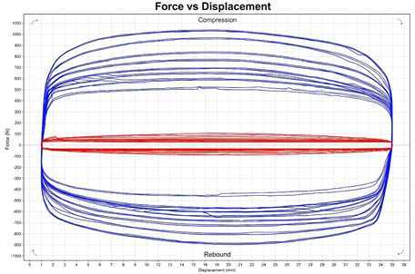

*대표 Öhlins TTX25 MkII 시료의 Shock Dyno 힘–변위 그래프. 외부 시험기관의 측정 데이터를 분석·세팅 근거로 활용했습니다. 차량 4개 댐퍼 전수 시험을 뜻하지 않습니다. · 3. 설계보고서_A-FA.pdf · 47쪽*

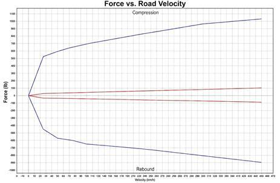

*대표 댐퍼 시료의 F-V 곡선. 보고서 본문은 샤프트 속도로 설명하지만 원문 그래프 가로축은 Road Velocity로 표기되어 있습니다. 원시 데이터 정의 재확인 전 차속으로 해석하지 않습니다. · 3. 설계보고서_A-FA.pdf · 47쪽*

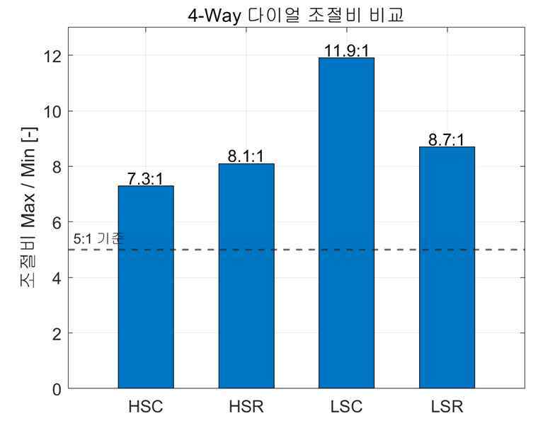

*HSC·HSR은 300 mm/s, LSC·LSR은 25 mm/s에서 평가한 다이얼 조절비. 서로 다른 평가 속도의 비율이며 전 영역 선형 감쇠계수나 최종 주행 최적값을 뜻하지 않습니다. · 3. 설계보고서_A-FA.pdf · 48쪽*

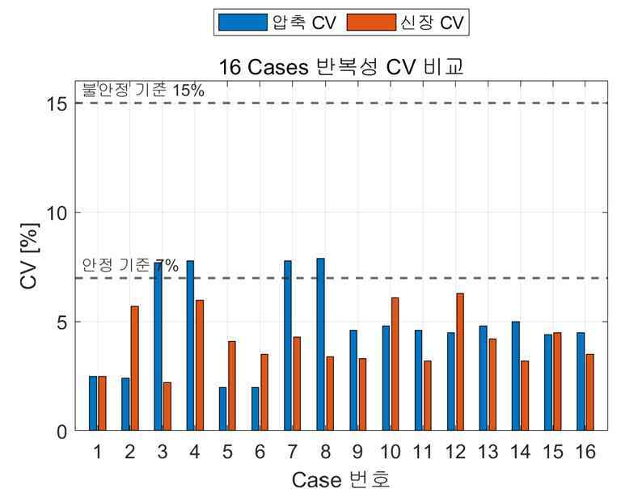

*16개 Max/Min 조합의 반복성 CV 비교. 보고서 기준 총 128개 측정점 중 124개가 CV 7% 미만이었습니다. 저감쇠 조건 일부 산포를 포함합니다. · 3. 설계보고서_A-FA.pdf · 49쪽*

## 벨크랭크: 하중 경로를 유지한 경량화와 제작 가능한 재설계

### 세 체결점을 실제 부품으로 연결하기

벨크랭크는 푸시로드의 힘을 댐퍼 방향으로 바꾸면서 휠 변위와 댐퍼 변위의 관계를 결정합니다. 따라서 외형을 줄이는 문제보다 먼저 피벗·푸시로드 연결점·댐퍼 연결점의 상대 위치를 정해야 했습니다. 목표 MR, 댐퍼 스트로크, 로드엔드 작동각, 피벗 반력과 주변 패키징이 연결되어 있습니다.

전륜은 푸시로드 측 기준 레버암 78 mm, 댐퍼 측 55 mm, 후륜은 81/65 mm로 구성했습니다. 이 값은 피벗에서 연결점까지 거리와 작용선의 각도를 함께 검토한 기준입니다. 실제 작동 중 유효 모멘트암은 각도에 따라 달라질 수 있으므로, 단순 길이비 하나가 전체 트래블의 순간 MR과 항상 같다고 설명하지 않습니다.

후륜 푸시로드의 장착 위치를 어퍼암에서 로어암 보강대로 변경하면서 푸시로드 입력 방향도 바뀌었습니다. 전륜 형상을 그대로 복사하거나 전년도 외곽만 줄이는 대신, 후륜 프레임 상부 댐퍼와 로어암 입력 방향에 맞춘 별도 형상 검토가 필요했습니다.

### 자유물체도와 하중 산정의 연결

보고서 하중 계산은 드라이버 포함 질량 330 kg, 전후 배분 52.3/47.7%, 중력가속도 9.81 m/s²를 사용했습니다. 1륜 정적 하중 전륜 846.6 N/후륜 772.1 N에 3G 등가 배수를 적용해 휠 하중 2539.7/2316.3 N을 얻었습니다. 이 3G는 단품 구조 검토용 등가 조건이며 모든 범프·제동·코너링의 동적 조합을 실측한 포락선이 아닙니다.

MR=댐퍼 변위/휠 변위이므로 등가 댐퍼 하중은 F_shock=F_wheel/MR입니다. 계산값은 전륜 3628.1 N, 후륜 2895.4 N입니다. 정적 자세에서 작용선이 레버암과 수직이라는 가정으로 피벗 모멘트 평형을 적용했습니다.

F_pushrod × l_pushrod = F_shock × l_shock

계산한 전체 푸시로드 축하중은 전륜 2558.3 N, 후륜 2323.4 N입니다. 이 하중은 뒤의 푸시로드 좌굴 검토와 연결됩니다. 실제 부품은 양측 2장 플레이트와 스페이서로 구성되므로, 단일 플레이트 해석에서는 균등 분담을 가정해 전체 하중의 절반을 적용했습니다.

| 항목 | 전륜 | 후륜 |
| --- | --- | --- |
| 전체 댐퍼 하중 | 3628.1 N | 2895.4 N |
| 전체 푸시로드 하중 | 2558.3 N | 2323.4 N |
| 산정표의 단일 판 댐퍼 하중 | 약 1814 N | 약 1448 N |
| 산정표의 단일 판 푸시로드 하중 | 약 1279 N | 약 1162 N |

개인 원고의 해석 조건 절에는 전륜 푸시로드/댐퍼 1279.7/1813.3 N, 후륜 1161.2/1447.4 N이 기재되어 있습니다. 산정 절의 반올림 표와 소폭 다르므로, 이를 완전히 동일한 입력이라고 덮지 않습니다. 공개 설명에서는 대표 하중 수준과 가정을 제시하고, 정밀 재현 시에는 해석 원본의 실제 입력을 확인할 항목으로 남깁니다.

### 토폴로지 결과를 그대로 만들지 않은 이유

먼저 세 체결부를 잇는 보수적인 일반 판 형상을 만들었습니다. 체결 홀 주변과 베어링 삽입부는 유지해야 하는 영역으로 두고, 나머지 판에서 제거 가능한 재료를 Altair Inspire로 검토했습니다. 결과에서 피벗과 두 체결부를 잇는 외곽 하중 경로, 홀 주변 환형 영역을 확인했습니다. 중앙부와 일부 내부가 경량화 포켓의 후보가 되었습니다.

최적화 결과에는 유기적인 곡선과 얇은 연결부가 나타날 수 있습니다. 실제 제작은 워터젯과 홀 후가공을 사용하는 2차원 판재 방식이므로, 최적화 출력이 최종 제조 도면이 될 수는 없었습니다. 주요 하중 경로를 남기면서 포켓을 정리하고, 홀 주변 여유·최소 코너 반경·공구 접근·디버링·베어링 압입 영역을 함께 고려해 재설계했습니다. 외부 가공은 MakeIT가 수행했고, 저는 도면·수량·마감 조건 전달과 제작품 수령·검토를 연결했습니다.

### CAD 감량과 실물 질량을 구분하기

단일 플레이트 CAD 전륜은 51.21→26.25 g, 후륜은 58.13→28.27 g입니다. CAD 감량률은 전륜 48.7%, 후륜 51.4%입니다. 보고서의 저울 사진은 실제 제작품 전륜 25 g, 후륜 28 g을 보여줍니다. 경량화 전 실물의 질량을 측정해 전후 비교한 자료는 아니므로, 실제 저울 감량률이라고 쓰지 않습니다. 이 사진은 출력 결과가 실제 가공품으로 이어졌다는 점과 제작품 질량을 보여주는 근거입니다.

### 회전 구조와 해석 조건

피벗에는 686ZZ 베어링(내경 6 mm, 외경 13 mm, 폭 5 mm)을 적용했습니다. 외륜은 판에 압입하고 내륜은 피벗 볼트·스페이서로 지지하여 체결력이 회전을 방해하지 않도록 하는 구조입니다. 두 판이 같은 하중을 나누려면 스페이서 길이와 로드엔드 위치, 조립 상태가 대칭에 가깝게 유지되어야 합니다. 베어링 외륜 압입량이 과하면 회전 저항과 변형 문제가 생길 수 있어 홀 후가공과 조립 상태가 중요합니다.

최종 Al6061-T6 단일 플레이트를 ANSYS Static Structural로 검토하고 피벗 베어링 삽입부를 Fixed Support로 단순화했습니다. 전륜 최대 등가응력 약 166.9 MPa/최소 안전율 1.5528, 후륜 169.6 MPa/1.5282가 보고서 결과입니다. 좁아진 웹과 포켓 주변에서 응력이 크게 나타나, 재료 제거와 하중 경로 검토를 다시 연결할 수 있었습니다.

이 결과는 설정한 3G 등가 정적 조건에서 항복에 대한 1차 검토입니다. 반복 피로, 충격, 볼트 프리로드, 접촉·압입, 실제 하중 분담 불균형까지 검증한 것은 아닙니다. 제작 후 확인할 항목은 피벗 회전, 베어링 압입 상태, 체결 유격·볼트 풀림, 전 트래블 간섭입니다. 설계·최적화·제작성·정적해석·실물이라는 연결을 남기되 각 근거가 답하는 범위를 분명히 했습니다.

> 근거: 개인 섀시 설계보고서 188~194, 196~197, 200~213쪽; A-FA 팀 제출 설계보고서 50~58쪽.

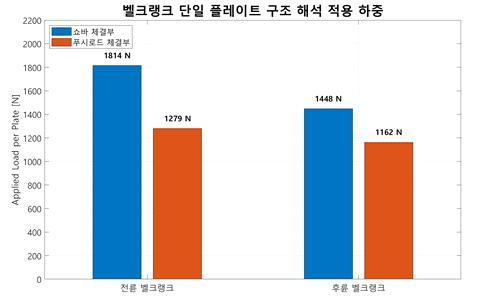

*단일 벨크랭크 플레이트의 댐퍼·푸시로드 해석 하중 비교. 양측 판이 균등 분담한다는 가정으로 전체 하중의 절반을 적용했습니다. · 3. 설계보고서_A-FA.pdf · 53쪽*

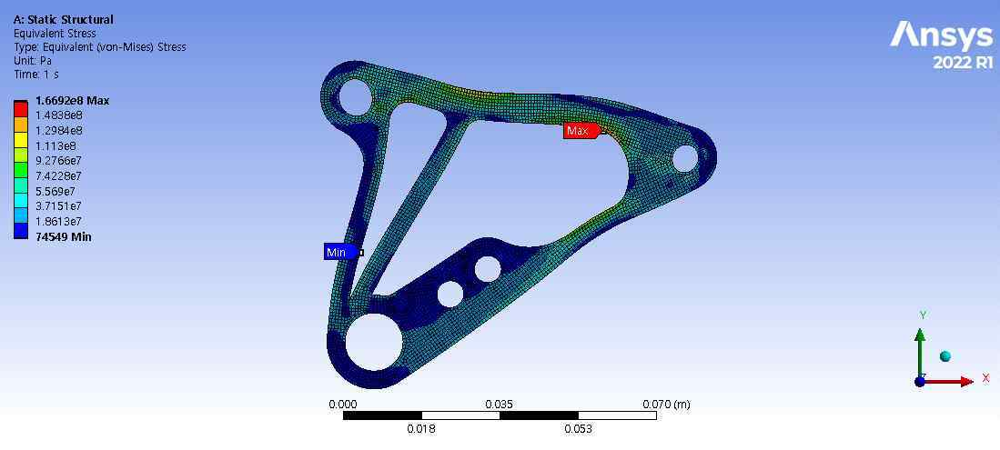

*전륜 벨크랭크 최종 형상의 ANSYS 정적 등가 하중 해석. 보고서 최대 등가응력 약 166.9 MPa. 반복 내구시험 결과가 아닙니다. · 3. 설계보고서_A-FA.pdf · 57쪽*

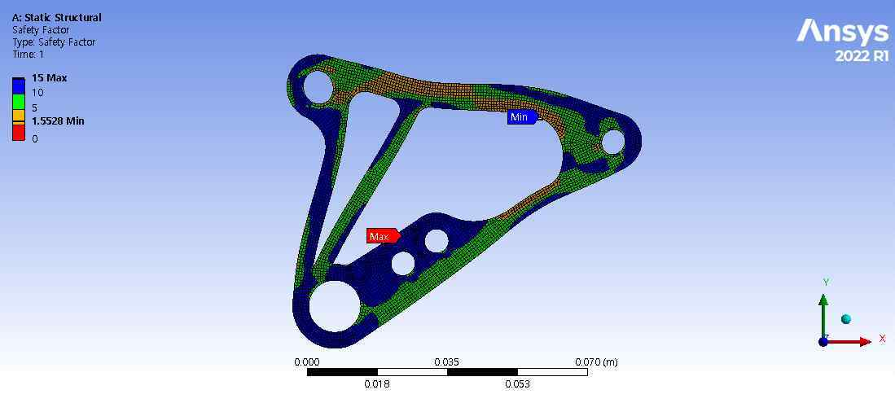

*전륜 벨크랭크 최소 안전율 1.5528의 해석 분포. 3G 등가 정적 하중·단일 플레이트·피벗 Fixed Support 조건의 결과입니다. · 3. 설계보고서_A-FA.pdf · 57쪽*

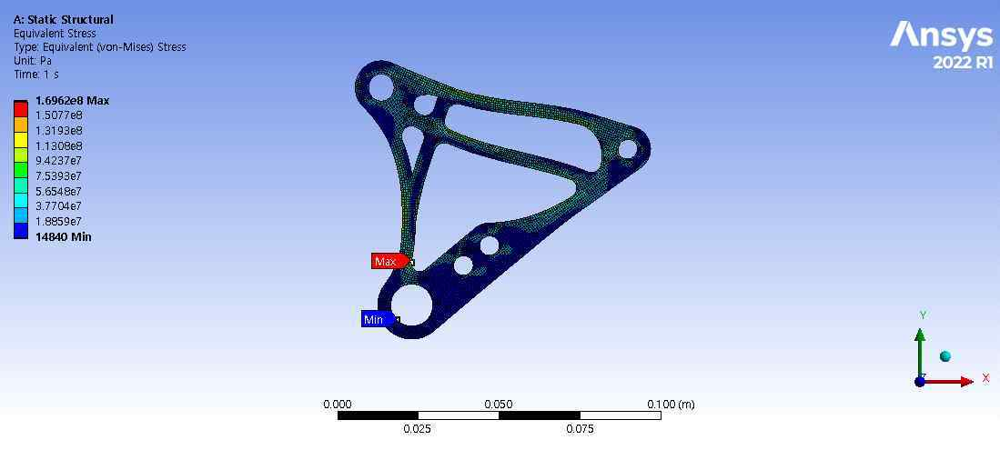

*후륜 벨크랭크 등가응력 분포. 보고서 최대 약 169.6 MPa. 전륜과 다른 하중 방향·형상을 별도 검토했습니다. · 3. 설계보고서_A-FA.pdf · 58쪽*

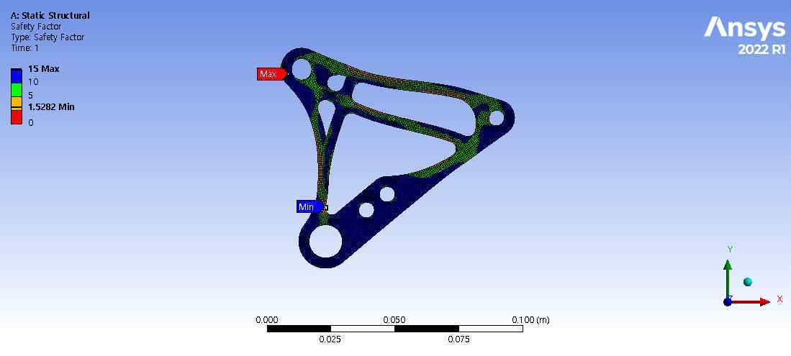

*후륜 벨크랭크 최소 안전율 1.5282의 해석 분포. 노면 충격·체결 유격·베어링 압입·피로수명 검증까지 완료했다는 의미는 아닙니다. · 3. 설계보고서_A-FA.pdf · 58쪽*

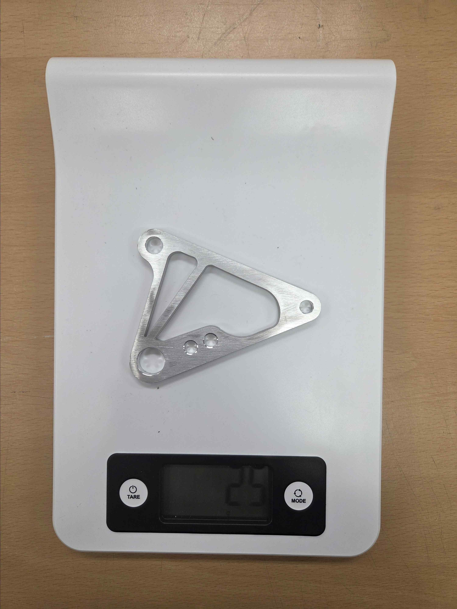

*전륜 벨크랭크 실제 가공품의 질량 표시 25 g. 보고서에 수록된 원본 사진입니다. 단일 플레이트이며 제작 전 실물과의 감량률 측정 사진은 아닙니다. · 3. 설계보고서_A-FA.pdf · 55쪽*

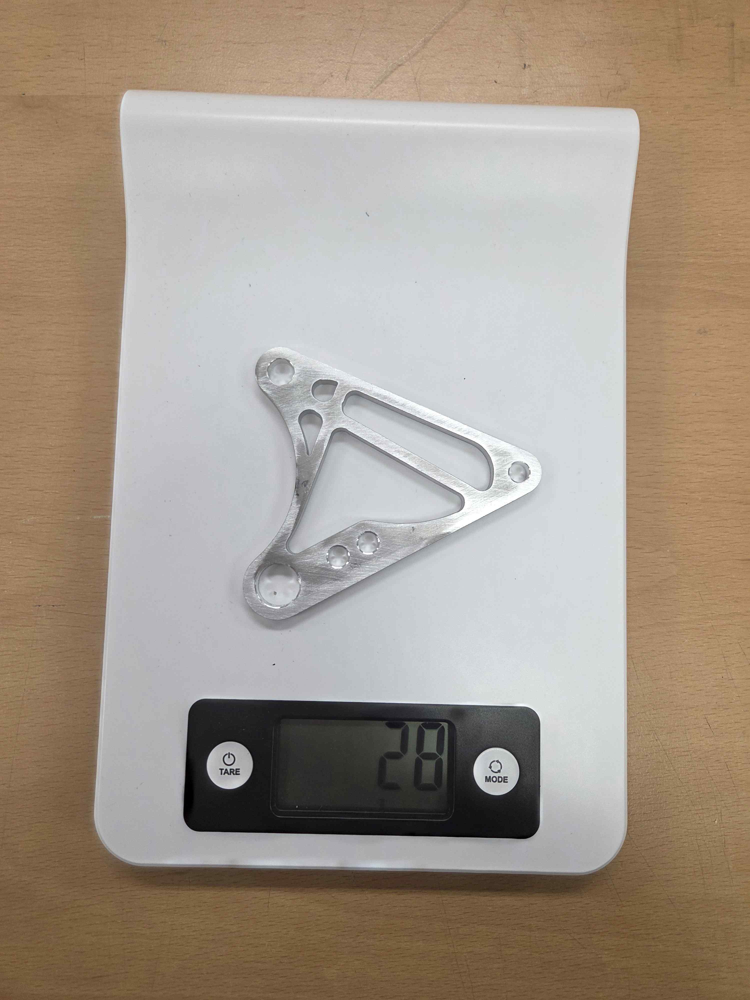

*후륜 벨크랭크 실제 가공품의 질량 표시 28 g. 보고서에 수록된 원본 사진입니다. 단일 플레이트이며 제작 전 실물과의 감량률 측정 사진은 아닙니다. · 3. 설계보고서_A-FA.pdf · 55쪽*

## 03장. 푸시로드·제작·검증 기록

## 푸시로드·제작 지그: 좌굴 계산과 하드포인트 재현성

### 압축 부재와 조정 가능한 링크를 함께 설계하기

푸시로드는 휠의 수직 운동을 벨크랭크로 전달하는 압축 부재입니다. 본체를 외경 14 mm, 두께 1.7 mm, 내경 10.6 mm의 STKM-11A 파이프로 구성하고 양끝에 용접너트를 삽입해 로드엔드 체결부를 만들었습니다. 얇은 파이프 자체에 직접 나사를 내는 대신 별도 너트를 사용하여 나사 체결 길이를 확보하는 구조입니다.

전륜 ITOI는 484.86 mm, 후륜은 328.87 mm입니다. ITOI는 파이프 절단 길이가 아니라 양쪽 로드엔드 베어링 중심 간 거리입니다. 전륜은 프레임·벨크랭크 패키징상 더 긴 부재가 되므로 같은 단면이라도 좌굴 조건이 더 불리합니다.

양단은 우나사·좌나사 로드엔드를 조합했습니다. 장착 상태에서 푸시로드 본체를 회전시켜 전체 길이를 바꿀 수 있어 차고·코너 웨이트·벨크랭크 초기각 조정에 활용할 수 있습니다. 조절 기능이 있다는 것과 모든 조정 범위에서 충분한 나사 체결 깊이가 확보된다는 것은 다르므로, 제작 후 검수에 체결 깊이와 조정 가능 범위를 포함했습니다.

### 벨크랭크 단일 판과 다른 하중을 쓰기

푸시로드에는 전체 축방향 하중이 흐릅니다. 두 장 플레이트가 나눠 받는 벨크랭크 해석과 달리, 좌굴 계산에서는 하중을 절반으로 줄이지 않았습니다. 적용값은 전륜 2558.3 N, 후륜 2323.4 N입니다.

중공 원형 단면의 2차 모멘트는 I=π(D⁴-d⁴)/64로 계산했으며 약 1266.0 mm⁴입니다. 로드엔드 양단을 핀 지지로 가정해 유효길이계수 K=1.0, 이 절의 탄성계수 E=205,000 MPa를 적용했습니다. 실제 파이프보다 긴 ITOI 전체 길이를 적용한 것은 이상적 파이프 계산에서 길이를 짧게 잡지 않기 위한 가정입니다. 끝단 용접너트와 나사부가 포함된 조립체의 모든 국부 거동을 동시에 모델링한 것은 아닙니다.

P_cr = π²EI / (KL)²

| 좌굴 계산 항목 | 전륜 | 후륜 |
| --- | --- | --- |
| 적용 길이 L | 484.86 mm | 328.87 mm |
| 적용 압축하중 | 2558.3 N | 2323.4 N |
| Euler 임계하중 | 10895.9 N | 23683.6 N |
| 계산 안전율 | 4.26 | 10.19 |
| 보고서 축압축응력 | 38.9 MPa | 35.4 MPa |

같은 단면·재료에서 길이가 길어지면 임계좌굴하중이 길이의 제곱에 반비례해 감소합니다. 후륜의 안전율이 더 큰 이유를 단순히 하중이 조금 작아서라고 설명하지 않고 길이 차이와 연결했습니다. 이 값은 Euler 이상 좌굴 계산 결과이며 실제 푸시로드의 압축 파괴시험이나 용접부 내구시험 결과가 아닙니다.

프레임 절은 E=200,000 MPa, 푸시로드 절은 205,000 MPa를 사용합니다. 서로 다른 절의 가정을 하나로 정리했다고 주장하지 않습니다. 보고서의 축압축응력과 최소 인장강도 비교도 압축 항복·용접부·나사산의 검증을 대신하지 않습니다. 통합 재검토에서는 재료 성적과 허용 기준, 초기 휨, 편심, 국부 단면 변화를 함께 확인할 필요가 있습니다.

### 연결부의 하중 용량과 작동각

현가 암 인보드에는 THK NOS 6T 로드엔드, 아웃보드에는 JET 6 스페리컬 베어링을 적용했습니다. 보고서 NOS 6T 정적 허용하중 4900 N과 전체 푸시로드 하중을 비교한 비는 전륜 약 1.92, 후륜 약 2.11입니다. 이는 보고서의 정적 허용하중 기준 비교이며 실제 로드엔드 피로수명이나 전체 현가 암 하중 해석의 대체값이 아닙니다.

링크가 범프·리바운드·조향에서 움직일 때 각도 여유가 부족하면 의도하지 않은 측하중과 구속이 생깁니다. 그래서 부품 번호와 하중 용량뿐 아니라 허용 작동각, 스페이서, 로드엔드와 주변 부품 간 간섭을 함께 다뤘습니다.

### 지그가 기구학과 제작을 연결하는 방식

CAD에서 정의한 하드포인트를 실제 암에 옮기기 위해 5T 철판 지그를 사용한 제작 절차를 보고서에 정리했습니다. 인보드 로드엔드 위치와 아웃보드 베어링 하우징을 기준으로 고정구를 배치하고, 절단한 파이프·보강대를 고정한 뒤 가접→치수 확인→본용접 순서로 진행하는 방식입니다. 용접 열에 의한 위치 틀어짐을 줄이고 좌우 반복 제작의 기준을 유지하는 것이 목적입니다.

제작 후에는 하드포인트 위치와 좌우 대칭, 베어링 삽입, 로드엔드 체결, 용접부 외관, 전 트래블 간섭을 확인할 항목으로 관리했습니다. 푸시로드는 ITOI, 직진성, 용접너트 동축도, 나사 체결 깊이와 조정 범위를 구분했습니다. 제작 절차와 검수 항목이 있다는 이유만으로 실제 위치 오차 분포·공차 합격률·용접 강도 수치를 만들어 내지 않습니다.

현가 방식, 암 제작 지그, 인보드 로드엔드/아웃보드 스페리컬 베어링 구조는 AEF-25에서 유지한 것입니다. AEF-26의 주요 변경은 MR 재설정, 후륜 푸시로드의 로어암 보강대 장착, 보유 댐퍼 실측 데이터 반영, 푸시로드 좌굴 계산 보완, 토폴로지 기반 벨크랭크 재설계입니다. 기존 방식을 새로 발명했다고 쓰기보다, 유지할 구조와 보완할 검증을 구분한 사례로 정리합니다.

> 근거: 개인 섀시 설계보고서 197, 214~216, 218~229, 233~234쪽.

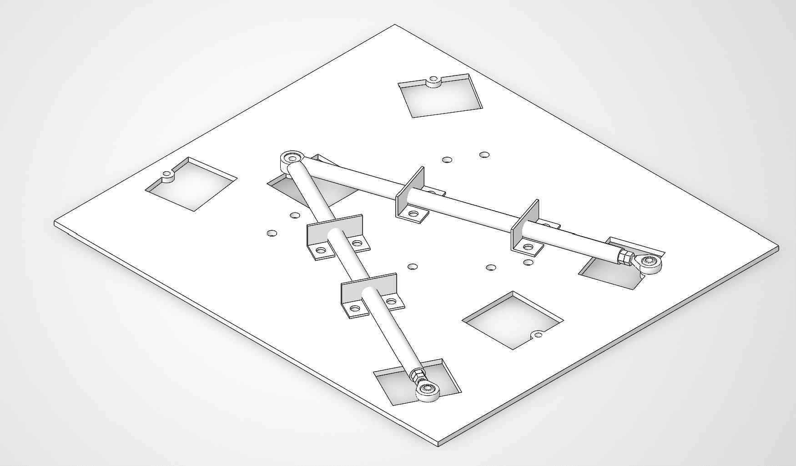

*현가 암 제작용 5T 철판 지그 CAD. 실제 제작 사진이 아니며 기존 AEF-25 제작 방식을 유지한 구조입니다. · 내가 쓴 섀시 설계보고서.pdf · 225쪽*

## 설계보고서의 통합: 계산·제작·시험 상태를 연결한 기록

### 결과물과 판단 근거를 함께 남기기

이번 A-FA 경험에서 보고서는 완성된 부품을 설명하는 자료인 동시에, 다음 사람이 설계 판단을 다시 따라갈 수 있게 하는 인계 자료였습니다. 프레임의 하드포인트 변경이 강성 모델에 연결되고, 휠 트래블과 MR이 스프링·댐퍼 사용량에 연결되며, 벨크랭크 하중이 푸시로드 좌굴 계산으로 이어집니다. 계산식의 수치만 모으기보다 입력·정의·가정·결과·남은 확인사항을 같은 흐름으로 정리했습니다.

팀 제출 합본은 313쪽이며, 개인 섀시 원고는 236쪽의 상세 판본입니다. 합본 표지의 팀장·제출 책임자라는 사실을 모든 파트의 단독 저작·해석·제작자로 확장하지 않습니다. 제 개인 경험은 프레임·현가·벨크랭크·제작·정적해석 및 팀 기술 문서 통합을 중심으로 설명하고, 배터리 전기설계·공력·계측 플랫폼 등 다른 담당자의 결과는 팀 인터페이스와 협업 맥락으로 표시합니다.

### 한 표에서 구분한 검증 수준

| 근거의 종류 | 이 포트폴리오의 실제 예 | 그 근거로 말할 수 있는 범위 |
| --- | --- | --- |
| 설계 목표 | MR 0.70/0.80, 정적 롤센터 40/70 mm | 의도한 값과 선정 이유 |
| 계산·모델 | Beam 강성 약 2170 N·m/deg, Euler SF 4.26/10.19 | 가정한 모델 조건의 결과 |
| 해석 그림 | 벨크랭크 응력·안전율 분포 | 해당 정적 등가 하중의 응력 경향 |
| 실물 사진 | 제작 벨크랭크 25/28 g 저울 사진 | 실제 부품과 당시 표시 질량 |
| 외부 시험 데이터 | 대표 댐퍼 Dyno 그래프 | 그 시료·시험 조건의 측정 특성 |
| 별도 주행 분석 | 7회 롤 시험 | 해당 세팅·세션에서 관찰한 변화 |
| 검증 계획 | 프레임 비틀림 강성 실측 절차 | 앞으로 비교해야 할 방법과 항목 |

이 구분은 내용을 줄이기 위한 것이 아니라 각 결과의 의미를 더 자세히 설명하기 위한 기준입니다. 예를 들어 벨크랭크 실측 25 g은 FEA의 타당성을 직접 증명하지 않고, 안전율 1.55는 실물의 피로수명을 측정한 결과가 아닙니다. 두 자료를 연결해 설계가 제작물로 이어졌다는 사실과 남은 구조 검증을 함께 보여줍니다.

### 판본을 연결할 때 발견한 확인 항목

개인 원고에는 그림 삽입 지시·편집 안내·미작성 제목도 남아 있습니다. 이를 실제 도판이나 완료된 실험으로 바꾸지 않고, 제출본의 실재 그림과 표를 우선 연결했습니다. 예를 들어 개인본의 공력 하중 고려 절은 제목만 남아 있지만 제출본 p40은 최종 다운포스 미확정으로 초기 스프링 계산에 직접 반영하지 않았다는 상태를 설명합니다. 후륜 토 변화도 개인본은 제작 전 재검토, 제출본은 제작 후 초기 세팅 관리 대상으로 서술 시점이 다릅니다.

다른 예는 벨크랭크 산정 하중과 FEA 입력 절의 소폭 차이, 프레임·푸시로드의 탄성계수 설정 차이, 초기 스프링안과 별도 롤 주행시험의 강성 조건 차입니다. 이런 항목을 임의로 하나의 최종 수치로 합치지 않고, 원본을 다시 열어야 하는 연결점으로 남겼습니다. 후속 팀원이 같은 모델을 수정하거나 테스트를 재현할 때 필요한 정보입니다.

### 팀 운영과 기술 문서화의 연결

팀장으로서 여섯 기술 파트의 보고·스터디·인계를 관리하면서, 결과만 전달되는 상황보다 설계 이유와 후속 확인사항을 함께 전달할 필요를 느꼈습니다. 문서에서는 무엇을 유지했고 무엇을 변경했는지, 어떤 조건에서 계산했는지, 제작품으로 무엇을 확인했는지, 어떤 시험은 아직 남았는지를 추적할 수 있게 하는 데 초점을 맞췄습니다.

프레임 실측 계획에는 독립된 변위 기준과 반복 측정을, 현가 제작 절차에는 지그 고정과 가접 후 치수 확인을, 세팅 계획에는 정적 얼라인먼트→저속 기능 확인→기본 주행→후속 점검의 순서를 담았습니다. 이는 설계 문서를 다음 작업의 실행 자료로 만드는 방식입니다. 다만 문서화로 생산성이나 인수인계 시간이 몇 퍼센트 개선되었다는 전후 지표는 없습니다.

### 시즌 결과와 다음 검증의 정직한 연결

2026 FSK에서는 배터리 검차를 통과하지 못해 동적 경기·내구레이스 완료 성과를 주장할 수 없습니다. 보고서의 목표와 해석·제작 결과를 대회 완주나 전년도 대비 경기력 향상으로 치환하지 않습니다. 설계보고서 제출 시점에도 모든 목표가 실차로 최종 검증된 것은 아니었습니다.

그럼에도 실제 결과물은 남습니다. 프레임 모델과 계산, 현가 제원과 기구학 표, 보유 댐퍼 측정 데이터 분석, 벨크랭크의 제작 가능한 형상과 실물, 지그와 제작 절차, 부품 검수와 후속 시험 계획이 그것입니다. 내 포트폴리오에서는 성공한 수치뿐 아니라 설계 의사결정과 미완료 검증을 분리해 보여주는 기술 기록으로 제시합니다.

> 근거: 개인 섀시 설계보고서 1, 13, 17, 120~121, 159, 181, 187, 196~197, 207, 222~223, 225, 233~236쪽; A-FA 팀 제출 설계보고서 1, 20, 22, 24, 36, 38~40, 49, 53, 55, 57~58, 313쪽.

---

## 기록의 근거

개인 섀시 설계보고서와 실제 제출한 A-FA 팀 설계보고서의 해당 절·그림. 수치의 정의·하중 조건·해석 및 실측 범위를 구분했습니다.

2026-10-20 기준. 개인 담당과 팀 기여, 해석·계획과 실측·완료 결과를 구분했습니다.
