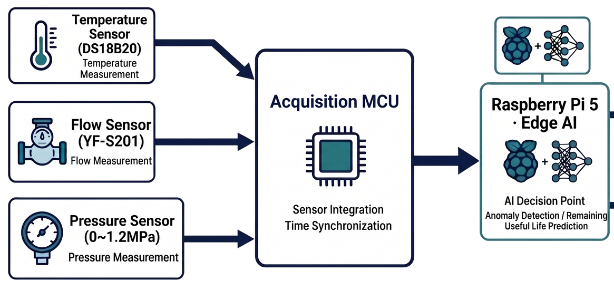

# 냉각 상태와 전력을 함께 판단하다

[포트폴리오 처음으로](../../README.md) · [웹 상세](https://yongmin.gardengnat12.chatgpt.site/cases/coolingenergy/) · [상세 PDF · 5쪽](../../site/downloads/coolingenergy.pdf) · [English summary](README.en.md)

> IDEAS / CARBON-NEUTRALITY R&D · R&D 제안서 작성 / 접수 전

「우리 모두의 R&D」 탄소중립 분야를 위해 준비한 중소 제조현장 점검 서비스 제안입니다. 0ERROR의 상태감시 구상을 냉각 품질과 소비전력을 함께 판단하는 문제로 구체화했습니다.

| 항목 | 내용 |
|---|---|
| 계측 | 온도 · 유량 · 압력 · 전력 |
| 판단 지원 | 운전 조정과 정비 항목 안내 |
| 접수 전 | 신청서·아이디어 원고 준비 |

## 01장. 냉각 품질과 전력을 함께 보는 질문

## 탄소중립 제안으로의 전환
“우리 모두의 R&D”를 위해 0ERROR의 상태감시 개념을 냉각 품질과 소비전력의 관계로 구체화했습니다. 전력을 줄이는 것만 목표로 하면 공정에 필요한 냉각 조건을 놓칠 수 있으므로, 냉각 상태를 유지하면서 운전 조정을 검토할 구간과 먼저 정비할 구간을 구분하는 방향입니다.

## 제안한 입력과 판단
온도·유량·압력에 전력 계측을 더해 설비의 상태와 운전 에너지를 함께 보도록 제안했습니다. 생산 부하와 외기조건이 유사한 구간을 비교하고, 운전 변화와 설비의 성능 저하를 구분하는 평가 방향을 적었습니다.

## 담당과 문서의 범위
팀의 신청서·아이디어 제안서와 온라인 입력 원고를 준비했습니다. 기반 프로젝트에서 제 역할은 기계 설계·제작이며 분석·제어의 전체 구현을 개인 성과로 확대하지 않습니다. 물산업 제안과 같은 기반을 공유하지만 이번 원고에서는 에너지와 냉각 조건의 동시 판단에 초점을 맞췄습니다.

## 현재 단계
작성 기준 2026년 10월 17일 자료와 제출 안내는 접수 전 상태를 기록합니다. 따라서 연구비 선정, R&D 수행 완료나 절전 성과를 달성한 프로젝트로 표시하지 않습니다.

## 냉각 부족과 과다 운전의 다른 조치

아이디어는 담당자가 ‘현재 냉각이 충분한가, 전력을 많이 쓰는가, 무엇부터 점검할까’를 함께 판단하도록 돕는 서비스입니다. 냉각 상태가 유지되는데 전력이 높으면 운전 설정 검토 대상으로, 유량 저하와 압력 변화가 함께 생기면 배관·펌프 점검 대상으로 구분하는 설명을 넣었습니다. 온도 하나만 보고 모든 상황에 같은 조치를 내리는 방식의 한계를 다룹니다.

사용자는 사출·가공 등 기존 냉각수 순환설비의 생산·설비 담당자, 구매 판단자는 공장장·설비 책임자, 설치·사후점검 협력 경로는 유지관리 업체로 나눴습니다. 실제 고객·협력기업 확보를 주장하지 않으며, 기존0ERROR 기반과제를 탄소중립 공모 주제에 맞춰 확장한 제품·서비스 개발 원고입니다.

> 근거: 우리모두의_RnD_2026/01_참가신청서_및_아이디어제안서_0ERROR.docx (문제/서비스/기술/검증계획)

## 02장. 계측·점검 지원·평가 원고

*물산업 제안서의 센서·수집·엣지 분석 개념도 · 장비·예측 기능의 완성 증거 아님*

## 문서로 구체화한 서비스
냉각 조건을 계측하고 상태를 해석한 뒤 현장 담당자가 운전 조정이나 정비 항목을 검토하도록 돕는 흐름을 작성했습니다. 자동 제어의 완성보다 판단 근거를 제공하는 초기 서비스 범위를 정하는 데 중심을 두었습니다.

## 공통 기반 도식의 위치
아래 그림은 0ERROR의 물산업 제안서에 사용한 공통 센서·분석 구조입니다. 이번 R&D 제안과 공유하는 기반을 설명하기 위해 참고 도식으로 배치했습니다. 전력 계측을 포함한 이번 제안의 완성 회로나 실제 장비 사진으로 오해하지 않도록 출처와 범위를 명시합니다.

## 평가의 방향
조치 전후 전력은 비슷한 생산 부하와 환경 조건에서 비교하도록 제안했습니다. 냉각 성능이 달라졌거나 생산량이 줄어든 상태의 전력 감소를 그대로 절감 실적으로 세지 않기 위한 방향입니다. 실제 측정 자료를 확보한 결과가 아니라 제안한 평가 기준입니다.

## 운영 조건도 함께 적기
운전 조건의 변경은 현장 담당자가 허용 범위를 검토한 뒤 수행하고, 기존 보호장치와 비상정지 기능은 유지하는 방향으로 원고를 구성했습니다. 센서·AI 기능의 나열을 실제 운영의 판단과 책임에 연결하려는 기획 결과입니다.

## 신호를 같은 시간축과 조건에 맞추기

기술 과제를 세 가지로 정리했습니다. 첫째 온도·유량·압력·전력의 시간 동기와 센서오차·통신 단절을 확인합니다. 둘째 열수지·압력손실과 정상 운전자료로 부하 변화와 성능 저하를 구분합니다. 셋째 유사한 생산량·외기조건에서 조치 전후kWh를 비교하면서 허용 온도·최소 유량을 동시에 확인합니다.

자료가 부족하거나 학습 범위를 벗어나면 판단을 보류하고 추가 점검을 안내하도록 했습니다. 담당자가 제조사 허용범위와 현장 조건을 확인한 뒤 조정하며 기존 보호·비상정지를 유지합니다. 이용 흐름은 기준 등록 → 계측 → 상태 비교 → 점검·조정안 검토 → 담당자 조치 → 효과 재측정입니다. 화면 구현이나 실제 자동제어를 완료한 산출물로 제시하지 않습니다.

## ‘더 적게 돌리기’보다 적합한 비교조건

제안서는 산업용 냉각기의 원격모니터링·경보·제어 제품과 펌프 절전 적용 가이드를 기존 사례로 참고했습니다. 이미 존재하는 기능의 이름보다 제조사·배관·생산부하가 다른 설비에서 적은 초기 자료로 정상범위를 만들고, 성능저하와 과다운전을 구별하는 부분을 개발 질문으로 두었습니다. 펌프속도를 일률적으로 낮추면 된다고 가정하지 않은 이유입니다.

비교에서는 전력만 낮아졌는지 보지 않고 냉각수 온도와 최소유량을 동시에 확인하도록 했습니다. 생산량이나 외기조건이 달라진 시간을 단순 전후로 비교하지 않으며 측정기간·조건·불확실성을 저장하는 방향입니다. 수익모델도 설치·초기설정과 정기점검·소프트웨어 유지로 나누고, 투자회수는 실제 도입비와 확인된 절감액으로 판단할 항목으로 남겼습니다. 대학 반복실험과 현장평가를 연결하자는 제안이지 정부R&D선정이나 현장실증 수행 실적은 아닙니다.

> 근거: 우리모두의_RnD_2026/01_참가신청서_및_아이디어제안서_0ERROR.docx (문제/서비스/기술/검증계획)

## 03장. 접수 전 상태와 실증의 조건

## 확인한 완료 범위
완료한 것은 참가신청서·아이디어 제안서와 입력 원고의 준비입니다. 접수·선정·개발비 확보나 실증 완료를 확인한 기록으로 소개하지 않습니다. 제안한 절전 목표와 개발 일정은 계획값입니다.

## 다음 검증에서 필요한 비교
부하·환경·냉각 요구조건을 기록하고, 정상 운전과 점검이 필요한 상태를 구분해야 합니다. 전력과 냉각 지표를 함께 보며 조치의 효과가 조건 변화에서 나온 것인지 살펴야 합니다. 계측의 정확성과 데이터 누락, 동일 조건 비교 가능성도 검토 대상입니다.

## 제품과 정책 제안의 차이
공모 분야에 맞게 문제·평가·실행 계획을 작성하는 능력과 검증된 제품을 납품하는 능력은 별개의 단계입니다. 이번 사례는 기술 개념을 탄소중립의 질문으로 번역하고 개발·평가 방향을 문서화한 경험입니다.

## 남긴 관점
효율의 숫자만 제시하기보다 유지해야 하는 품질 조건과 현장 의사결정을 함께 설명하려고 했습니다. 같은 0ERROR 기반의 다른 제안과 함께 읽으면 적용 분야에 따라 어떤 문제와 지표를 강조했는지 비교할 수 있습니다.

## 절전 목표를 검증 가능한 질문으로

개발 목표는 같은 열부하에서 허용 온도·최소 유량을 유지하며 펌프·팬 전력을 기준 운전보다5% 이상 줄일 수 있는 운전구간이 있는지 확인하는 것입니다. 5%는 목표이며 달성률이 아닙니다. 탄소감축량도 확인된 전력 절감량에 적용 시점의 공인 배출계수를 곱하는 후속 산정으로 구분했습니다.

1~2개월 요구·안전조건, 3~4개월 시험장치·계측·반복성, 5~6개월 임계값·물리·AI 비교와 전력화면, 이후 현장 적용을 제안했습니다. 판단 지표는 냉각조건 위반시간, 유사조건의전력, 정상 부하의오경보·고장 탐지지연, 설치·설정·정기점검 공수입니다. 현재는 원고·개발계획 완성이며 실제 접수와 현장 비교효과는 확인되지 않았습니다.

> 근거: 우리모두의_RnD_2026/01_참가신청서_및_아이디어제안서_0ERROR.docx (문제/서비스/기술/검증계획)

---

## 기록의 근거

근거: 우리모두의_RnD_2026의 참가신청서·아이디어제안서, 온라인입력값과 제출안내. 작성 기준 2026.10.17. 물산업 등 다른 제안과 같은 0ERROR 개발 기반을 공유합니다.

2026-10-20 기준. 개인 담당과 팀 기여, 해석·계획과 실측·완료 결과를 구분했습니다.
