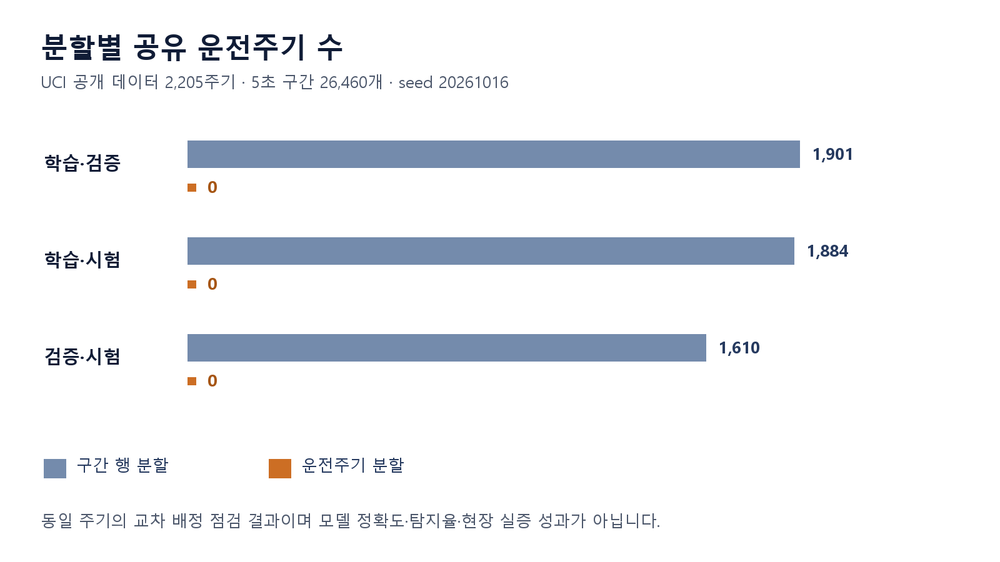
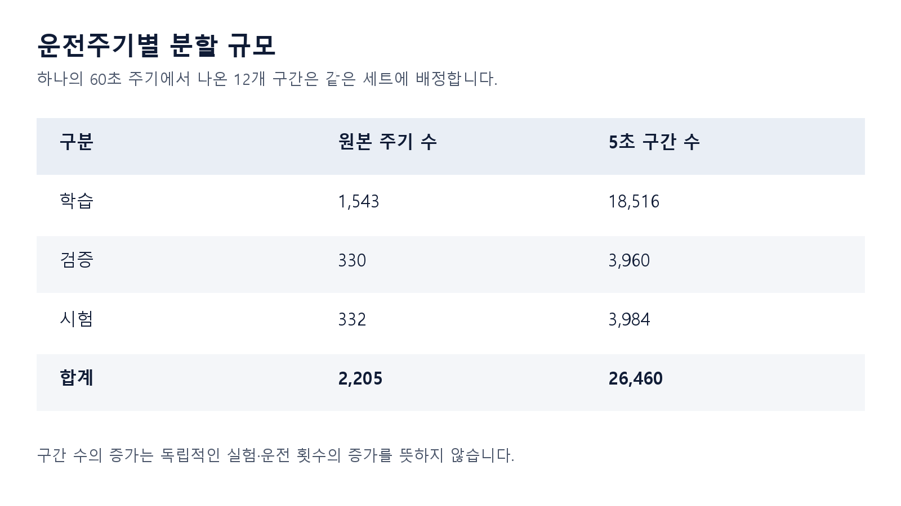

# 같은 운전주기가 평가에 섞이지 않도록

[포트폴리오 처음으로](../../README.md) · [웹 상세](https://yongmin-engineering-portfolio-oct26.gardengnat12.chatgpt.site/cases/datarecipe/) · [상세 PDF · 6쪽](../../site/downloads/datarecipe.pdf) · [English summary](README.en.md)

> IDEAS / DATA EVALUATION · 2026.10.16 접수 완료

2026 데이터+AI 혁신 챌린지에 제출한 0ERROR 팀의 데이터 레시피입니다. 공개 유압설비 데이터의 구간들이 학습·검증·시험 세트에 어떻게 나뉘는지 살펴보고, 원본 주기를 기준으로 평가 누수를 점검했습니다.

| 항목 | 내용 |
|---|---|
| 2,205 | 공개 데이터의 원본 주기 |
| 26,460 | 파생 구간 · 32개 센서 변수 |
| 0 | 주기별 분할 후 공유 주기 |

## 01장. 문제 정의와 데이터의 출처

## 서로 다른 행이 독립된 실험은 아닙니다
긴 센서 신호를 짧게 나누면 데이터 행 수는 많아집니다. 그러나 같은 운전에서 나온 구간들은 운전 조건과 시간의 맥락을 공유합니다. 이들을 무작위로 나누면 학습과 시험에 같은 원본 운전의 일부가 들어갈 수 있습니다. 이 프로젝트는 모델의 성능을 높이기 전에 평가의 구분이 무엇을 의미하는지 확인하는 질문에서 출발했습니다.

## 실제 사용한 자료
UCI 공개 유압설비 데이터의 60초 운전주기 2,205개를 5초 구간 26,460개로 정리했습니다. 8개 센서의 요약 변수 32개와 원본 주기·구간·분할을 추적하는 메타데이터를 연결했습니다. 자체 냉각 테스트베드에서 수집한 실험 데이터는 아닙니다.

## 제 역할과 팀의 맥락
0ERROR 팀의 대회 대표로 평가 구조의 기획과 분석 결과 정리를 설명합니다. 데이터 처리 코드와 원고에는 AI 보조가 활용됐습니다. 코드 파일이 존재한다는 사실만으로 전체 파이프라인을 제가 독자 구현했다고 표현하지 않습니다. 파란학기 팀장과 이 대회의 대표 역할도 구분합니다.

## 설계한 점검 기준
분할 사이의 원본 주기 식별자 교집합, 각 세트의 주기 수와 구간 수를 확인하는 방식입니다. 데이터의 행 개수만 비교하면 놓치는 출처 단위의 공유를 드러내고, 다른 사람이 분할 구조를 다시 점검할 수 있도록 CSV와 결과 기록을 남겼습니다.

## 왜 행을 나누는 것만으로 부족한가

원본은 UCI 공개 유압설비 데이터의 60초 운전주기2,205개입니다. 각 주기를 5초 구간12개로 나누면 26,460행이 되지만 같은 운전에서 나온 행끼리는 운전 조건을 공유합니다. 이 행을 무작위로 나누면 시험자료에도 학습 때 본 운전의 이웃 구간이 들어갈 수 있습니다. 프로젝트는 모델 정확도보다 ‘평가자료가 어떻게 만들어졌는가’라는 질문을 다뤘습니다.

8개 센서의 요약변수32개와 메타데이터9개로 41열을 정리하고 원본 운전주기 식별자를 보존했습니다. 0ERROR의 상태진단 개발과 연결되는 평가 절차의 제안이지만 공개 유압유 데이터를 자체 냉각수 실험 측정값으로 바꾸어 소개하지 않습니다. 본인은 대회 대표로 평가 구조와 결과 정리에 참여했고 코드·원고에는 AI 보조가 포함됩니다.

> 근거: Data_AI_Challenge_2026/02_데이터레시피_등록원고_0ERROR.docx (7단계 등록원고); Data_AI_Challenge_2026/분석근거/audit_results.json (집계값); 파생 CSV 대조 기록 (CSV26,460행 재집계)

## 02장. 분할 비교와 실제 분석 산출물

*실제 분할 감사 결과 · 원본 주기 교집합 비교 · 모델 성능 그래프 아님*

## 남긴 파일 묶음
파생 CSV, 열 정의와 샘플, 분할 감사 코드, audit_results와 두 개의 결과 이미지를 정리했습니다. 아래 그래프는 공유 주기 수 비교이고 표는 주기별 분할의 규모입니다. 고장 탐지 정확도나 예측 성능 그래프가 아닙니다.

## 행 분할과 주기 분할의 비교
행 무작위 분할에서는 학습·시험이 공유한 원본 주기가 1,884개였습니다. 주기 단위 분할에서는 학습·검증·시험 사이의 원본 주기 교집합이 모두 0이었습니다. 같은 주기의 구간 전체를 한 세트에 배정한다는 분할 규칙이 수치로 확인됩니다.

## 분할 규모를 함께 제시하기
학습·검증·시험의 주기 수는 1,543 / 330 / 332이고, 구간 수는 18,516 / 3,960 / 3,984입니다. 합계는 2,205주기와 26,460구간으로 대응합니다. 41열 CSV는 센서 변수 32개와 메타데이터 9개로 구성됩니다. 저장된 결과와 CSV의 집계를 읽기 전용으로 대조했습니다.

## 결과물의 핵심
이 작업은 “더 높은 정확도”보다 “어떤 데이터가 어느 세트에 들어갔는지 설명할 수 있는가”를 결과물로 삼았습니다. 레시피 원고와 이미지·표를 함께 제공해 분할 규칙을 코드에만 묻어두지 않고 검토 가능한 문서로 옮겼습니다.

*실제 주기별 분할 규모 · 2,205주기·26,460구간의 세트 구성 · 05_split_sizes.png*

## 두 분할 방식과 실제 점검 결과

구간 행을 나눈 경우 학습·시험 양쪽에 나타나는 원본 운전주기는1,884개였습니다. 운전주기 식별자를 기준으로 나눈 경우 학습1,543·검증330·시험332주기, 이에 대응하는 구간은18,516·3,960·3,984개입니다. 세 집합의 주기 교집합은 모두0으로 집계됐습니다.

산출물은 분할 비교 코드와 audit_results.json, 전체·샘플CSV, 열 정의표, 공유 주기 그래프와 분할 규모표, 포털7단계 입력원고입니다. 기존 감사에서는 전체CSV26,460행을 읽기 전용으로 재집계하여 저장된 숫자와 일치하는지 확인했습니다. 그래프의0은 이 식별자 기준 중복이 없다는 뜻이며 학습·시험 데이터가 모든 의미에서 통계적으로 독립적이라는 보장은 아닙니다.

## 6단계 절차와 열의 역할

원문 레시피의 절차는 출처 원본점검, 구간요약, 행분할, 주기분할, 교집합 점검, 결과저장입니다.1 Hz 온도는5초 구간에 5개,10 Hz 유량은 50개,100 Hz 압력은 500개 측정값을 써 평균·모집단 표준편차·최솟값·최댓값을 계산했습니다. 다른 수집빈도의 신호를 시간 길이가 같은 구간 요약으로 맞추는 구조입니다.

cycle_id와 window_index는 같은 원본을 추적하기 위해 남기지만 모델 입력에서는 제외하도록 했습니다. cooler_condition·valve_condition·pump_leakage·accumulator_pressure·stable_flag와 두 분할 열도 점검용 메타데이터입니다. 같은 시드 20261016과70:15:15 비율로 두 방식을 비교하고, 후속 분석에서는 스케일러나 결측 대체 규칙도 학습 세트에만 맞추도록 적었습니다. 원본 체크섬·DOI·라이선스·열 정의·분할 규모를 함께 저장해 재현 가능한 점검 기록을 남기는 것이 산출물의 구체적인 내용입니다.

> 근거: Data_AI_Challenge_2026/02_데이터레시피_등록원고_0ERROR.docx (7단계 등록원고); Data_AI_Challenge_2026/분석근거/audit_results.json (집계값); 파생 CSV 대조 기록 (CSV26,460행 재집계)

## 03장. 접수 상태·해석·후속 검증

## 실제 진행 상태
2026년 10월 16일 포털의 제출완료 화면을 확인했습니다. 등록 원고와 분석 근거, 결과 이미지가 해당 제출의 산출물입니다. 접수 완료와 참가자격 판정·선정·수상은 서로 다른 단계이므로 결과를 구분해 적습니다.

## 0의 의미
공유 주기 0은 원본 주기 식별자가 분할 사이에 겹치지 않는다는 뜻입니다. 다른 주기·설비의 통계적 독립성이나 모든 종류의 평가 누수가 제거됐다는 뜻은 아닙니다. 특징 생성, 전처리 통계, 데이터 취득 시기와 설비 차이에서 생길 수 있는 다른 의존성은 별도 검토가 필요합니다.

## 다음 모델 평가로 이어지는 기준
실제 모델을 비교한다면 분할을 먼저 고정하고 전처리의 학습 범위와 결과 이력을 함께 남겨야 합니다. 오경보·탐지지연·성능 평가도 출처 단위와 현장 조건을 반영해 설계해야 합니다. 이는 후속 평가의 방향이며 이번 레시피에서 모델 성능 향상을 실증한 결과는 아닙니다.

## 이 경험의 의미
현장 설비를 다루는 프로젝트에서도 데이터를 많이 모았다는 설명보다 평가 단위를 정확하게 정하는 일이 중요하다는 점을 배웠습니다. 원자료의 출처와 분할 이력을 보존하고, 결과의 단위를 오해 없이 전달하는 경험을 남겼습니다.

## 평가 레시피가 남기는 재현 기록

보고 싶은 것은 단일 정확도 숫자보다 데이터 원본, 원본주기와 파생구간의 관계, 분할의 단위, 집합별 규모와 교집합입니다. 이 항목을 함께 남기면 다른 분석자가 왜 그런 분할을 했는지 이해하고 동일 운전이 섞였는지 다시 점검할 수 있습니다. 후속 모델 비교에서는 특징을 만드는 규칙·전처리 적합 범위와 현장별 운전 조건 차이까지 살펴야 합니다.

2026년10월16일 포털 제출완료 화면을 확인했습니다. 다만 접수는 참가자격·선정·수상이나 고장진단 성능을 확정하지 않습니다. 이번 결과는 분할 구조와 기록을 점검한 데이터레시피이며 정확도·탐지율 향상, 실제 제조설비의 오경보 감소로 설명하지 않습니다.

> 근거: Data_AI_Challenge_2026/02_데이터레시피_등록원고_0ERROR.docx (7단계 등록원고); Data_AI_Challenge_2026/분석근거/audit_results.json (집계값); 파생 CSV 대조 기록 (CSV26,460행 재집계)

---

## 기록의 근거

근거: Data_AI_Challenge_2026의 데이터레시피 등록 원고, 파생 CSV·audit_results, 현재진행상태 기록과 접수완료 화면. 공개 데이터 2,205주기 및 26,460행을 읽기 전용으로 대조했습니다.

2026-10-20 기준. 개인 담당과 팀 기여, 해석·계획과 실측·완료 결과를 구분했습니다.
