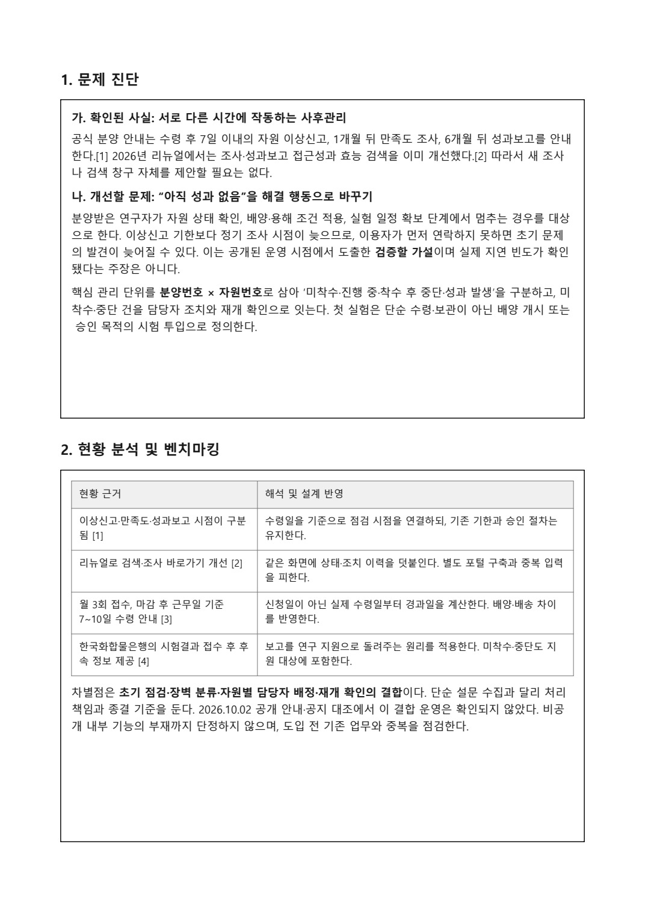
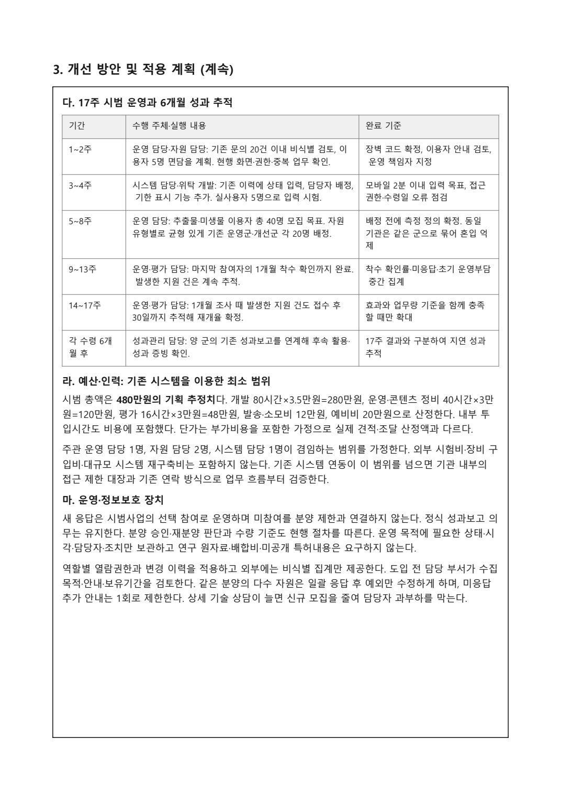

# 첫실험 패스 · 멈춘 연구의 다음 단계

[포트폴리오 처음으로](../../README.md) · [웹 상세](https://yongmin-engineering-portfolio-oct26.gardengnat12.chatgpt.site/cases/firstexperiment/) · [상세 PDF · 8쪽](../../site/downloads/firstexperiment.pdf) · [English summary](README.en.md)

> IDEAS / RESEARCH-SUPPORT SERVICE · 서비스 제안서 작성

해양바이오뱅크 산업·연구 활용 아이디어 공모전을 위해, 자원을 받은 뒤 실제 실험을 시작하고 이어갈 수 있도록 지원하는 서비스 절차를 제안했습니다.

| 항목 | 내용 |
|---|---|
| 5쪽 | 서비스 제안서 본문 |
| 후속지원 | 중단 이유·담당자·조치 연결 |
| 기획 | 실제 운영 전 단계 |

## 01장. 분양 이후 멈춘 실험에 주목하기

## 서비스가 다루는 시점
해양바이오뱅크 산업·연구 활용 아이디어 공모전을 위해 “첫실험 패스”를 기획했습니다. 자원을 분양하는 절차가 끝나도 사용자가 바로 실험을 시작하거나 이어갈 수 있는 것은 아니라는 문제를 다룹니다. 수령 이후의 중단 이유를 구분하고 필요한 지원과 재개 확인으로 잇는 서비스 개념입니다.

## 질문을 운영 흐름으로 바꾸기
자원을 받았는지, 실험에 착수했는지, 무엇 때문에 멈췄는지를 같은 질문으로 묻지 않도록 구분했습니다. 문제 유형과 담당자의 조치를 연결하고, 지원 이후 실제로 다시 진행됐는지 확인하는 방향입니다. 단순 만족도 조사보다 다음 행동으로 이어지는 사후 관리에 초점을 맞췄습니다.

## 실제 작성 범위
공개된 자원 분양과 사후 보고의 흐름을 검토해 5쪽 제안 본문과 참고자료 묶음으로 정리했습니다. 원본 PDF는 양식과 함께 6쪽입니다. 본인 명의 서약서도 확인됩니다. 기관이 서비스를 도입했거나 실제 이용자를 면담한 결과로 확대하지 않습니다.

## 서비스 설계의 중심
새로운 자원이나 플랫폼을 만드는 것보다 기존 절차 사이에서 누가 어떤 문제에 응답하는지 정하는 접근입니다. 문제의 접수·담당·조치·재개 확인을 연결한 문서가 이번 사례의 결과물입니다.

## 새 포털보다 기존 사후관리 사이의 빈틈

제안서는 수령 후 7일 이내 이상신고, 1개월 만족도 조사, 6개월 성과보고가 서로 다른 시점에 작동한다는 공개 절차에서 출발했습니다. 2026년 리뉴얼에서 조사·보고 접근성과 검색이 이미 개선되었다는 점도 반영해, 새 검색창이나 설문을 하나 더 만들기보다 기존 분양내역에 지원 이력을 연결하는 방향을 택했습니다.

관리 단위는 ‘분양번호 × 자원번호’입니다. 상태를 미착수, 진행 중, 착수 후 중단, 성과 발생으로 구분하고 ‘첫 실험’을 단순 수령·보관이 아니라 배양 개시 또는 승인 목적 시험 투입으로 정의했습니다. 초기 장벽이 실제로 얼마나 빈번한지는 확인되지 않았으므로 공개 절차에서 도출한 가설로 남겼습니다. 한국화합물은행의 결과 접수 후 후속 정보 제공 사례에서는 보고를 지원으로 되돌리는 원리를 참고했습니다.

> 근거: 해양/파일2_부문3_첫실험패스_제안서.pdf (1–5 + 참고자료6)

## 02장. 상태 확인·담당 조치·재개 확인

*첫실험 패스 제안서 · 문제 진단과 기존 절차 검토 · 원본 PDF 2쪽*

## 실제 제안서의 구성
문제 진단, 기존 절차의 분석, 개선안과 단계별 적용 계획, 소요 자원과 운영 조건으로 정리했습니다. 아래 이미지는 제안서 원본의 주요 페이지입니다. 실제 서비스 이용 통계나 시범사업 운영 화면이 아닙니다.

## 연결하려 한 단계
자원 수령 → 초기 실험 상태 확인 → 중단 이유의 분류 → 담당자와 지원 조치 → 활용 재개 확인의 흐름입니다. 연락을 했다는 사실보다 문제가 다음 담당자와 조치로 이어지는지 확인할 수 있게 구성했습니다.

## 기존 업무를 활용하는 방향
기존 조사·보고와 연결하고, 최소한의 기록으로 운영 부담을 검토하도록 제안했습니다. 일정과 인력·예산도 문서에 포함해 어떤 조건에서 검토할 수 있는지 설명했습니다. 원고의 시기·금액은 실행 계획이며 실제 집행 내역이 아닙니다.

## 문서가 보여 주는 결과
한 아이디어를 사용자의 상태와 담당자의 대응으로 풀어 쓴 서비스 운영안입니다. 지원 이후의 실험 착수율 개선이나 기관의 비용 절감을 확인한 성과는 아직 없습니다. 이미지와 설명 모두 제안한 과정의 구체성을 보여 주는 자료로 제시합니다.

*첫실험 패스 제안서 · 적용 일정과 운영 자원 계획 · 원본 PDF 4쪽 · 파일2_부문3_첫실험패스_제안서.pdf · 4쪽*

## 첫실험 카드와 네 가지 지원 분기

수령 0일에는 날짜와 보관 안내, 3일에는 정상·이상 의심·미확인 상태, 1개월에는 착수 상태와 장벽을 확인하고 미착수·중단에만 지원 건을 생성하도록 했습니다. 지원 이후에는 합의한 시점에 한 번 재확인하며, 6개월에는 기존 이력을 불러와 성과보고를 잇습니다.

| 코드 | 장벽 | 담당 조치와 종결의 기준 |
|---|---|---|
| Q | 자원 이상 의심 | 기존 공식 연락·재분양 경로로 즉시 연결. 새 카드가 정식 신청을 대신하지 않음 |
| P | 취급·조건 적용 어려움 | 담당자가 검토한 보관·배양·용해 안내. 시험 투입·배양 개시일로 재개 확인 |
| S | 일정·장비·인력 지연 | 희망 재개일에 1회 확인. 기존 연계 범위의 장비 정보 안내 |
| R | 기대 결과 없음·연구 중단 | 음성 결과도 유효한 활용으로 기록. 양성 성과를 요구하지 않음 |

일반 상담의 2근무일 내 첫 회신과 해결 완료를 구분하고 미응답을 정상·해결로 자동 처리하지 않는 규칙도 넣었습니다. 이 분류와 종결 기준이 단순 만족도 설문과 구별되는 설계 내용입니다.

> 근거: 해양/파일2_부문3_첫실험패스_제안서.pdf (1–5 + 참고자료6)

## 03장. 제안의 현재 단계와 후속 평가

## 확인한 결과물
서비스 제안서, 참고자료와 본인 명의 서약서가 남아 있습니다. 기관 도입이나 실제 이용자 면담, 연구 성과 증가를 수행한 운영 실적으로 쓰지 않습니다. 실제 접수 완료·수상도 별도 확인되지 않은 상태입니다.

## 실행 전 확인할 질문
자원이 도착한 뒤 실험이 멈추는 이유는 시약·장비·정보·일정 등 여러 맥락일 수 있습니다. 실제 사용자에게 유형이 맞는지 확인하고 기관이 대응할 수 있는 범위를 정해야 합니다. 제안의 분류가 현장에서 유효한지는 후속 조사 대상입니다.

## 효과를 확인하는 방식
연락 건수만으로 성과를 판단하기보다 착수 여부, 지원의 적절성, 재개 확인까지 이어지는지를 살펴야 합니다. 동시에 담당자의 추가 업무량과 정보 수집의 최소 범위를 검토할 필요가 있습니다. 현재 확보한 운영 지표가 아니라 시범 적용 시의 평가 방향입니다.

## 남긴 경험
문제를 한 번의 신청이나 분양으로 끝내지 않고, 이용자의 다음 행동까지 이어지는 서비스로 생각해 보았습니다. 복잡한 기술 구현 없이도 절차와 담당·기록의 연결이 기획의 중요한 결과물이 될 수 있음을 보여 주는 사례입니다.

## 16주 시범안의 판단 기준

시범안은 1~2주 업무·문의 검토, 3~4주 화면·권한과 입력 시험, 5~8주 총 40명 모집, 9~12주 1개월 착수 확인, 13~16주 지원 후 30일까지 추적하는 순서입니다. 기존 운영군·개선군 각 20명을 구상하고 같은 기관 이용자는 같은 군으로 묶어 두 흐름이 섞이지 않게 했습니다. 6개월 성과는 16주 결과와 별도로 추적합니다.

예산 480만원은 개발 280만원, 운영·콘텐츠 120만원, 평가 48만원, 발송·소모 12만원, 예비 20만원의 기획 추정치입니다. 목표는 착수 확인률 차이 15%p 이상, 장벽 해소 후 30일 내 재개율 50% 이상, 2근무일 내 첫 회신율 90% 이상, 추가 운영부담 참여자당 평균 15분 이하입니다. 모두 시범 도입 시 판정 기준이며 달성 성과가 아닙니다. 40명 규모로 인과적 효과를 확정하지 않고 운영 가능성과 부담을 함께 보도록 구성했습니다.

## 분모와 업무량까지 함께 적은 평가표

착수 확인률은 각 군 전체 참여자 중 하나 이상의 자원에서 첫 실험일이 확인된 이용자의 비율로 정의했습니다. 각20명일 때15%p 차이는3명 차이라는 점을 원고에 함께 썼습니다. 지원 후 재개율은 처음 미착수·중단이었던 이용자를 분모로 하고 실제 인원도 같이 제시하며, 응답이 없는 건을 재개 인원에 넣지 않습니다. 여러 자원을 받은 한 사람이 지표를 좌우하지 않도록 자원 수 기준 착수율을 보조로 살피는 항목도 넣었습니다.

운영 부담은 기존 조사 업무를 제외하고 새 확인·분류·후속 처리에 든 시간으로 정의했습니다. 효과가 좋아 보여도 한 사람에게 상담이 몰리면 확장이 어렵기 때문에 평균15분을 넘으면 문항·모집 규모를 줄이는 조건을 뒀습니다. 정보 수집도 연구 원자료·배합비·미공개 특허내용을 요구하지 않고 상태·시각·담당자·조치에 한정하는 방향입니다. 지원 이력을 쌓는 과정에서 이용자의 응답 부담과 기관의 인력 여력까지 같은 운영안에 넣었습니다.

> 근거: 해양/파일2_부문3_첫실험패스_제안서.pdf (1–5 + 참고자료6)

---

## 기록의 근거

근거: 「첫실험 패스」 제안서, 참고자료 묶음과 본인 명의 참가자 서약서. 문서 기준 2026.10.

2026-10-20 기준. 개인 담당과 팀 기여, 해석·계획과 실측·완료 결과를 구분했습니다.
