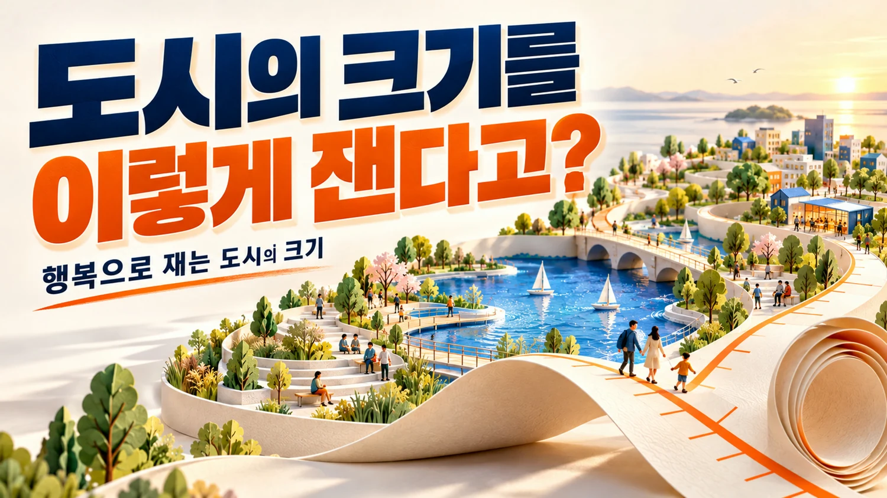
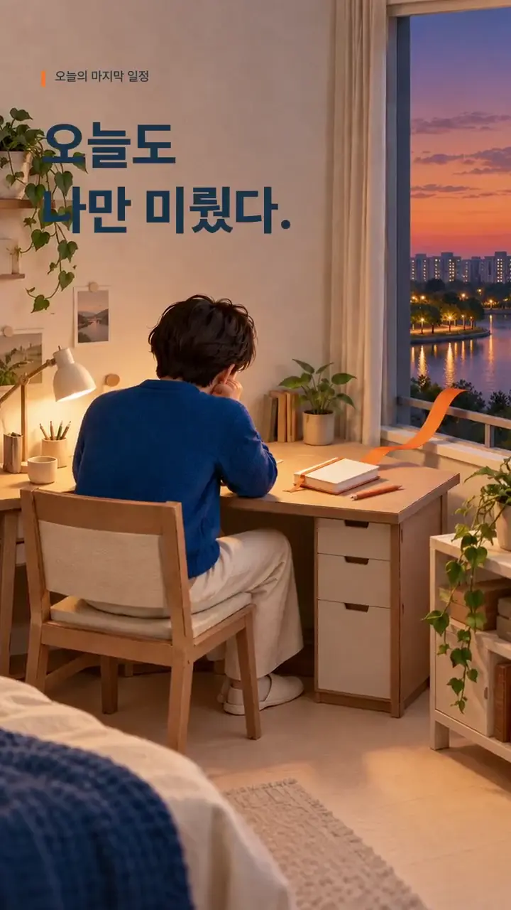
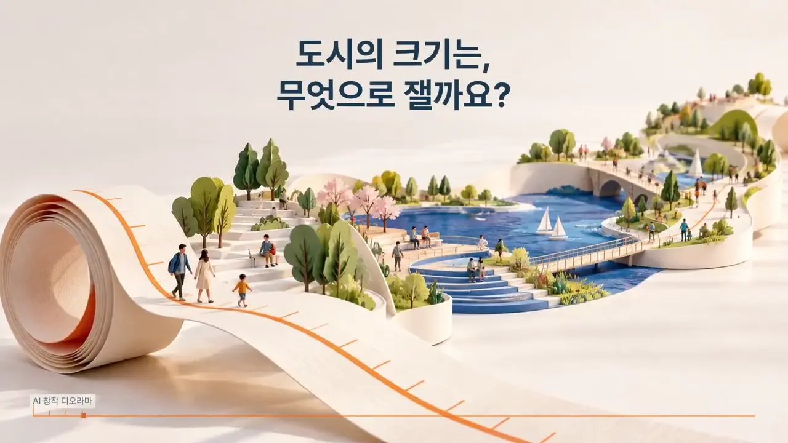
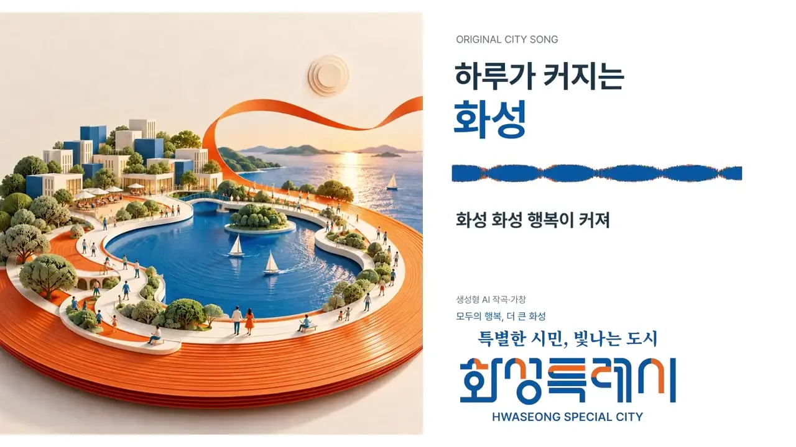

# 화성을 이야기하는 세 가지 형식

[포트폴리오 처음으로](../../README.md) · [웹 상세](https://yongmin.gardengnat12.chatgpt.site/cases/hwaseongmedia/) · [상세 PDF · 7쪽](../../site/downloads/hwaseongmedia.pdf) · [English summary](README.en.md)

> IDEAS / AI-ASSISTED CITY CONTENT · 숏폼·CF·CM송 제작 / 접수 미확인

별별화성 Awards AI CF 공모전을 위해 0ERROR 팀이 준비한 숏폼·CF·CM송입니다. 최종 작품기술서에 제 역할은 기획, 남선우는 제작, 김지윤은 편집으로 기록되어 있습니다.

| 항목 | 내용 |
|---|---|
| 38초 | 오늘의 마지막 일정 · 숏폼 |
| 35초 | 행복으로 재는 도시의 크기 · CF |
| 44초 | 하루가 커지는 화성 · CM송 |

## 01장. 도시를 세 가지 형식으로 기획하기

## 같은 도시, 다른 전달 방식
별별화성 Awards AI CF 공모전을 위해 숏폼·CF·CM송을 준비했습니다. 숏폼은 하루 끝의 일상과 여유, CF는 도시의 크기를 행복으로 재는 비유, CM송은 반복되는 가사와 리듬으로 도시의 인상을 전하도록 구성했습니다.

## 확인된 개인 역할
최종 작품기술서에는 권용민 기획, 남선우 제작, 김지윤 편집으로 기록되어 있습니다. 제 기획 역할과 동료의 실제 제작·편집 기여를 함께 적습니다. 영상·음악·이미지 전체를 독자 제작한 경험으로 설명하지 않습니다.

## 기획의 산출물
작품기술서와 시나리오, 내레이션·가사와 생성 프롬프트, AI 활용 내역이 남아 있습니다. 기획은 주제를 정하는 데서 그치지 않고 길이와 매체에 맞는 전달 방식으로 구체화하는 역할이었습니다.

## 창작 이미지의 성격
영상과 썸네일에는 AI 소재가 사용됐습니다. 현장 촬영 여행기나 실제 시민의 인터뷰로 오해되지 않도록 AI 활용 팀 콘텐츠로 표시합니다. 도시의 인상을 전달하기 위한 창작 결과물입니다.

## 한 도시를 세 가지 기억 방식으로

기획을 맡아 도시 브랜드를 인물의 일상, 도시를 재는 시각적 비유, 따라 부르는 이름으로 나눠 설명했습니다. 숏폼은 할 일을 다 끝내도 자신을 미뤄 둔 시민이 체크리스트 마지막 칸을 쉼으로 채우는 이야기입니다. CF는 ‘더 큰 도시’를 건물·면적 대신 여유·마음·가능성으로 재는 종이 측정 리본을 썼습니다. CM송은 시작부터 ‘화성’ 후렴을 들려주고 도시 이름과 공통 주제를 남깁니다.

권용민 기획·남선우 제작·김지윤 편집은2026년 10월 17일 최종기술서에 기재된 역할입니다. 도시·장소는 동탄호수공원과 제부도·서해에서 영감을 얻은 모티프이며 실제 현장 촬영이나 실존 시민의 하루를 취재한 영상은 아닙니다.

> 근거: 화성_AI공모전_2026/제출서류/최종제출본_20261017/01_작품기술서_숏폼_오늘의마지막일정.docx (기획/작품설명/AI활용); 화성_AI공모전_2026/제출서류/최종제출본_20261017/02_작품기술서_CF_행복으로재는도시의크기.docx (기획/작품설명/AI활용); 화성_AI공모전_2026/제출서류/최종제출본_20261017/03_작품기술서_CM송_하루가커지는화성.docx (기획/작품설명/AI활용)

## 02장. 38초 숏폼·35초 CF·44초 CM송

*도시의 크기를 행복으로 풀어낸 CF용 AI 활용 썸네일*

## 최종 작품 보기
“오늘의 마지막 일정”은 38초 숏폼, “행복으로 재는 도시의 크기”는 35초 CF, “하루가 커지는 화성”은 약 44초 CM송입니다. 각 영상과 대표 이미지를 아래에서 확인할 수 있습니다. 실제 최종본과 작품기술서를 기준으로 길이를 적었습니다.

## 형식에 맞춘 내용
숏폼은 짧은 일상 장면의 흐름, CF는 하나의 비유를 따라가는 이야기, CM송은 반복되는 문장과 음악의 인상을 중심으로 합니다. 같은 내용을 단순히 줄이거나 늘리는 대신 각 형식에서 중심이 될 표현을 구분했습니다.

## 버전과 제출자료
최종본은 숏폼 v3·CF v3·CM송 v2 기록과 작품기술서 3종에 대응합니다. 생성 기록과 규격검수 자료는 파일이 어떤 과정을 거쳐 최종본이 됐는지 설명하는 근거입니다. 제작·편집 담당의 기여도 함께 기록했습니다.

## 결과 이미지의 위치
썸네일과 영상 스틸은 실제 완성 영상과 연결되는 시각 결과물입니다. 홍보 효과를 측정한 차트가 아니라 기획한 메시지가 어떻게 구현됐는지 보여 주는 자료로 배치했습니다.

*오늘의 마지막 일정 · 38초 숏폼 대표 이미지 · 기존 공개 포트폴리오의 실제 결과물*

*행복으로 재는 도시의 크기 · 35초 CF 대표 이미지 · 기존 공개 포트폴리오의 실제 결과물*

*하루가 커지는 화성 · 약 44초 CM송 대표 이미지 · 기존 공개 포트폴리오의 실제 결과물*

## 각 결과물의 장면과 음악 구조

38초 숏폼은0~9초 책상·미완성 체크리스트,9~22초 종이 풍경·호숫가 쉼,22~32.5초 표정·체크 변화,마지막 5.5초 BI·제작 출처입니다. 원화 4종과 7문장 내레이션, 120 BPM 음악·체크 효과음을 결합했습니다.

35초 CF는 도시의 크기 질문 → 호수의 여유 → 서해 바람 → 미래 상상 → 시민의 오늘을 연결합니다. 원화 5종과 7문장 내레이션, 114 BPM 음악을 사용하고21.07~29.47초에 핵심 카피, 29.47초 이후 BI·출처를 배치했습니다. 종이 리본·눈금이 장면마다 같은 시각 언어로 이어집니다.

CM송은44.01초 음원과44.03초 영상입니다.118 BPM·G major·한국어 가창,즉시 시작하는 후렴과 2마디 간주·벌스·마무리로 구성했습니다. 오렌지 레코드가 푸른 호수로 이어지는 종이 앨범아트와 가사를 결합한 실제 음악·영상 파일이 결과물입니다.

## 화면과 소리의 일관성을 적은 제작서

최종 기술서는 기획의도만이 아니라 원화 개수, 장면별 시간, 내레이션 원고와 음악의 속도까지 적었습니다.숏폼은 같은 인물·종이재질의 일관성을 유지하도록 원화를 참조하고, 발화 중 배경음악을 낮추는 방식으로 장면과 음성을 정리했습니다.CF는 측정리본이라는 동일한 사물이 호수·서해·미래상상을 연결해 장면전환마다 관객이 새로운 광고를 보는 듯 끊기지 않도록 기획했습니다.

CM송은 시작에 도시이름을 반복하고, 시민의오늘·내일과 바닷바람의 이미지를 짧은 가사에 연결했습니다.레코드의 홈을 호숫길로 바꾸는 앨범아트는 노래와 같은 도시·자연·미래 메시지를 시각으로 옮긴 결과물입니다.공식BI는 원본색상과 비율을 유지하고 엔딩에 소재·도구·글꼴 출처를 함께 표시했습니다.최종파일과 기술서의 장면·음악 구성을 대조해 읽을 수 있다는 점이 단순한 아이디어 목록과 다른 구체적 산출물입니다.

> 근거: 화성_AI공모전_2026/제출서류/최종제출본_20261017/01_작품기술서_숏폼_오늘의마지막일정.docx (기획/작품설명/AI활용); 화성_AI공모전_2026/제출서류/최종제출본_20261017/02_작품기술서_CF_행복으로재는도시의크기.docx (기획/작품설명/AI활용); 화성_AI공모전_2026/제출서류/최종제출본_20261017/03_작품기술서_CM송_하루가커지는화성.docx (기획/작품설명/AI활용)

[영상: 오늘의 마지막 일정 · 숏폼 38초](../../site/assets/competitions/hwaseong-short.mp4)

[영상: 행복으로 재는 도시의 크기 · CF 35초](../../site/assets/competitions/hwaseong-cf.mp4)

[영상: 하루가 커지는 화성 · CM송 약 44초](../../site/assets/competitions/hwaseong-song.mp4)

## 03장. 완성본의 범위와 다음 평가

## 현재 진행 상태
숏폼·CF·CM송 세 편과 작품기술서를 완성했습니다. 확인되는 단계는 콘텐츠 제작과 제출자료 준비이며 실제 접수·수상 여부는 확인되지 않았습니다. 공식 선정작이나 수상작으로 표시하지 않습니다.

## 결과를 설명하는 기준
서로 다른 세 형식의 완성 매체와 제작 기록은 분명한 결과물입니다. 반면 도시 인지도 상승, 관광객 증가나 광고 전환을 입증한 결과는 없습니다. 목표한 인상과 실제 관객에게 전달된 인상은 후속 평가에서 구분해야 합니다.

## 다음에 확인할 질문
각 형식의 첫 장면에서 메시지가 이해되는지, CM송의 반복 문장이 기억되는지, 작은 화면과 무음 재생에서도 내용이 남는지 확인할 수 있습니다. 매체 간 연결성과 도시 표현의 적절성도 검토 대상입니다. 현재 완료한 관객 실험의 성과로 쓰지 않습니다.

## 남긴 기획 경험
공학 외의 콘텐츠 작업에서도 목적·형식·제작 역할과 최종 파일을 연결하는 경험을 했습니다. 팀원과 AI 도구의 제작 기여를 드러내며 제가 맡은 기획을 결과물로 설명하는 사례입니다.

## 팀 제작과 AI 요소를 읽는 방식

숏폼·CF는 생성 원화에 고정 중심 확대와 자막·카피를 편집하고 Supertonic 3 M3 내레이션과 합성 음악을 결합했습니다. CM송은 새 가사와 텍스트 설명을 ACE-Step에 입력해 음악·가창을 생성하고 박자 경계·크로스페이드·음량을 조정한 제작 기록이 있습니다. 특정 가수·참조 음원을 입력하지 않았으며 본인이 직접 가창하거나 독립적으로 편집코드를 전부 구현한 실적으로 쓰지 않습니다.

자동 전사·규격 검사와 제작 출처를 결과물과 함께 남겼지만 이를 관객 이해도 검증으로 보지 않습니다. 세 작품의 완성은 확인되며 유튜브 게시·공모전 접수·수상은 별도 확인이 없습니다. 향후에는 이야기 이해, 브랜드 기억, 음악의 도시명 인지와 각 매체 길이의 적절성을 관객 반응으로 평가할 수 있습니다.

> 근거: 화성_AI공모전_2026/제출서류/최종제출본_20261017/01_작품기술서_숏폼_오늘의마지막일정.docx (기획/작품설명/AI활용); 화성_AI공모전_2026/제출서류/최종제출본_20261017/02_작품기술서_CF_행복으로재는도시의크기.docx (기획/작품설명/AI활용); 화성_AI공모전_2026/제출서류/최종제출본_20261017/03_작품기술서_CM송_하루가커지는화성.docx (기획/작품설명/AI활용)

---

## 기록의 근거

근거: 화성_AI공모전_2026의 최종제출본_20261017 작품기술서 3종, CF_v3·숏폼_v3·CM송_v2, 생성 기록과 최종 규격검수 자료.

2026-10-20 기준. 개인 담당과 팀 기여, 해석·계획과 실측·완료 결과를 구분했습니다.
