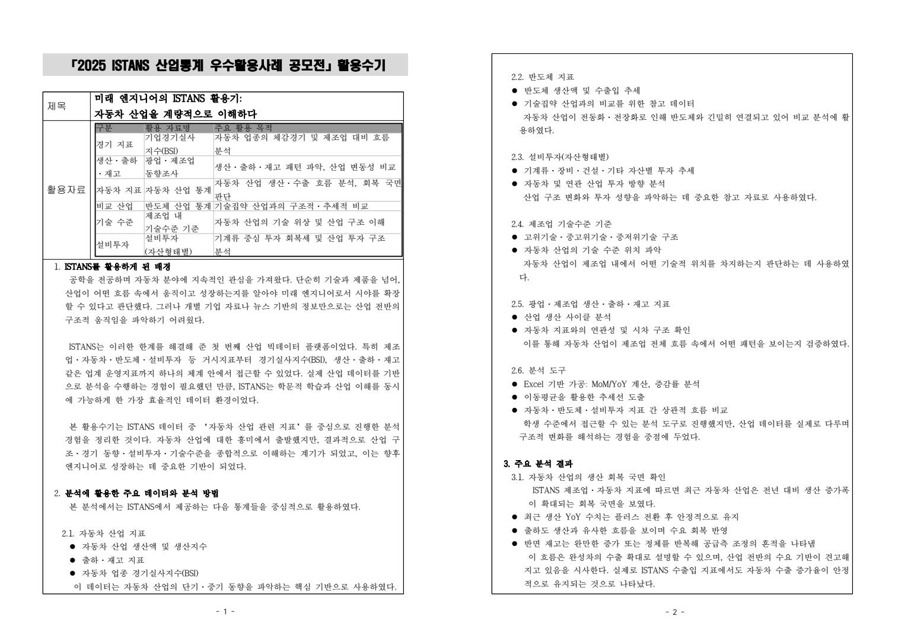
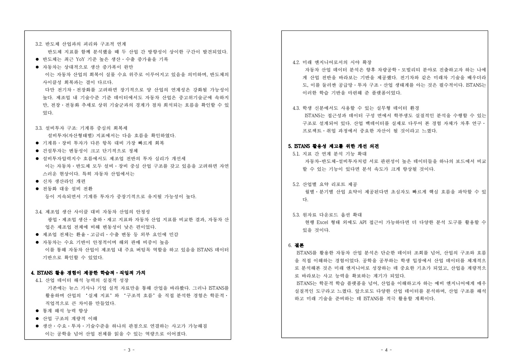

# 활용수기와 지표 비교의 구성

[전체 상세 기록](README.md) · [PDF 6쪽](../../site/downloads/istans.pdf)

*ISTANS 개인 활용수기 · 자료 선택과 분석 방법 · 원본 PDF 1쪽*

## 문서가 따라가는 흐름
결과물은 자료 선택, 분석 방법, 산업별 비교, 학습적 가치와 플랫폼 개선 의견으로 이어집니다. 자동차 지표를 중심에 두고 반도체·설비투자·제조업 전체를 비교 축으로 둬 단일 숫자만 읽는 방식을 벗어나려 했습니다.

## 지표를 연결한 이유
생산이 증가해도 재고와 출하의 흐름에 따라 해석이 달라질 수 있습니다. BSI와 실물 지표 역시 성격이 다릅니다. 따라서 각 지표가 보여 주는 질문을 구분하고, 여러 자료가 함께 제시하는 맥락을 문장으로 정리했습니다. 공학적 관심과 산업 구조를 연결하는 설명의 틀을 만든 작업입니다.

## 실제 결과물 보기
아래 이미지는 작성한 활용수기의 원본 PDF 페이지입니다. 지표별 활용 목적과 분석 방법, 해석과 개선 의견을 직접 확인할 수 있습니다. 첫 페이지는 두 논리 페이지를 한 장에 배치한 원본 출력 형식이므로 확대해 읽을 수 있습니다.

## 산출물에서 강조할 점
확인 가능한 것은 활용수기와 관련 자료의 작성입니다. 원시 시계열을 다시 계산해 모든 수치·인과관계를 독립 검증한 분석 보고서로 확대하지 않습니다. 문서에 서술한 산업 해석과 실제로 재현 가능한 계산 근거의 차이를 함께 인식하는 것이 이후 분석의 기준이 됐습니다.

*ISTANS 개인 활용수기 · 해석과 개선 의견 · 원본 PDF 2쪽 · ISTANS_산업통계_우수활용사례_공모전_활용수기_권용민.pdf · 2쪽*

## 실제 발표자료가 보여 주는 월별 비교

발표자료는 2025년 10월 제조업 업황실적BSI 68과 매출실적BSI 78을 나란히 놓고, 매출 상황과 업황 심리가 같지 않을 수 있다고 해석했습니다. 실물 지표에서는 8월 제조업 생산 110.9·출하 102.3과 9월 121.5·112.5의 변화를 비교했습니다.

자동차 생산지수는 4월 137.8에서 7월 120.4까지 낮아진 뒤 8월 122.9, 9월 128.1로 반등하는 흐름을 제시했습니다. 8월에는 생산 122.9보다 출하 118.7이 낮고 재고는 140.7, 9월에는 생산 128.1·출하 128.0과 재고 135.2를 함께 보여 주었습니다. 이처럼 하나의 상승·하락 수치보다 생산·출하·재고 관계를 보는 방식이 결과물의 핵심입니다. 이 숫자는 제출 발표자료에 기재된 당시 지표이며 현재 산업상황을 설명하는 최신 통계는 아닙니다.

## 활용수기와 발표자료의 연결을 남기기

발표자료는 각 비교 뒤에 ‘활용수기 연결’ 문단을 두어 어떤 주장에 사용한 지표인지 설명했습니다. 산업 심리를 확인하는 BSI, 제조업 전체를 비교 기준으로 삼는 생산·출하·재고, 자동차의 월별 변동, 수출·물가의 보조 비교, 반도체와의 대비, 기술수준과 투자 구조의 순서입니다. 그래프를 모아 놓는 데서 끝내지 않고 서술의 근거 위치를 독자가 따라가게 하려는 구성입니다.

이 방식은 수기와 슬라이드가 다른 이야기를 하지 않도록 검토할 출발점도 됩니다. 수기는 자동차의 회복과 제조업 안의 위치를 넓게 설명하고 발표자료는 특정 기간의 수치를 제시하므로, 포트폴리오에서는 범위를 명확히 적어야 합니다. 예를 들어 자동차의7월120.4→9월128.1은 두 달 사이 지수8월·9월 반등을 보여 주지만 장기 성장률이나 수요 원인의 확정은 아닙니다. 제출자료에서 제시한 관찰과 해석을 분리해 읽는 과정을 함께 남기는 것이 이 작업을 더 정확하게 설명합니다.

> 근거: ISTANS_산업통계_우수활용사례_공모전_활용수기_권용민.pdf (본문 논리적1–4쪽(추출PDF2페이지)); ISTANS_산업통계_우수활용사례_공모전_기타활용성과물_권용민.pptx (데이터셋/분석1–8/종합결론)
