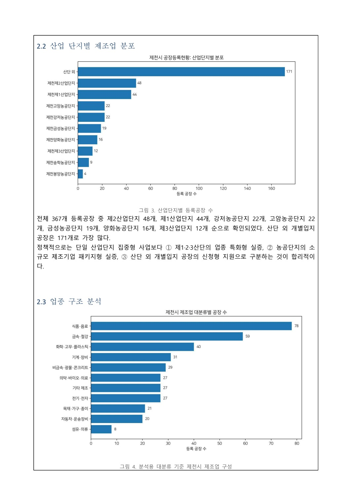
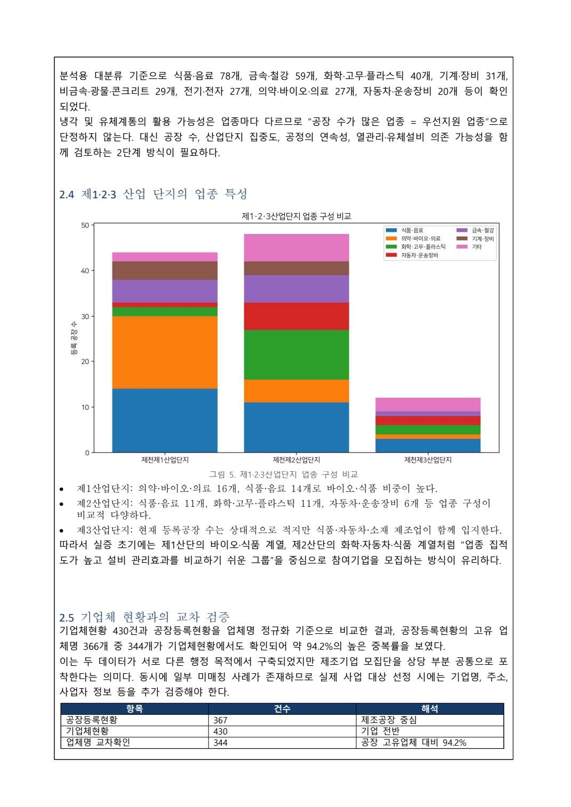

# 제천 제조업 데이터에서 실증지원 정책으로

[포트폴리오 처음으로](../../README.md) · [웹 상세](https://yongmin.gardengnat12.chatgpt.site/cases/jecheon/) · [상세 PDF · 7쪽](../../site/downloads/jecheon.pdf) · [English summary](README.en.md)

> IDEAS / PUBLIC DATA & POLICY · 2026.10.12 팀 대표 이메일 제출

2026 제천시 AI 활용 데이터 분석 아이디어 공모전을 위한 팀 작업입니다. 0ERROR 팀의 제조업 데이터 분석을 단계적인 설비관리 실증지원 정책으로 연결했습니다.

| 항목 | 내용 |
|---|---|
| PM | 총괄 기획·보고서 통합 |
| 팀 작업 | 데이터 분석과 역할 분담 |
| 정책안 | 현장 실증지원 제안 |

## 01장. 지역 데이터에서 지원 대상을 찾기

## 정책의 질문
2026 제천시 AI 활용 데이터 분석 아이디어 공모전을 위해, 제조기업의 분포를 설비관리 실증지원 정책으로 연결했습니다. 출발점은 모든 기업에 같은 장치를 보급하는 대신 어떤 업종·입지에서 현장 수요를 먼저 확인할지 설명하는 일이었습니다.

## 데이터와 기술의 역할 분리
공장등록·기업체 현황은 지원 후보를 살피는 정책 데이터로, 설비의 온도·유량·압력은 이후 상태감시를 위한 기술 데이터로 구분했습니다. 지역의 공장 수가 많다는 사실만으로 냉각설비 진단의 효과가 입증되지는 않습니다. 실제 설비 보유와 참여 의사를 확인하는 단계가 제안에 필요했습니다.

## 제 역할
보고서 역할표의 제 담당은 총괄 PM, 정책 기획, 보고서 통합과 발표입니다. 공공데이터 분석·AI 검증과 센서·회로, 냉각·열유체 검토는 팀 내 역할이 구분되어 있습니다. 관련 산출물은 팀의 공동 결과이며 세부 분석을 모두 제 독자 수행으로 쓰지 않습니다.

## 0ERROR와의 관계
기존 냉각설비 상태감시 구상을 지역 실증지원의 맥락으로 재구성한 사례입니다. 새로운 독립 제품을 개발해 제천 기업에 보급한 실적이 아니라, 데이터 근거와 정책 실행 단계를 연결한 제안 경험으로 소개합니다.

## 지역 공공데이터와 설비 데이터의 역할 분리

보고서는 공장등록현황 367건(2026-01-12)과 기업체현황 430건(2025-11-26)을 지역 지원대상의 분포를 파악하는 자료로 사용했습니다. 미래 실증에서 수집할 온도·유량·압력 시계열은 설비 상태를 판단하는 자료로 나눴습니다. 지역 공장 목록을 AI의 고장 학습자료처럼 쓰지 않는 구분입니다.

전처리 원고에는 결측 산업단지를 ‘산단 외’로 통일하고 복수 업종명의 대표 키워드로 분석용 대분류를 만든 절차가 있습니다. 이 분류는 정책 시각화용이며 실제 지원대상은 KSIC·행정자료로 다시 확인하도록 했습니다. 제 담당은 총괄 PM·정책기획·보고서 통합이며, 팀의 공공데이터 분석과 센서·열유체·AI 역할을 나눠 최종 제안으로 엮었습니다.

> 근거: 제천/제출/데이터 분석 보고서 및 요약서.pdf (1–10)

## 02장. 분포 그래프에서 실증 운영안까지

*제천 팀 제출 보고서 · 산업단지·업종별 공장 분포 그래프 · 실제 작성한 분석 자료*

## 실제 보고서의 구성
팀 보고서는 공장등록과 기업체 현황, 산업단지별·업종별 분포, 후보군 검토와 실증 운영안으로 이어집니다. 아래 이미지는 제출한 문서의 실제 그래프 페이지입니다. 제천 기업의 현장 진단 화면이나 센서 설치 사진이 아닙니다.

## 숫자를 정책 판단으로 옮기기
원고는 등록공장 367건과 산업단지·업종 분포를 집계해 설명합니다. 업종의 분석용 대분류와 행정상의 공식 산업분류를 구분하고, 실제 선정에는 현장 확인과 재매칭이 필요하다고 적었습니다. 공장 수의 순위가 그대로 우선지원 순위가 되지 않도록 정책의 해석 단계를 둔 점이 핵심입니다.

## 실행 계획의 연결
공공데이터로 후보군 설정 → 현장 수요와 설치 조건 확인 → 정상 운전 자료 축적 → 상태감시와 점검 활용 평가 → 후속 확대라는 흐름을 제안했습니다. 자동정지보다 점검 판단 지원을 초기 기능으로 두고 행정·대학·기업의 협업 조건도 문서에 연결했습니다.

## 현재 포트폴리오에서의 해석
제출 문서 안의 테스트베드·AI 성능 관련 서술을 현장 검증 완료의 증거로 삼지 않습니다. 이번에 제시하는 결과물은 팀의 분석 보고서와 정책 제안서, 통합·제출 경험입니다. 실제 실증의 성과는 별도 근거가 있어야 설명할 수 있습니다.

*제천 팀 제출 보고서 · 업종 구성과 기업체 현황의 대조 · 정책 제안용 분석 자료 · 데이터 분석 보고서 및 요약서.pdf · 4쪽*

## 집계에서 대상선정 규칙으로 연결하기

보고서에 기재한 집계는 산업·농공단지 196개(53.4%)와 산단 외 171개(46.6%)입니다. 제2산단 48개·제1산단 44개, 강저·고암 농공단지 각22개, 금성19개·양화16개·제3산단12개라는 분포를 바탕으로 집적형 실증과 개별입지 신청형 지원을 병행하는 방향을 제안했습니다.

업종별로는 식품·음료78, 금속·철강59, 화학·고무·플라스틱40, 기계·장비31 등으로 제시했습니다. 공장 수가 많다는 이유만으로 냉각 설비가 필요하다고 결론내리지 않고 업종 집적도·공정 연속성·실제 유체설비 보유 여부를 추가 확인하는 2단계 선정 구조입니다. 두 목록을 업체명으로 비교한 344/366(94.2%)는 이름 정규화 기준의 교차확인으로, 대상 기업 전체의 법적 동일성이나 현장 적합성을 확정하지 않습니다.

## 산업단지별로 다른 참여 경로를 제안한 이유

제출 보고서는 제1산단의 의약·바이오·의료16개와 식품·음료14개, 제2산단의 식품·음료11개·화학계열11개·자동차계열6개를 예로 들었습니다. 이를 바탕으로 제1산단은 바이오·식품, 제2산단은 화학·자동차·식품처럼 비교하기 쉬운 집적 그룹에서 먼저 모집하는 방향입니다. 동시에 산단 밖171개가 가장 큰 집단이므로 산단 중심 사업만으로 전체 수요를 대표하지 않도록 별도의 신청형 지원을 두었습니다.

정책으로 옮길 때 필요한 조치도 나눴습니다. 산업·기업지원 부서는 모집과 사업, 스마트정보 부서는 데이터·AI 활용, 참여기업은 설비 접근과 허용된 정비이력, 대학·연구 협력은 설치·분석·검증을 담당하는 제안입니다. 생산기밀과 사업자 정보는 최소 수집하고 분석·반출 범위를 협약으로 정하도록 했습니다. 실제 정비비·가동손실 감소는 나중에 참여기업 자료로 평가할 항목이며 공장 목록의 집계만으로 추정하지 않습니다.

> 근거: 제천/제출/데이터 분석 보고서 및 요약서.pdf (1–10)

## 03장. 제출 기록과 정책 검증의 과제

## 확인한 진행 단계
분석 보고서·요약서와 신청서를 작성하고 팀 대표로 2026년 10월 12일 이메일 제출했습니다. 발신 제출 기록과 정책 채택·수상·현장 실증은 각각 다른 단계입니다. 포트폴리오에는 제출까지 확인된 팀 제안으로 표시합니다.

## 제안의 강점
데이터 분석을 차트의 완성으로 끝내지 않고, 누구를 어떤 절차로 지원할지 설명하는 정책으로 연결했습니다. 기술 개념과 행정 운영의 사이에 현장 수요 확인, 설치 가능성, 평가와 확산의 단계를 둔 것이 작업의 중심입니다.

## 다음 검증에서 필요한 것
실제 사업으로 이어진다면 업종 분류의 적절성, 참여기업의 냉각·유체설비 보유, 데이터 접근과 센서 설치 조건을 확인해야 합니다. 오경보·탐지지연과 같은 기술 지표와 정비자의 사용성·유지관리 부담 같은 운영 지표도 구분해서 평가해야 합니다. 아직 확보한 실증 성과가 아니라 제안의 실행 조건입니다.

## 남긴 역량
팀의 서로 다른 기술 자료를 하나의 정책 논리와 보고서로 통합했습니다. 개발 목표가 실제로 검증된 결과와 혼동되지 않도록 설명하고, 분석의 단위를 지원 대상의 판단과 연결하는 경험을 쌓았습니다.

## 정책안이 제시하는 현장 실증의 순서

제1·2산단 중심 후보 모집 → 실제 냉각·유체설비 확인 → 4~8주 정상자료 수집 → 이상징후와 정비 활용성 평가 → 농공단지·개별입지 확대를 제안했습니다. 초기 기능은 자동정지가 아니라 이상점수·영향변수와 점검 권고를 보여 주는 보조수단입니다. 고정 임계값·이동통계를 기준으로 정상학습 모델을 비교하고 오경보율·탐지지연·점검 활용도를 함께 평가하도록 적었습니다.

보고서 안의 냉각 테스트베드 실험 완료처럼 읽힐 수 있는 대목은 별도 증거가 부족하므로 웹사이트에서 완료 성과로 옮기지 않습니다. 확인한 것은 0ERROR를 제조업 지원정책에 적용한 보고서와 요약서, 2026년10월12일 이메일 제출입니다. 참여기업 확보·현장 실증·정비비 절감·정책 채택으로 넓히지 않으며, 위 분포 수치도 제출 보고서가 보여 주는 분석 결과로 출처와 기준일을 붙여 설명합니다.

> 근거: 제천/제출/데이터 분석 보고서 및 요약서.pdf (1–10)

---

## 기록의 근거

근거: 제천 공모전 제출 폴더의 참가신청서와 「데이터 분석 보고서 및 요약서」, 보고서 역할표 및 2026.10.12 본인 발신 제출 메일.

2026-10-20 기준. 개인 담당과 팀 기여, 해석·계획과 실측·완료 결과를 구분했습니다.
