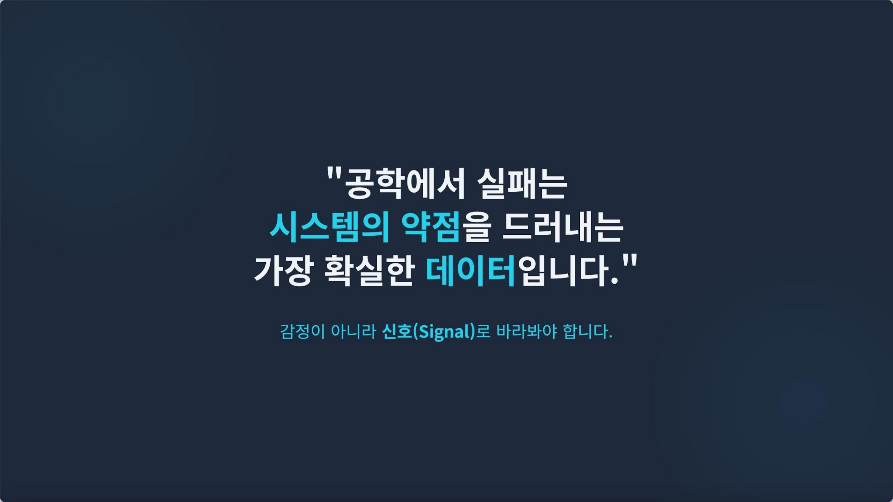
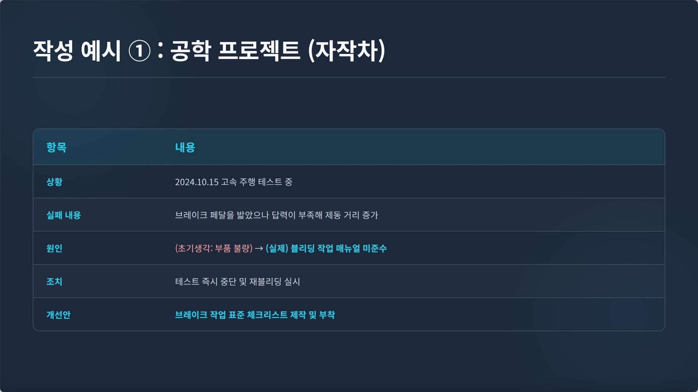
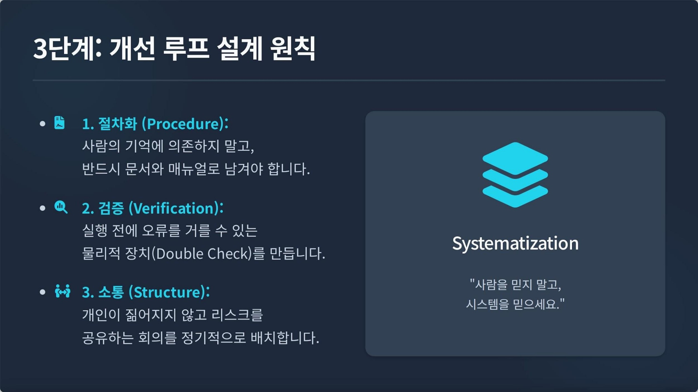

# 실패를 데이터로 바꾸는 법

[포트폴리오 처음으로](../../README.md) · [웹 상세](https://yongmin-engineering-portfolio-oct26.gardengnat12.chatgpt.site/cases/learningloop/) · [상세 PDF · 7쪽](../../site/downloads/learningloop.pdf) · [English summary](README.en.md)

> IDEAS / LEARNING CONTENT · 3차시 학습자료 작성

2025-2학기 온라인 학습법 콘텐츠 개발을 위해, 공학 프로젝트의 실패를 기록·회고·개선으로 연결하는 학습 자료를 제작했습니다.

| 항목 | 내용 |
|---|---|
| 3차시 | PDF 학습 자료 |
| 기록 | Failure Log |
| 회고 | AAR와 개선 루프 |

## 01장. 실패 경험을 학습 내용으로 옮기기

## 콘텐츠의 질문
2025-2학기 온라인 학습법 콘텐츠 개발을 위해 “프로젝트로 배우는 학습: 실패를 데이터로 바꾸는 법”을 기획했습니다. 프로젝트가 끝난 뒤 “다음에는 더 잘하자”는 다짐만 남지 않도록, 실패를 조건·현상·원인과 다음 실행의 기록으로 옮기는 과정을 학습 자료로 구성했습니다.

## 세 차시의 연결
1차시는 실패를 학습 데이터로 보는 관점, 2차시는 Failure Log와 팀 회고, 3차시는 반복되는 문제의 우선순위와 개선 루프를 다룹니다. 한 번의 회고에서 끝나지 않고 다음 실행으로 되돌아가는 흐름입니다.

## 개인 작업의 범위
본인 명의 신청서와 강의 시나리오, 1·2·3차시 PDF 자료를 작성했습니다. 예시와 질문, 기록 항목과 개선 절차를 교육용으로 정리했습니다. 실제 촬영·배포·수강 운영의 완료와 학습 효과 측정을 수행한 것으로 적지 않습니다.

## 교육 콘텐츠로서의 선택
실패를 개인의 노력 부족으로만 설명하지 않고 절차와 검증, 소통의 조건을 다시 보도록 구성했습니다. 수강자가 자신의 프로젝트에 적용할 수 있는 질문과 기록 방식을 주는 것이 자료의 목적입니다.

## 33쪽 자료를 세 단계로 설계하기

실제 PDF는 1차시 10쪽, 2차시 10쪽, 3차시 13쪽으로 총 33쪽입니다. 시나리오는 공학계열 학부생과 설계·캡스톤·동아리 프로젝트 참여자를 대상으로, 각 10분 내외의 상반신+PPT 강의형을 계획했습니다. 세부 시간은 약 9분·9분·8분으로 배정했습니다.

1차시는 단위가 다른 설계자료와 가공품이 맞지 않는 교육용 사례를 통해 현상을 봅니다. 표면의 개인 실수에서 멈추지 않고 단위 표준 문서와 교차 검증 절차가 있었는지 질문합니다. 2차시는 그 질문을 기록 양식으로 옮기고, 3차시는 쌓인 기록의 우선순위와 반복 방지 장치로 연결합니다. 콘텐츠 안의 자작차·시험 사례는 학습용 설명이므로 실제 팀 사고 이력이나 제 성적, 검증된 재발 감소 수치로 사용하지 않습니다.

> 근거: 학습법 개발/권용민_온라인 학습법 콘텐츠 개발 시나리오.hwpx (시나리오 차시별 구성); 프로젝트로 배우는 학습_ 실패를 데이터로 바꾸는 법_1차시.pdf (10쪽); 프로젝트로 배우는 학습_ 실패를 데이터로 바꾸는 법_2차시.pdf (10쪽); 프로젝트로 배우는 학습_ 실패를 데이터로 바꾸는 법_3차시.pdf (13쪽)

## 02장. 3차시 자료와 실제 슬라이드

*학습 콘텐츠 1차시 · 실패를 시스템의 신호로 보는 관점 · 원본 슬라이드 4쪽*

## 제작한 산출물
시나리오와 세 차시 PDF가 남아 있습니다. 아래에는 관점 전환, Failure Log의 교육용 예시와 개선 루프의 원칙을 보여 주는 실제 슬라이드를 배치했습니다. 공학 프로젝트 사례는 교육을 위한 설명이며 제 개인의 특정 성과를 입증하는 자료로 사용하지 않습니다.

## 기록의 항목
무슨 일이 있었는지뿐 아니라 어떤 조건에서 어떤 판단을 했고 결과가 어떻게 나타났는지 남기는 방향입니다. 회고에서는 계획과 실제의 차이를 설명하고, 다음 실행에서 바꿀 항목을 정하도록 구성했습니다. 감정적인 반성문보다 다시 읽고 행동으로 옮길 수 있는 기록을 목표로 했습니다.

## 개선 루프로의 연결
절차의 구체화, 오류를 확인하는 검증, 팀 안의 소통 구조를 개선의 축으로 다뤘습니다. 문제가 반복되는 이유를 개인의 기억에만 맡기지 않고 다음 작업의 절차에 반영하는 관점입니다.

## 자료가 보여 주는 범위
콘텐츠가 구성되어 있다는 사실과 수강자가 실제로 배웠다는 효과는 다릅니다. 슬라이드의 학습 예시나 시간·성적 변화 수치를 개인의 검증된 성과로 가져오지 않고, 교육 자료 자체의 구성과 사용 목적을 설명합니다.

*학습 콘텐츠 2차시 · Failure Log 교육용 작성 예시 · 개인 실적이 아닌 학습 예시 · 프로젝트로 배우는 학습_ 실패를 데이터로 바꾸는 법_2차시.pdf · 5쪽*

*학습 콘텐츠 3차시 · 절차·검증·소통의 개선 루프 · 원본 슬라이드 7쪽 · 프로젝트로 배우는 학습_ 실패를 데이터로 바꾸는 법_3차시.pdf · 7쪽*

## Failure Log와 AAR의 실제 항목

Failure Log는 ① 날짜·상황, ② 구체적인 실패 내용, ③ 원인 추정, ④ 결과·영향, ⑤ 당시 조치와 교훈으로 구성했습니다. ‘계산을 잘못했다’는 한 문장보다 어떤 단위·조건에서 오류가 생겼고 다음 작업에 어떤 손실이 이어졌는지를 남기는 양식입니다. 브레이크 작업과 SI 단위 환산을 교육용 예로 배치해 공학·개인 학습에 같은 구조를 적용하도록 했습니다.

팀 회고의 AAR은 ‘최초 목표는? / 실제 결과는? / 차이는 왜 생겼나? / 다음에 바꿀 것은?’의 네 질문입니다. 사람을 지목하는 회고와 작업 매뉴얼·확인 항목을 점검하는 회고를 나란히 보여 주었습니다. 기록은 개인의 기억을 보존하고, 회고는 각자가 본 조건을 비교하며 다음 절차를 정하는 역할로 나눴습니다.

## 세 차시를 잇는 학습자의 산출물

강의 시나리오는 사례를 듣고 끝나는 순서보다 자기 경험에 쓸 수 있는 도구를 단계별로 늘리는 흐름입니다. 첫 차시에서 실패를 현상과 조건으로 다시 설명하고, 두 번째 차시에서 한 건을 Failure Log 항목에 써 보며, 세 번째 차시에서 반복되는 문제를 분류하고 다음 작업에 넣을 규칙을 정합니다. 앞 차시의 기록이 다음 차시의 입력이 되도록 구성했습니다.

자료는 ‘기록된 실패’와 ‘분석된 원인’도 구분합니다. 원인 추정 칸은 최종 사실을 확정하는 곳이 아니라 나중에 회고에서 다시 검토할 가설을 남기는 자리입니다. AAR은 최초 목표와 실제 결과를 비교해 그 추정을 팀의 관점에서 살피는 단계입니다. 마지막 개선안은 ‘주의하겠다’보다 단위 확인란, 일정 시각화, 정기 위험회의처럼 다음 행동의 장소와 시점을 바꾸는 방식으로 설명합니다. 이 연결은 교육 내용의 구성으로 확인할 수 있으며 실제 학습자가 해당 루프를 완주한 효과 연구로 설명하지 않습니다.

> 근거: 학습법 개발/권용민_온라인 학습법 콘텐츠 개발 시나리오.hwpx (시나리오 차시별 구성); 프로젝트로 배우는 학습_ 실패를 데이터로 바꾸는 법_1차시.pdf (10쪽); 프로젝트로 배우는 학습_ 실패를 데이터로 바꾸는 법_2차시.pdf (10쪽); 프로젝트로 배우는 학습_ 실패를 데이터로 바꾸는 법_3차시.pdf (13쪽)

## 03장. 콘텐츠 완성과 학습 효과의 구분

## 완료한 것
강의 시나리오와 3차시 학습자료를 작성했습니다. 실제 강의 촬영·게시·수강 운영과 교육 효과를 측정한 결과는 확인되지 않았습니다. “자료 제작”을 완료 상태로 적고 운영 성과를 덧붙이지 않습니다.

## 이후 검토할 사용성
학습자가 Failure Log의 항목을 이해하는지, 회고 질문이 구체적인 다음 행동으로 이어지는지 확인할 필요가 있습니다. 자료를 읽은 직후의 만족도보다 일정 시간이 지난 뒤 기록을 실제로 재사용하는지를 보는 방향이 유용합니다. 아직 수행한 교육 실험이 아니라 후속 평가 아이디어입니다.

## 내용 개선의 기준
예시가 너무 특정 프로젝트에만 맞는지, 초보자가 원인과 현상을 구분할 수 있는지, 팀 회고에서 책임 추궁으로 흐르지 않는지 살펴야 합니다. 사례와 질문의 난이도를 조정하고 실제 작성 과제를 연결하는 방법을 검토할 수 있습니다.

## 다른 프로젝트와의 연결
A-FA의 문서화와 지식관리 경험을 교육 콘텐츠의 언어로 풀어 본 작업입니다. 실패의 기록을 결과와 한계를 설명하는 습관으로 바꾸려는 관점은 실차 시험과 후속 프로젝트의 기록 방식에도 이어집니다.

## 빈도와 영향도로 다음 행동을 고르기

3차시는 실패를 기술, 커뮤니케이션, 관리·프로세스로 분류한 뒤 빈도×영향도 4분면으로 대응을 고릅니다. 자주 발생하고 영향이 크면 즉시 개선, 드물지만 치명적이면 비상 매뉴얼·대비, 자주 생기는 작은 실수는 체크리스트·템플릿으로 절차화, 드물고 영향이 작으면 기록하며 추이를 관찰하는 구조입니다.

구체적인 교육 예로 단위 오류에는 SI 가이드와 도면의 단위 확인란, 일정 지연에는 간트 차트와 월요일 리스크 점검회의를 연결했습니다. 개인 공부에는 백지 복습 5분, 오답의 개념 태그, 시간 제한 연습과 넘어가기 규칙을 제시했습니다. 마지막에는 기록→회고→분류→개선 설계→다음 실행의 다섯 단계를 정리하고 한 과제에 Failure Log를 적용해 보도록 했습니다. 완성한 것은 이 시나리오와 학습자료이며 촬영·배포·수강 효과 측정은 별도 단계입니다.

> 근거: 학습법 개발/권용민_온라인 학습법 콘텐츠 개발 시나리오.hwpx (시나리오 차시별 구성); 프로젝트로 배우는 학습_ 실패를 데이터로 바꾸는 법_1차시.pdf (10쪽); 프로젝트로 배우는 학습_ 실패를 데이터로 바꾸는 법_2차시.pdf (10쪽); 프로젝트로 배우는 학습_ 실패를 데이터로 바꾸는 법_3차시.pdf (13쪽)

---

## 기록의 근거

근거: 본인 명의 온라인 학습법 콘텐츠 개발 신청서·시나리오, 「프로젝트로 배우는 학습: 실패를 데이터로 바꾸는 법」 1~3차시 PDF.

2026-10-20 기준. 개인 담당과 팀 기여, 해석·계획과 실측·완료 결과를 구분했습니다.
