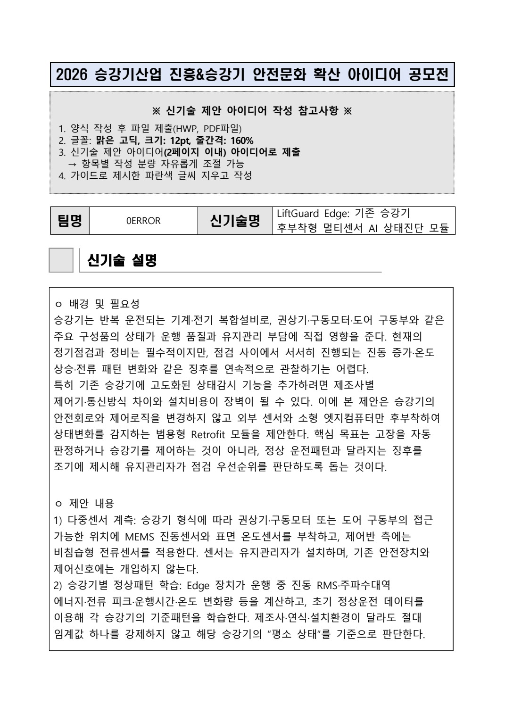
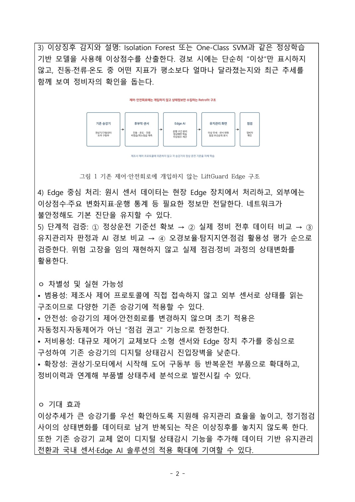

# 2쪽 기술 제안서의 구조

[전체 상세 기록](README.md) · [PDF 7쪽](../../site/downloads/liftguard.pdf)

*LiftGuard Edge 개념 제안서 · 후부착 센서와 점검 지원 구상 · 원본 PDF 1쪽*

## 실제 결과물
팀 참가신청서와 2쪽 “신기술 제안 아이디어” 문서가 결과물입니다. 원본 문서 이미지는 센서 후부착, 정상 패턴 비교와 엣지 처리, 점검 안내의 흐름을 보여 줍니다. 실제 승강기에 장착된 모듈이나 현장 실증 사진이 아닙니다.

## 제안의 흐름
센서로 신호 수집 → 기본 통계·특징 정리 → 정상 패턴과 변화 비교 → 관리자가 이해할 수 있는 점검 권고로 연결하는 개념입니다. 초기 모델 후보와 단계적 검증을 문서에 설명했습니다. 모델 이름의 기재는 성능 검증 완료를 의미하지 않습니다.

## 후부착의 조건
기존 설비에 추가한다는 접근은 설치와 유지관리 조건을 더 중요하게 만듭니다. 센서가 기존 장치와 간섭하지 않는지, 점검자가 정보를 신뢰하고 조치할 수 있는지 확인해야 합니다. 제안서는 기존 안전회로의 비개입과 점검 지원이라는 경계를 두고 있습니다.

## 문서의 기대효과
조기 점검과 유지관리 지원은 아이디어의 목적입니다. 실제 고장률 감소, 탐지율·오경보율 달성이나 현장 설치 수를 확인한 실적으로 사용하지 않습니다. 문서의 구성과 현재 단계를 함께 읽을 수 있도록 결과물을 배치했습니다.

*LiftGuard Edge 개념 제안서 · 처리 구조와 단계적 검증안 · 원본 PDF 2쪽 · 신기술 제안 아이디어.pdf · 2쪽*

## 센서에서 점검 권고까지의 설명 구조

문서에 제시한 특징은 진동 RMS, 주파수대역 에너지, 전류 피크, 운행시간, 온도 변화량입니다. 엣지 장치가 특징을 계산하고 Isolation Forest 또는 One-Class SVM처럼 정상 상태에서 벗어나는 정도를 보는 방법을 후보로 검토하도록 했습니다. 알고리즘 명칭만 나열하지 않고 경보 화면에 어떤 지표가 평소보다 얼마나 달라졌는지와 최근 추세를 함께 보여 주는 구조를 적었습니다.

원시 신호는 현장 장치에서 처리하고 외부에는 이상점수·주요 변화지표·운행통계 등 필요한 정보를 보내는 방향입니다. 네트워크가 끊겨도 현장 처리를 유지하도록 기획했습니다. 이 구조도와 2쪽 설명서가 실제 결과물이며, 완성된 대시보드나 설치된 센서 사진이 존재한다는 의미는 아닙니다.

## 절대 임계값과 ‘평소 상태’의 차이

제안서가 승강기별 정상 패턴을 두는 이유는 진동·전류·온도 수준이 제조사·설치 위치·운행 조건에 따라 달라질 수 있기 때문입니다. 같은 수치가 모든 장비에서 같은 의미를 갖는다고 가정하지 않고 해당 승강기의 이전 상태에서 얼마나 벗어났는지를 살피는 구상입니다. 특징량 중 RMS는 진동 크기, 주파수대역 에너지는 진동이 나타나는 대역, 운행시간과 전류 피크는 반복 운전의 변화를 설명할 후보로 적었습니다. 실제로 원인별 분리 성능을 확인한 결과는 아직 없습니다.

경보를 보는 유지관리자에게는 점수 하나보다 확인할 단서가 필요하므로 신호별 변화와 추세를 함께 보여 주도록 했습니다. 예를 들어 진동과 온도가 달라졌다는 관측을 곧바로 특정 부품 고장 판정으로 연결하지 않습니다. 이 설계는 정비자의 판단을 돕는 정보 계층을 정한 것입니다. 현장 엣지에서 요약하고 필요한 통계만 외부에 보내는 구성도 설치된 통신환경이나 서버 구현의 성과가 아니라 범용 후부착 모듈의 기술 요구를 정리한 문서 내용입니다.

> 근거: 승강기/신기술 제안 아이디어.pdf (1–2)
