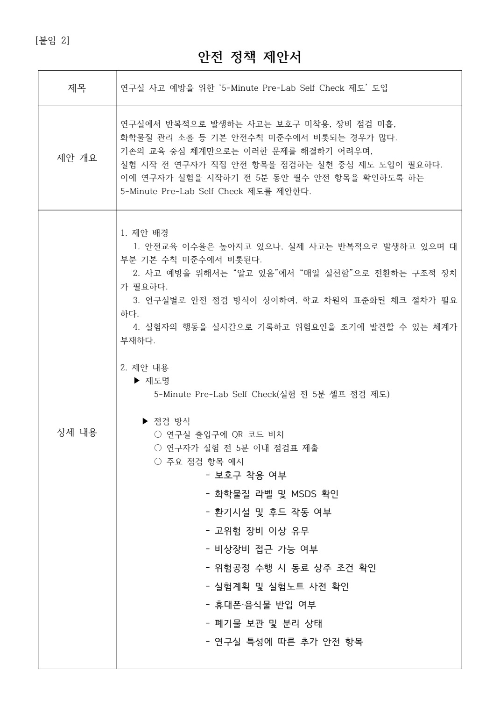
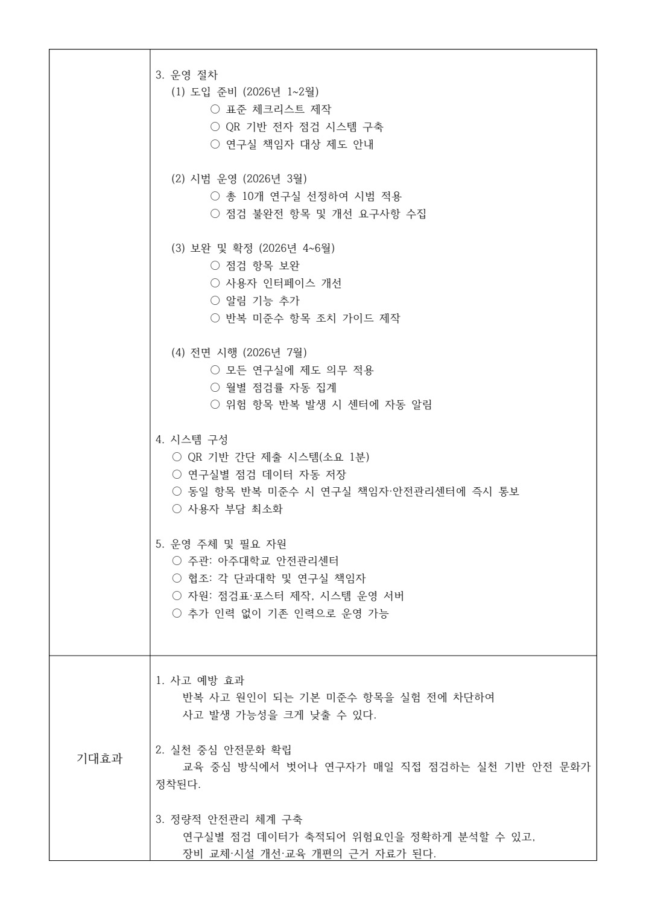

# 실험 전 5분, 안전을 확인하는 절차

[포트폴리오 처음으로](../../README.md) · [웹 상세](https://yongmin.gardengnat12.chatgpt.site/cases/prelab/) · [상세 PDF · 7쪽](../../site/downloads/prelab.pdf) · [English summary](README.en.md)

> IDEAS / SAFETY POLICY · 개인 정책 제안서 작성

2025학년도 아주대학교 연구실 안전 공모전 정책제안부문에 맞춰, 실험 전 점검을 일상적인 행동과 기록으로 연결하는 제도를 기획했습니다.

| 항목 | 내용 |
|---|---|
| 5분 | 제안한 사전 점검 시간 |
| QR | 점검 입력과 기록 방식 |
| 정책안 | 개인 제안서 작성 |

## 01장. 실험 직전 행동을 바꾸는 정책

## 문제를 작게 설정하기
2025 아주대학교 연구실 안전 공모전 정책제안부문에서, 실험 시작 전의 짧은 확인을 일상적인 절차로 만드는 5-Minute Pre-Lab Self Check를 기획했습니다. 안전교육을 받았다는 사실과 당일 실험의 조건을 확인하는 행동 사이의 간격에 주목했습니다.

## 제안의 구조
실험 전 필요한 항목을 확인하고 QR 입력으로 기록합니다. 보호구, 화학물질 정보, 환기·배기, 비상설비와 실험 장치의 상태처럼 작업 직전 확인해야 할 항목을 예시로 정리했습니다. 반복되는 문제는 책임자와 안전관리 담당자가 검토하는 운영 흐름으로 연결했습니다.

## 제 역할과 결과물
개인 신청서와 정책 제안서를 작성했습니다. 제안의 배경, 점검 항목, 기록 구조와 단계별 시범운영 방향이 실제 문서에 남아 있습니다. QR 시스템을 개발하거나 연구실에 배포한 실적으로 소개하지 않습니다.

## 정책 설계의 관점
기록 자체가 목적이 되면 형식적인 체크로 끝날 수 있습니다. 사용자가 이해하기 쉬운 항목과 기록 이후의 검토·조치가 이어져야 한다는 질문을 담은 제안입니다. 실험 전 5분은 제도 설계상의 시간 기준이며 실제 운영에서 검증한 최적 시간은 아닙니다.

## 체크리스트에 넣은 구체적인 행동

제안서에서는 실험 준비를 보호구 확인 한 가지로 축소하지 않았습니다. 보호구 착용, 화학물질 라벨·MSDS 확인, 환기시설·후드 작동, 고위험 장비 이상, 비상장비 접근 가능 여부를 기본 항목으로 두었습니다. 여기에 위험공정 중 동료 상주 조건, 실험계획·노트 사전 확인, 휴대폰·음식물 반입, 폐기물 보관·분리 상태와 연구실별 추가 항목을 포함했습니다.

이 목록은 개인의 기억을 점검 순서로 바꾸기 위한 설계입니다. 예를 들어 보호구는 착용했어도 비상장비 앞을 물건이 막고 있다면 실험 준비가 완료됐다고 볼 수 없습니다. 연구실 공통 항목을 표준화하면서 장비·물질이 다른 연구실은 추가 항목을 갖도록 구성했습니다. 작품의 결과물은 이 절차를 설명한 정책 문서이며, 실제 연구실의 미준수 빈도를 측정한 조사는 아닙니다.

> 근거: (권용민)2025학년도_연구실_안전_공모전_정책제안부문.pdf (2–4)

## 02장. 점검 항목·QR 기록·시범운영안

*Pre-Lab 정책 제안서 · 배경과 점검 항목 · 원본 PDF 2쪽*

## 문서에 구체화한 내용
정책 제안서에는 제안 배경과 점검 항목의 예시, QR 기반 입력, 기록의 검토와 알림 구조를 적었습니다. 아래 실제 문서 페이지에서 항목 구성과 도입 단계를 확인할 수 있습니다. 실사용 시스템의 화면을 재현한 이미지가 아닙니다.

## 도입 계획
준비, 일부 연구실의 시범 적용, 의견 수렴과 보완, 이후 확대의 순서를 제시했습니다. 각 단계에서 점검 항목의 이해 가능성과 현장의 적용 부담을 확인하는 방식입니다. 문서에 적힌 시기와 적용 규모는 계획이며 실제 참여 연구실 실적이 아닙니다.

## 정보의 연결
QR로 입력한 확인 기록이 책임자에게 이어지고, 반복 항목을 검토할 수 있게 구성했습니다. 시스템 구현보다 누가 무엇을 확인하고 어떤 후속 판단을 하는지 정한 서비스·운영 설계가 산출물입니다.

## 결과 이미지를 읽는 기준
표에 담긴 기대효과는 도입 전 가정입니다. 안전 행동의 정착, 반복 위험의 파악과 사고 예방에 기여할 수 있다는 정책의 방향이며, 사고 감소율이나 실제 알림 운영 성과를 측정한 결과는 아닙니다. 문서의 항목과 그 한계를 함께 제시합니다.

*Pre-Lab 정책 제안서 · 단계별 도입·기록·운영안 · 원본 PDF 3쪽 · (권용민)2025학년도_연구실_안전_공모전_정책제안부문.pdf · 3쪽*

## QR 제출 이후의 책임과 정보 흐름

출입구 QR → 실험 전 확인 → 전자 점검표 제출 → 연구실별 저장 → 반복 미준수 항목 통보의 흐름을 제안했습니다. 연구자는 실험 전 5분 동안 실제 준비를 확인하고, 전자 제출 동작은 약 1분 이내를 목표로 했습니다. 두 시간은 각각 점검과 입력에 대한 설계 목표입니다.

운영 주체는 안전관리센터, 협조 주체는 연구실 책임자와 단과대학으로 적었습니다. 저장한 기록은 월별 점검률과 반복 미준수 항목을 보는 데 활용하고, 같은 위험이 반복되면 책임자·센터에 알리도록 했습니다. 데이터 축적의 목적도 체크 횟수를 늘리는 데 그치지 않고 장비 교체·시설 개선·교육 개편의 근거를 남기는 데 두었습니다.

원문에는 점검표·포스터 제작과 시스템 운영 서버가 필요한 자원으로 기재되어 있습니다. ‘기존 인력으로 운영 가능’은 제안의 운영 가정이므로 실제 업무량을 확인한 결론과 구분해 읽어야 합니다.

## 전자 기록을 읽는 두 가지 단위

제도안의 기록은 한 번의 실험 준비와 월별 연구실 운영을 서로 다른 단위로 봅니다. 실험자에게는 ‘이번 작업을 시작해도 되는가’라는 확인이 필요하고, 연구실 책임자에게는 같은 항목이 되풀이되는지 보는 정보가 필요합니다. 그래서 개인 점검표의 항목, 연구실별 저장, 월별 집계와 반복 위험 알림을 연결했습니다. 보호구 항목은 개인 준비에 가깝고, 후드 고장이나 비상장비 접근 문제는 시설·공간의 조치가 필요하므로 같은 미준수 표시라도 조치 주체가 다릅니다.

제안서가 산출한 것은 위험 빈도 통계가 아니라 이 두 수준의 기록을 연결하는 운영 구조입니다. 원문에 적힌 ‘현장 점검을 줄이고 위험 연구실에 집중’이라는 기대도 모든 현장 확인을 없애자는 의미로 사용하지 않습니다. 전자 입력이 실제 안전 상태를 대신할 수 없으므로 제도 검토에서는 기록의 충실도와 담당자 조치 가능성을 함께 봐야 합니다. 공통 체크 절차와 연구실별 추가 항목을 병행한 이유도 일률적인 점수보다 실제 준비 행동을 이끌기 위해서입니다.

> 근거: (권용민)2025학년도_연구실_안전_공모전_정책제안부문.pdf (2–4)

## 03장. 제안의 결과와 다음 검토 기준

## 확인 가능한 완료 범위
2025년 11월 20일 작성한 개인 신청서와 안전 정책 제안서가 결과물입니다. 학교의 제도 채택, QR 서비스 구축, 사고 감소의 실증이나 수상은 확인된 성과로 추가하지 않았습니다.

## 실제 적용 전에 필요한 확인
연구실마다 작업과 위험이 다르므로 공통 항목과 실험별 항목을 구분해 검토해야 합니다. 체크 시간이 현장에 부담을 주는지, 사용자가 무심코 모든 항목을 선택하게 되는지, 발견한 문제에 누가 대응하는지도 확인해야 합니다. 이는 현재 제안의 실행 조건을 정리한 후속 질문입니다.

## 평가의 방향
시범 적용에서는 입력 완료율만으로 효과를 판단하기 어렵습니다. 항목 이해도, 실제 발견·조치 사례, 누락과 중복 입력, 관리자의 검토 부담을 함께 살펴보는 방향이 필요합니다. 아직 수집한 운영 데이터가 없으므로 성과 수치로 제시하지 않습니다.

## 남긴 경험
공학 프로젝트의 작업 절차를 사람의 행동과 기록, 관리자의 후속 조치까지 연결해 본 정책 설계 경험입니다. 짧은 사전 확인이 일회성 캠페인에 머무르지 않게 운영 단계를 문서로 구체화한 점을 소개합니다.

## 원고에 담은 네 단계 도입안

| 제안 시점 | 진행할 일 | 다음 단계에 필요한 기록 |
|---|---|---|
| 2026년 1~2월 | 표준 체크리스트, QR 전자 점검, 책임자 안내 | 공통·연구실별 항목과 운영 책임 |
| 3월 | 10개 연구실 시범 적용 | 불완전 점검 항목과 사용자 개선 요구 |
| 4~6월 | 항목·입력 화면 보완, 알림·조치 가이드 | 반복 미준수에 대한 대응 방법 |
| 7월 | 전면 시행 검토, 월별 집계·반복 위험 알림 | 실제 점검 부담과 위험 개선 이력 |

이 날짜와 10개 연구실은 2025년 작성 제안서의 도입 계획입니다. 현재 시점에서 계획의 날짜가 지났다는 이유로 시행 실적으로 바꾸지 않았습니다. 현장에 적용한다면 단순 제출률과 실제 준비 확인의 일치 여부, 반복 경보의 담당자 처리 가능성부터 확인해야 합니다. 제안서가 남긴 구체적인 성과는 점검 항목과 기록·책임·도입 순서를 하나의 운영안으로 연결한 것입니다.

> 근거: (권용민)2025학년도_연구실_안전_공모전_정책제안부문.pdf (2–4)

---

## 기록의 근거

근거: 본인 명의 「2025학년도 연구실 안전 공모전 정책제안부문」 신청서·안전 정책 제안서. 작성일 2025.11.20.

2026-10-20 기준. 개인 담당과 팀 기여, 해석·계획과 실측·완료 결과를 구분했습니다.
