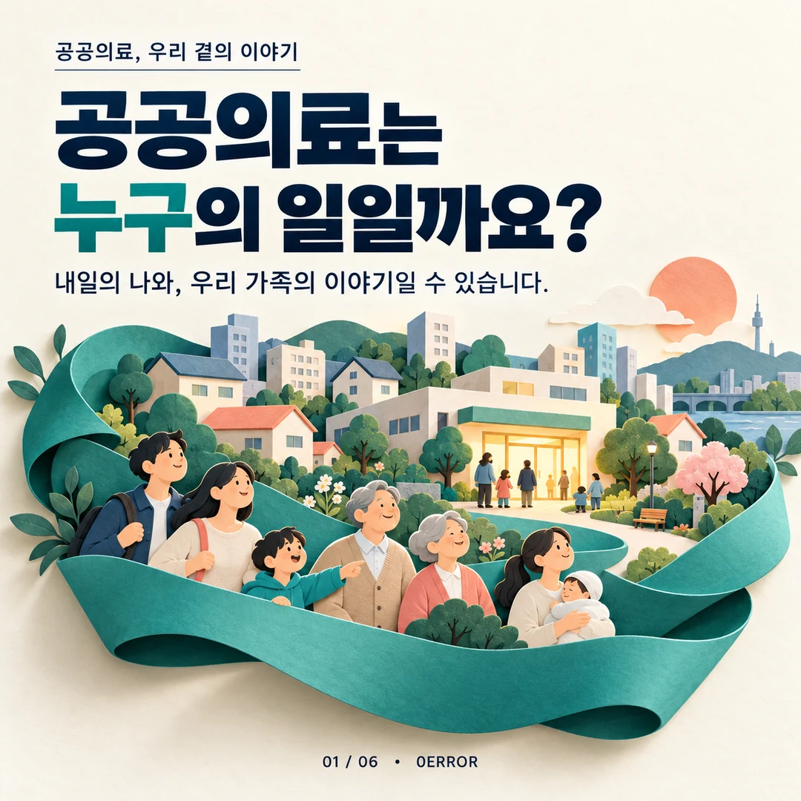
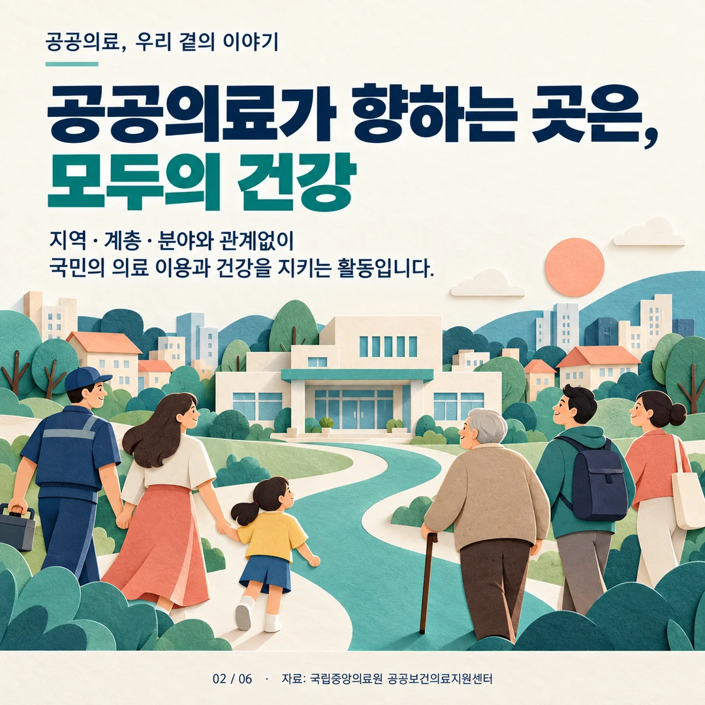
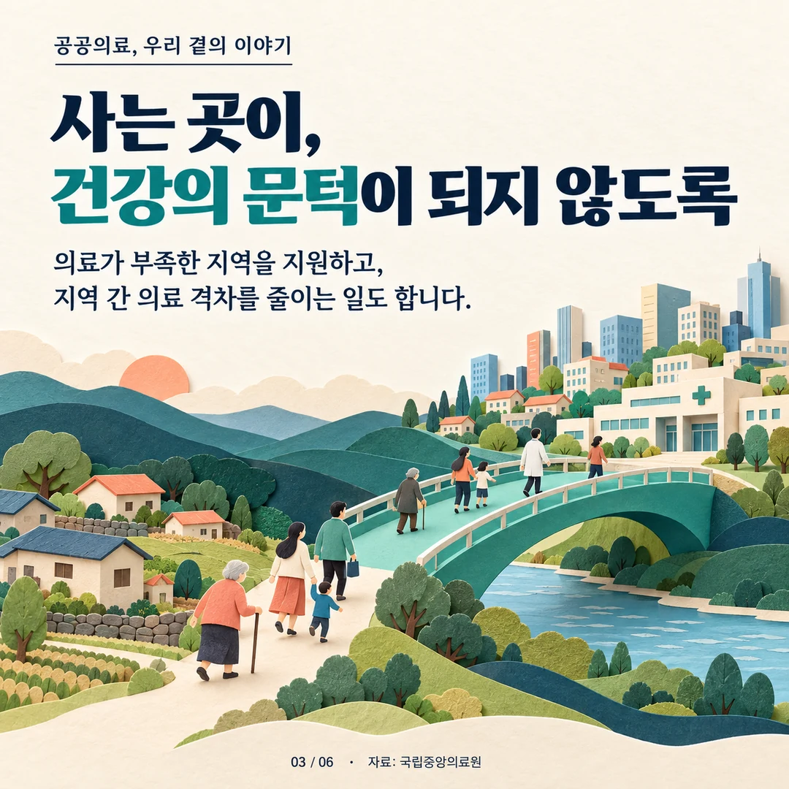
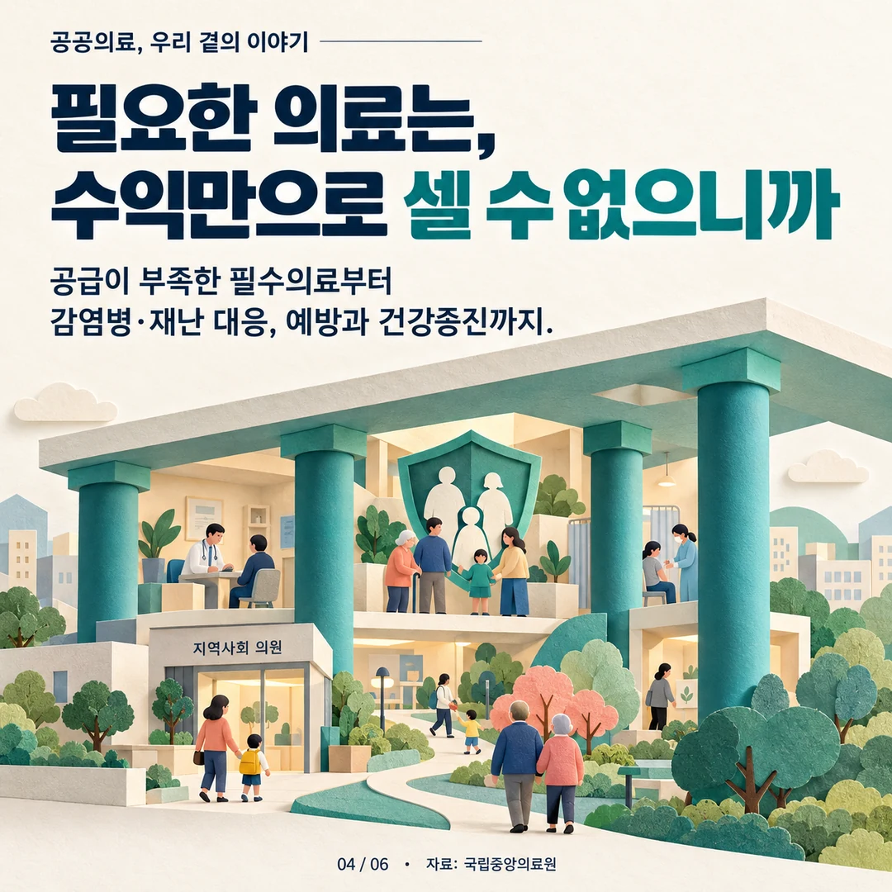
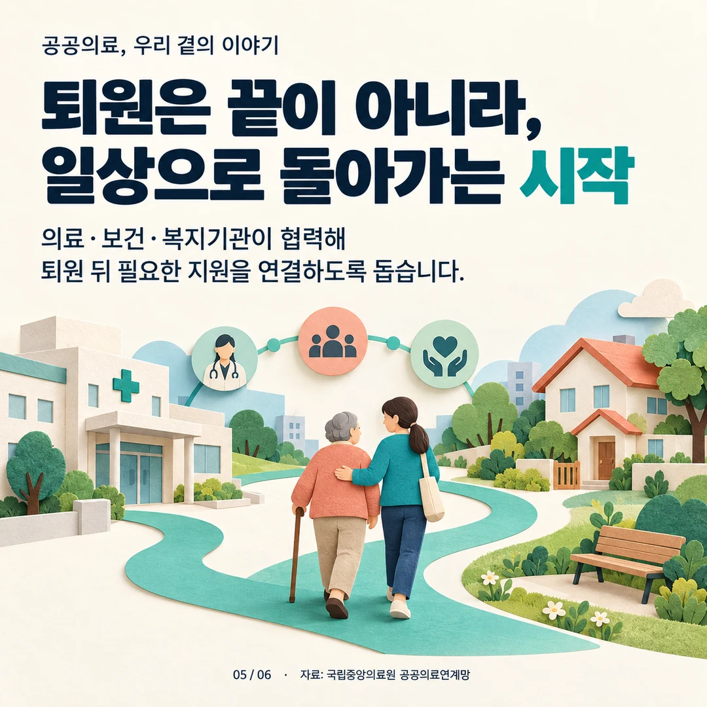
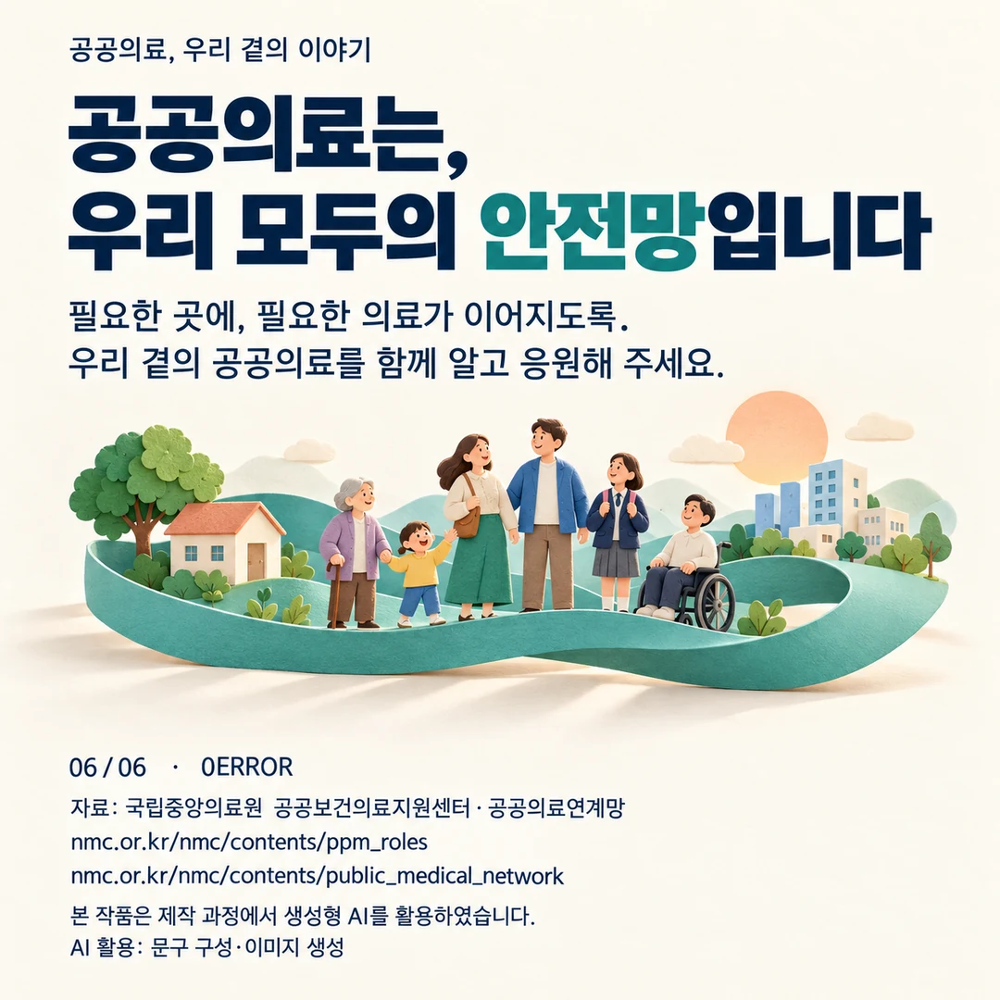

# Public healthcare in everyday life

[Portfolio home](../../README.en.md) · [한국어](README.md) · [Live portfolio](https://yongmin.gardengnat12.chatgpt.site/#ideas)

> IDEAS / PUBLIC-HEALTH COMMUNICATION · As of October 2026

Content prepared by team 0ERROR for a public-healthcare competition. I contributed planning across cards, a short and an essay about public healthcare, with sources and AI use documented.

| Item | Details |
|---|---|
| 6 | Content cards |
| 52 sec | A light that must stay on · Short |
| 3 | Cards · Video · Essay |

*Card 1/6 · Competition content using AI-generated illustration*

## Explaining through familiar situations

The cards connect public healthcare with family and community life, moving from a question about whom it serves to access, recovery and a shared safety net.

## The deliverables

Six cards, a 52-second short, an essay and AI-use/source records are available. AI assisted illustrations and voice. The essay preserves the wording and voice of my own draft through a light copyedit.

## Current status

Content and entry materials are prepared. The confirmed stage is production and entry preparation. A saved input-form record is available; completed submission has not been confirmed.

## Videos

- [A light that must stay on · 52-second short](../../site/assets/competitions/health-short.mp4)

For inline playback, open the [live media case studies](https://yongmin.gardengnat12.chatgpt.site/#ideas).

## Image gallery

*2/6 · Health for everyone*

*3/6 · Access to health*

*4/6 · Beyond financial returns*

*5/6 · Returning to daily life*

*6/6 · A shared safety net*

---

Sources: six final card images, the 52-second short, essay, work descriptions and source/AI-production records. Prepared outputs are distinguished from entry-form state.

This document mirrors the verified public portfolio. Individual responsibilities, team work, proposals, submissions, awards and completed work are distinguished.

<!-- detailed-casebook -->

## Full technical record

[Three-chapter detailed case study in Korean](README.md) · [Detailed Korean PDF · 11 pages](../../site/downloads/publichealth.pdf) · [Web case study](https://yongmin.gardengnat12.chatgpt.site/cases/publichealth/)

The expanded record includes original report figures, design reasoning, deliverables, personal and team roles, and the limits of the evidence.
