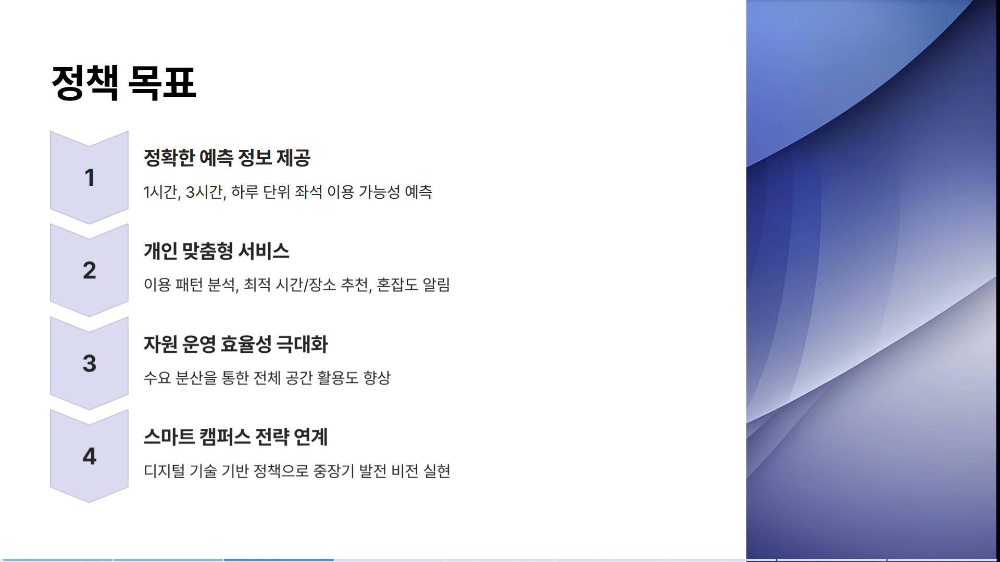
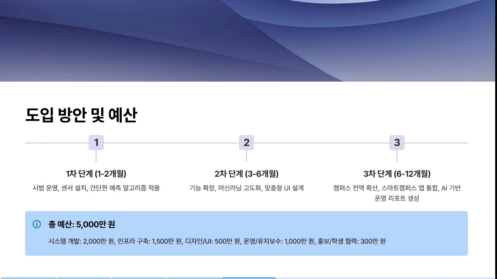
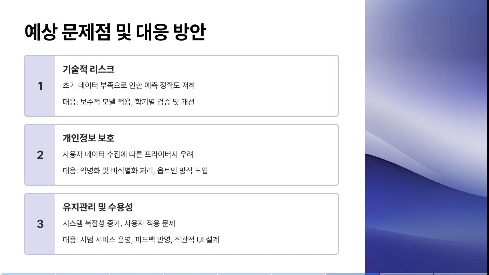

# 열람실 혼잡을 예측하고 공간을 나누다

[포트폴리오 처음으로](../../README.md) · [웹 상세](https://yongmin-engineering-portfolio-oct26.gardengnat12.chatgpt.site/cases/studyspace/) · [상세 PDF · 7쪽](../../site/downloads/studyspace.pdf) · [English summary](README.en.md)

> IDEAS / DATA-INFORMED POLICY · 정책·발표자료 작성

2025 대학혁신 정책제안 공모전을 위해 「AI 기반 열람실 이용률 예측 시스템 및 스마트 리소스 분산 운영 플랫폼 구축」 정책안과 발표자료를 작성했습니다.

| 항목 | 내용 |
|---|---|
| 10쪽 | 정책 제안 발표자료 |
| 데이터 | 출입·좌석·학사일정 활용안 |
| 기획 | 서비스와 운영 단계 설계 |

## 01장. 열람실 이용의 불확실성을 문제로

## 사용자가 알고 싶은 것은 빈자리만이 아닙니다
2025 대학혁신 정책제안 공모전에서 열람실 혼잡을 예측하고 이용 가능한 시간·공간을 안내하는 정책을 기획했습니다. 현재 빈자리 정보뿐 아니라 앞으로의 혼잡을 미리 알 수 있다면 이동과 학습 계획을 조정할 수 있다는 문제의식입니다.

## 제안한 데이터와 서비스
출입 기록, 좌석 정보와 학사일정 등을 활용하는 방향을 검토했습니다. 데이터 수집 → 이용률 예측 → 앱·포털 안내 → 대체 시간·공간 분산의 연결을 정책과 발표자료로 정리했습니다. 실제 데이터를 학습한 예측 모델이나 배포된 앱을 만든 경험으로 소개하지 않습니다.

## 산출물의 목적
10쪽 발표자료는 정책 목표, 서비스 구성, 단계별 도입과 예산, 기대효과 및 예상 문제를 설명하는 문서입니다. 아이디어를 기능 목록에만 두지 않고 학교 운영의 단계와 연결해 검토할 수 있도록 구성했습니다.

## 이 사례에서의 역할
본인 이름이 기재된 정책·발표자료 작성 경험입니다. 캠퍼스의 실제 이용률 개선이나 도입 완료를 입증하는 기록은 아닙니다. 기획자로서 데이터를 어떤 판단과 사용자 안내에 쓸지 설계한 부분을 중심으로 설명합니다.

## 현재 좌석 수에서 미래의 선택으로

제안서는 이용자가 지금 비어 있는 자리만 확인하는 상황에서, 1시간·3시간·6시간·하루 뒤의 혼잡 정보를 보고 이동 시점과 장소를 고르는 방향으로 질문을 바꿨습니다. 도서관만 대상으로 보지 않고 단과대 세미나실, 공강 시간의 강의실, 휴게 학습공간을 대체 공간으로 함께 안내하는 구상입니다.

학생에게는 선호 공간의 예상 혼잡도와 대체 공간의 도보 거리, 행정에는 공간별 수요 흐름과 사용률을 보여 주도록 기능을 나눴습니다. ‘내일 오전 10시, ○○열람실 이용률 30%’ 같은 알림은 화면 문구의 계획 예시이며 예측 시스템이 실제 산출한 값이 아닙니다. 결과물은 이러한 학생·관리자 요구와 도입 순서를 정리한 정책 문서 및 발표자료입니다.

> 근거: 총학생회정책공모전_용의손길.pdf (1–8); 총학생회정책공모전_용의손길.hwpx (정책1–9절)

## 02장. 10쪽 발표자료의 정책·운영 설계

*열람실 정책 발표자료 · 정책 목표 · 구현 서비스 화면이 아닌 제안 슬라이드*

## 발표의 논리
문제 인식에서 정책 목표로, 데이터·예측 서비스에서 도입 일정과 예산으로 흐름을 구성했습니다. 실제 자료의 목표 페이지, 단계별 도입 페이지, 위험 대응 페이지를 아래에 제시합니다. 이 이미지는 제안 발표자료이지 구현된 서비스 화면이 아닙니다.

## 단계적 도입을 제안한 이유
전체 공간으로 한 번에 확대하기보다 일부 공간에서 데이터와 안내 흐름을 검토하고 이후 넓히는 구조입니다. 예측 결과를 보여 주는 것과 이용자가 이를 이해해 다른 공간을 선택하는 일은 다르므로, 운영과 안내 채널을 함께 고려해야 했습니다.

## 예상 문제의 문서화
자료에는 초기 예측 오차, 개인정보 보호와 사용자 수용성 같은 쟁점을 정리했습니다. 수집 단위와 비식별화, 안내의 정확도·갱신과 유지관리 등은 서비스의 실행 조건입니다. 계획 예산과 기대 개선율은 제안의 가정이며 이미 집행하거나 실측한 값으로 소개하지 않습니다.

## 실제 결과물의 성격
정책의 내용을 비교·설명할 수 있는 발표 문서가 산출물입니다. 모델 후보를 검토한 서술이 학습 완료나 성능 달성의 증거는 아닙니다. 사용자 흐름과 운영 제약을 함께 정리한 기획 작업이라는 범위를 유지합니다.

*열람실 정책 발표자료 · 단계별 도입과 계획 예산 · 집행 실적 아님 · policy-page-5.png*

*열람실 정책 발표자료 · 예상 문제와 대응안 · 실제 발표자료 원본 · policy-page-8.png*

## 세 모듈과 피드백 흐름

입력 후보는 좌석 센서·출입기록·Wi-Fi 접속 이력, 학사일정과 날씨입니다. 수집·전처리 모듈에서 결측·이상값·시간 정보를 정리하고, 예측 엔진이 공간·시간대별 수요를 계산하며, 화면·알림 모듈이 혼잡도와 대체 공간을 전달하는 구조로 작성했습니다. 이후 실제 이용·예약 여부를 다음 학습자료로 되돌리는 흐름도 제시했습니다.

원문에는 ARIMA·LSTM 등 시계열 후보와 군집화 기법을 적었지만 적용 성능을 비교한 결과는 없습니다. 기존 좌석정보와 연결할 수 있는 API·접근권한이 확인되어야 하며, 개인화에 필요한 이용기록도 자동으로 확보할 수 있다고 가정하지 않아야 합니다. 현재 산출물에서는 여러 알고리즘 이름보다 수집→전처리→예측→안내→이용 확인의 역할을 어떻게 나눴는지 설명하는 것이 중요합니다.

## 이용자 화면과 관리자 화면에 다른 질문 주기

학생 화면에는 ‘언제, 어디로 가면 되는가’가 중심입니다. 자주 쓰는 열람실의 예상 혼잡도, 반복 이용 시간, 시험기간의 관련 건물, 대체 공간과 도보 거리를 안내하도록 했습니다. 관리자 화면에는 전체 공간의 시간대별 사용률과 수요 이동, 예측과 실제의 차이를 모아 시설 운영 판단에 쓰도록 구상했습니다. 같은 데이터라도 개인의 계획과 기관의 배분이라는 목적이 달라 화면의 정보가 달라져야 한다는 설계입니다.

예측 갱신은1일1회와 실시간 정보 대응을 병행하는 방향을 적었습니다. 새 예측 플랫폼이 기존 예약·좌석 시스템을 모두 교체하기보다 자료를 공유하거나 대시보드를 기존 포털에 넣는 단계적 통합을 제시했습니다. 다만 실제 API가 존재하고 연결 가능한지는 확인이 필요합니다. 문서의 운영안은 학기별 예측오차 검토, 피드백으로 UI와 알림 보완, 담당부서 지정까지 포함합니다. 이런 실행 조건을 읽을 수 있는 정책 결과물이라는 점이 구현 성과와 구별되는 내용입니다.

> 근거: 총학생회정책공모전_용의손길.pdf (1–8); 총학생회정책공모전_용의손길.hwpx (정책1–9절)

## 03장. 구현 이전에 남긴 검증 질문

## 확인된 결과와 현재 단계
정책 제안과 10쪽 발표자료를 작성했습니다. 교내 도입, 예측 모델 학습·평가, 앱 개발과 실제 이용률 개선은 이번에 확인한 완료 범위에 포함하지 않습니다. 기대효과와 실제 성과를 나누어 설명합니다.

## 다음에 확인할 질문
예측이 얼마나 맞는지뿐 아니라 안내 시점, 이용자의 선택 변화, 특정 공간의 과밀 이동을 함께 살펴야 합니다. 학사일정이나 시험기간에 따른 분포 변화, 데이터 누락 시의 안내도 검토해야 실제 서비스로 이어질 수 있습니다. 이 항목들은 현재 시점에서 정리한 후속 검증 방향입니다.

## 사용자·운영 관점의 연결
빈자리 수를 보여 주는 인터페이스 하나로 모든 이용 문제가 해결되지는 않습니다. 공간 운영자에게는 수집과 갱신 부담이 있고 이용자에게는 이동·시간 계획의 맥락이 있습니다. 정책안에서 두 입장을 함께 다뤄 보려 한 경험입니다.

## 이후 프로젝트로 이어지는 태도
데이터를 모으는 이유를 사용자 판단과 연결하고, 기능의 아이디어를 운영 단계와 예산으로 구체화했습니다. 구현하지 않은 기능을 완성된 시스템처럼 설명하기보다, 문서로 만든 설계와 다음 검증을 분명하게 제시하는 사례로 남깁니다.

## 1년 도입안과 운영 책임

1~2개월에는 주요 열람실의 자료 정비와 기초 시계열·내부 대시보드, 3~6개월에는 추천 기능·대체 공간·사용자 피드백, 6~12개월에는 포털 통합과 운영 리포트를 제안했습니다. 학술정보원이 좌석·운영 정책, 정보전산원이 인프라·통합, 총학생회가 요구·홍보, 단과대 행정실이 공간정보를 맡는 협업 구조입니다.

개인화는 옵트인과 삭제·거부권, 최소 2학기 자료 확보 후 정식 운영 검토 등 조건을 문서에 적었습니다. 원문의 예산 표는 개발 2,000만원, 인프라 1,500만원, UI 500만원, 운영 1,000만원, 홍보 300만원으로 합계 5,300만원인데, 본문에는 약 5,000만원이라고 되어 있어 정밀 예산으로 재사용하지 않습니다. 좌석 가용률·이동시간 개선 수치 역시 기대 시나리오입니다. 실제 앱이나 모델보다 문서의 구조·운영·검증 조건을 결과물로 제시합니다.

> 근거: 총학생회정책공모전_용의손길.pdf (1–8); 총학생회정책공모전_용의손길.hwpx (정책1–9절)

---

## 기록의 근거

근거: 표지에 본인 이름이 기재된 2025 대학혁신 정책제안 공모전 발표자료 10쪽. 원문에 있는 개선율과 예산은 계획값이므로 실적 지표에 사용하지 않았습니다.

2026-10-20 기준. 개인 담당과 팀 기여, 해석·계획과 실측·완료 결과를 구분했습니다.
