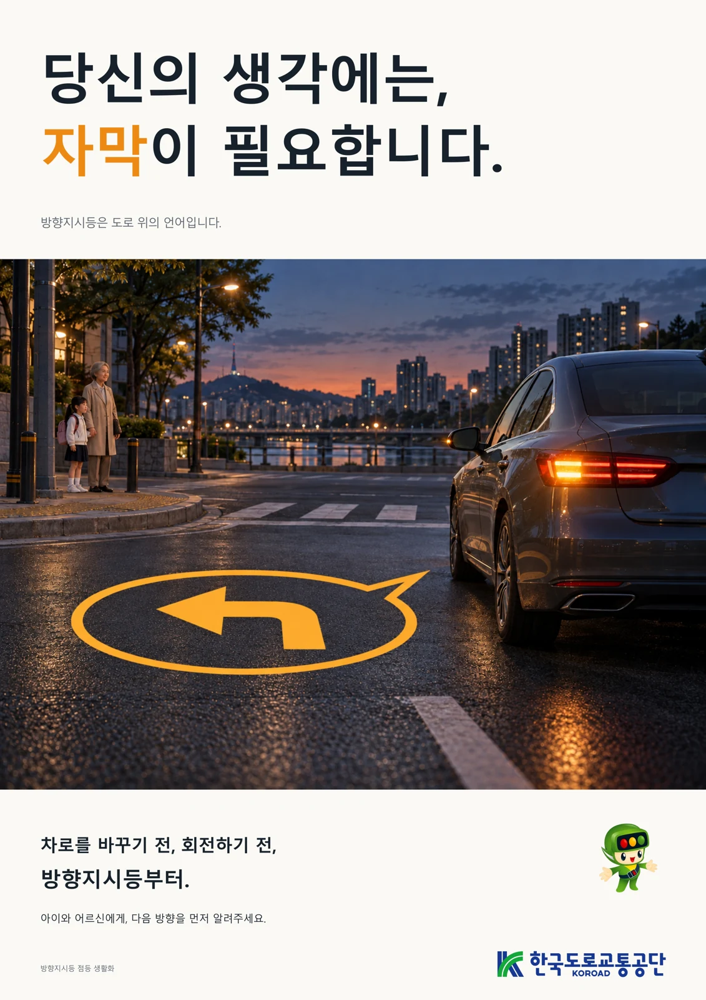
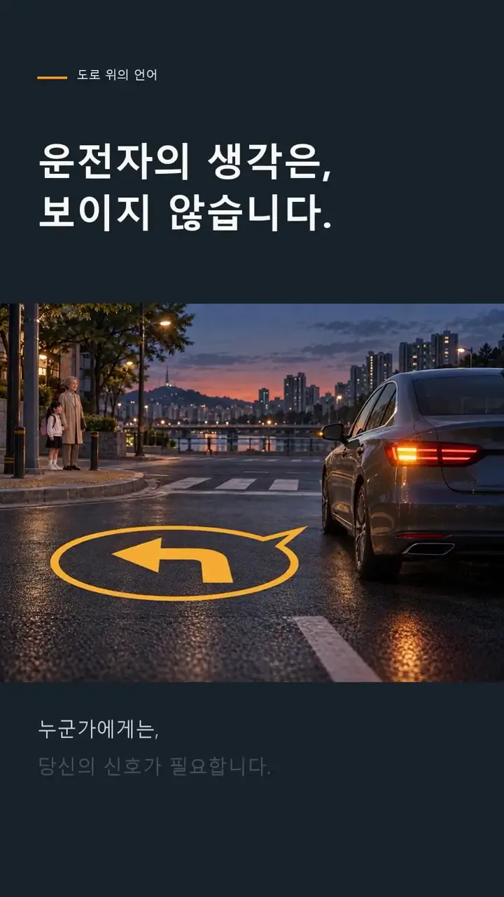
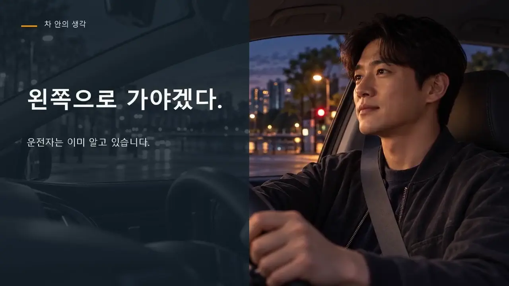

# A2 포스터와 두 길이의 영상

[전체 상세 기록](README.md) · [PDF 8쪽](../../site/downloads/trafficcampaign.pdf)

*실제 A2 광고 포스터 · AI 이미지 활용 팀 콘텐츠*

## 실제 완성 파일
“당신의 생각에는, 자막이 필요합니다” 포스터, “자막을 켜세요” 30초 숏폼 개선본 v2와 “생각의 자막” 2분 광고영상이 있습니다. 아래 포스터와 영상은 실제 준비한 콘텐츠입니다. 웹 열람용 영상은 용량을 줄인 공개본으로 연결합니다.

## 메시지의 연결
포스터의 문장을 출발점으로 장면과 내레이션·자막을 구성했습니다. 긴 설명을 전달하는 영상과 짧은 행동을 남기는 숏폼을 함께 준비해 같은 주제가 매체마다 어떻게 달리 전달되는지 비교할 수 있습니다.

## 제작 기록의 역할
AI 활용 내역과 원본·출력 파일의 구분은 결과물의 제작 방식을 설명하는 자료입니다. 생성된 소재가 실제 촬영 결과로 오해되지 않도록 표현하고, 최종 파일의 형식과 길이를 확인한 기록을 함께 정리했습니다.

## 이미지를 보는 기준
아래 포스터는 공모전용 광고 결과물입니다. 영상의 장면 이미지는 실제 사고나 현장을 증명하는 사진이 아닙니다. 기획·문구·AI 소재·편집이 모여 완성된 팀 콘텐츠로 읽을 수 있도록 설명합니다.

*자막을 켜세요 · 실제 30초 숏폼의 대표 장면 · 기존 공개 포트폴리오의 실제 결과물*

*생각의 자막 · 실제 2분 광고영상의 대표 장면 · 기존 공개 포트폴리오의 실제 결과물*

## 20장면 대본에서 메시지가 완성되는 과정

120초 광고는 장면당6초씩20개로 구성됩니다. 처음30초는 운전자 속생각과 아이·어르신·다른 운전자의 시선을 나란히 보여 줍니다. 30~60초는 ‘빈칸인 다음 방향’에서 작은 불빛과 방향지시등의 의미로 이동합니다. 60~90초는 다른 사람에게 준비할 시간과 주변을 살필 단서를 준다는 의미, 익숙한 길에서도 알리는 습관을 설명합니다. 90초 이후에는 ‘신호 → 주변 확인 → 안전하게 이동’의 순서와 핵심 문장을 정리합니다.

최종 파일은4961×7016px세로포스터,1080×1920·30fps·30초숏폼v2,1920×1080·30fps·120초광고입니다. 원고·SRT·음성·스토리보드와 인쇄용PDF·SVG가 같은 메시지의 제작 근거로 남아 있습니다. 길이·비율은 실제 파일 검사로 확인한 결과물 규격입니다.

## 세 형식에서 유지한 문장과 행동 순서

포스터의 중심 문장과 영상의 마지막 문장을 같은 ‘생각의 자막’으로 맞추고, 중간 장면은 관객의 판단 시간으로 풀었습니다.2분판의 11~13장면은 ‘준비할 시간’, ‘한 번 더 살필 단서’, ‘대화의 시작’을 차례로 보여 줍니다. 운전자의 조작을 보행자와 다른 운전자의 관점에서 읽게 만드는 부분입니다.14~16장면은 익숙한 길·짧은 이동에도 신호를 보내고 주변을 확인한 뒤 움직이는 행동으로 연결합니다.

이는 방향지시등만 켜면 모든 이동이 안전하다는 메시지로 끝내지 않기 위한 문장 구조입니다. 장면의 주황 불빛과 말풍선은 생각이 보이지 않던 앞부분과 신호가 생긴 뒷부분을 잇고, 큰 자막은 짧은 모바일 화면에서도 핵심 비유를 남기는 역할입니다. 제출용·무손실·인쇄 파일과 영상 길이가 다른 파생본은 하나의 캠페인에서 매체에 맞게 구성한 결과물이며 서로 별개의 공모전 수상작으로 세지 않습니다.

> 근거: 교통안전_광고영상_2026/06_대본_스토리보드.txt (20장면/120초); 제작·매체 검토 기록 (교통안전 캠페인)

[영상: 자막을 켜세요 · 30초 숏폼](../../site/assets/competitions/traffic-short.mp4)

[영상: 생각의 자막 · 2분 광고영상](../../site/assets/competitions/traffic-film.mp4)
