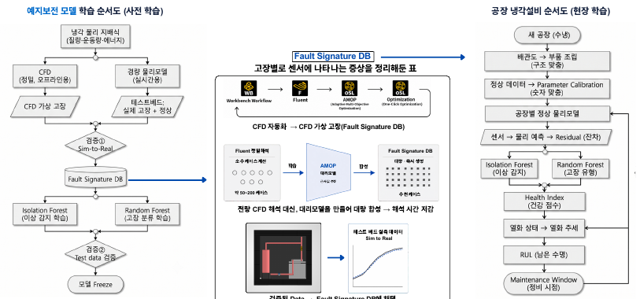

# 센서·분석 구조와 제안서 결과물

[전체 상세 기록](README.md) · [PDF 6쪽](../../site/downloads/watermonitoring.pdf)

*물산업 제안서의 센서·수집·엣지 분석 개념도 · 장비·예측 기능의 완성 증거 아님*

## 실제 준비한 자료
필수 신청·동의·서약 문서와 아이디어제안서의 HWPX·PDF, 같은 항목의 Word 문서를 준비했습니다. 포트폴리오에는 개인 동의서와 서명 대신 기술 제안 본문과 그 안의 도식을 결과물로 제시합니다.

## 도식의 의미
아래 첫 그림은 온도·유량·압력 신호를 수집 장치와 엣지 분석으로 연결하는 제안 구조입니다. 두 번째는 물리모델과 데이터의 차이를 검토하는 분석 흐름입니다. 실제 설치 사진이나 구현 완료 대시보드가 아니라 제안서에 사용한 개념도입니다. 그림 안의 남은 수명 예측 등 확장 표현 역시 달성된 기능을 뜻하지 않습니다.

## 평가 계획의 구성
고정 임계값, 원시 신호 기반 AI와 물리 잔차 기반 분석을 같은 조건에서 비교하는 개발·평가 방향을 적었습니다. 정상 조건과 이상 시나리오를 분리하고, 탐지와 오경보·지연을 함께 보려는 계획입니다. 문서의 실험 횟수와 진단 목표는 실제 달성 성능이 아닙니다.

## 결과물에서 볼 수 있는 역량
센서나 AI라는 요소를 나열하는 데서 그치지 않고, 담당자가 어떤 항목을 점검할지 설명하는 서비스 흐름으로 연결했습니다. 기계 설계와 계측, 판단 지원 사이의 관계를 문서로 정리한 제안 작업입니다.

*물산업 제안서의 물리모델·데이터 비교 흐름 · 개발 방향을 담은 개념도 · water-p3-image0.png*

## 물리 잔차와 고장 시나리오

기술 원고는 유량과 압력손실, 냉각수 입출구 온도차와 열교환의 관계로 정상 예상값을 계산하고 실측과의 차이인 잔차를 살피는 방식을 제안합니다. 같은 유량 감소라도 운전 조건 변화·막힘·펌프 저하의 원인이 다를 수 있어 여러 신호의 관계를 비교하려는 것입니다.

| 시나리오 | 제안한 재현 방법 | 관찰 항목 |
|---|---|---|
| 유로 막힘 | 밸브 개도 조정 | 유량·차압·정상 기준 변화 |
| 펌프 저하 | 구동 조건 조정 | 유량·압력 관계와 잔차 |
| 방열 저하 | 라디에이터 차폐 | 입출구 온도차·열교환 상태 |

CFD·대리모델은 사전 개발에서 조건별 합성자료를 만들고 실제 테스트베드와 대조한 범위만 사용하는 구상입니다. 현장에서는 정밀CFD를 매번 돌리는 대신 경량 모델과 진단을 실행하도록 역할을 구분했습니다.

## 설치와 성능의 앞단을 먼저 정의하기

원고는 모델을 비교하기 전 온도센서의 상대오차, 유량계 범위, 압력·차압 신호 안정성을 확인하고 각 측정에 실험번호·운전 조건·고장단계를 함께 적도록 했습니다. 센서값이 나왔다고 곧바로 고장과 연결하지 않고 계측의 안정성과 조건 식별을 먼저 확보하는 방향입니다. 누수와 기본작동이 확인되지 않으면 정상·고장 비교보다 조립·계측을 보완하는 단계조건을 두었습니다.

사업화 관점에서도 센서 부품 판매만 다루지 않았습니다. 현장별 설치·기준설정 절차, 고장 패턴의 정의, 반복실험과 운영이력이 축적할 자산이라는 구상을 썼습니다. 불필요한 설비정지와 점검공수, 실제 설치·유지비를 함께 비교하고, 유지관리 업체와 협력하는 도입 경로를 검토하도록 했습니다. 수냉식장비에서 데이터센터 등 다른 현장으로 넓히는 구상은 유체·운전 조건 차이를 확인한 뒤의 후속 방향입니다. 이 구조는 물이용 공모전 원고의 구체화 범위이며 계약·권리화·제품 판매 실적이 아닙니다.

> 근거: Startup_Water_2026/04_아이디어제안서_0ERROR.pdf (1–5)
