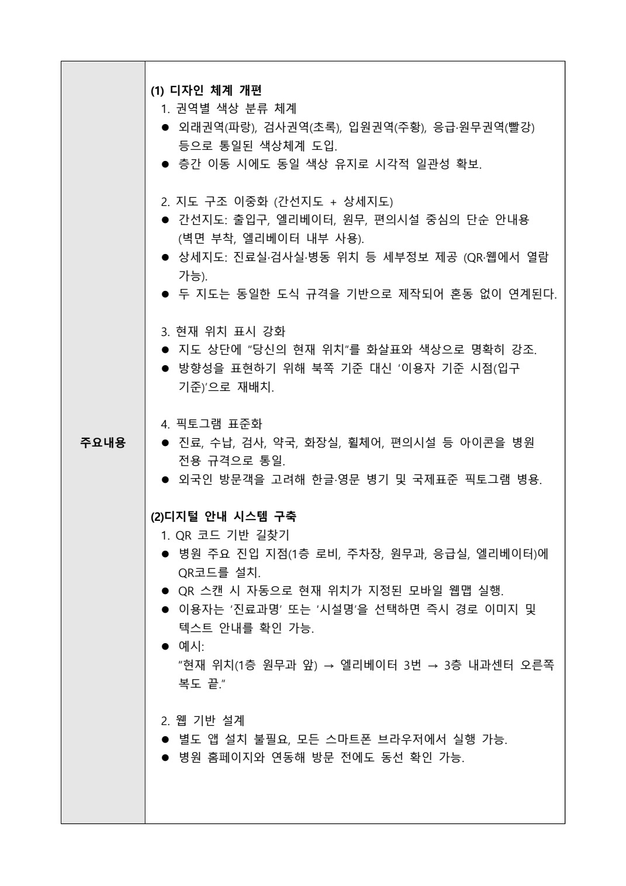
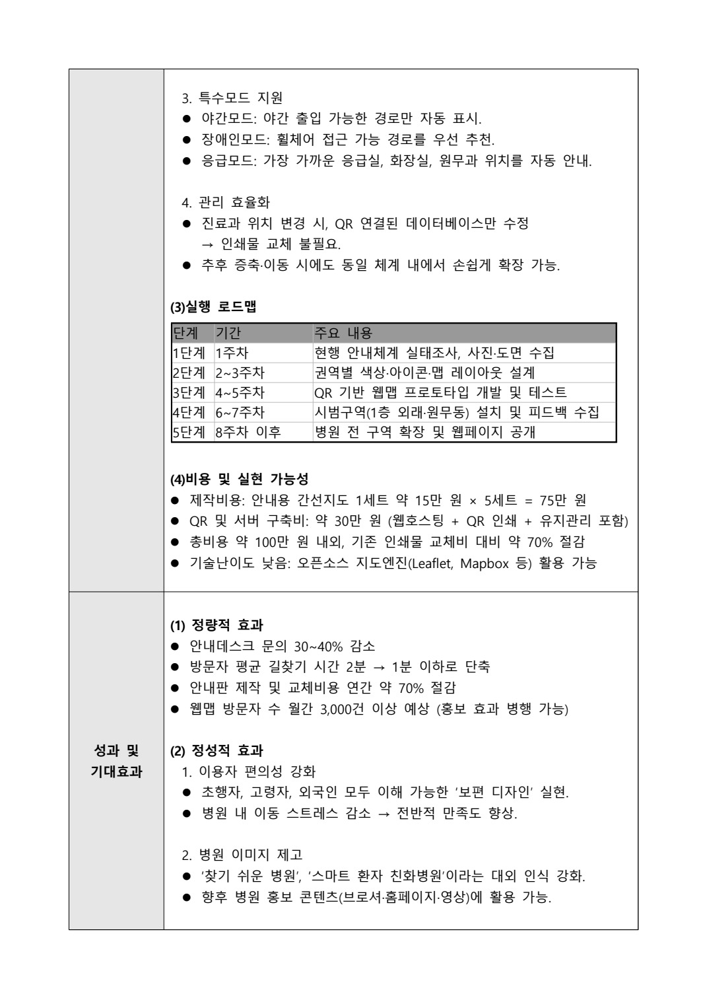

# 병원 안내지도와 QR 길찾기를 하나로

[포트폴리오 처음으로](../../README.md) · [웹 상세](https://yongmin-engineering-portfolio-oct26.gardengnat12.chatgpt.site/cases/wayfinding/) · [상세 PDF · 7쪽](../../site/downloads/wayfinding.pdf) · [English summary](README.en.md)

> IDEAS / SERVICE DESIGN · 개인 제안 제출 / 수상 미선정

2025 세종충남대학교병원 내 길찾기 맵 아이디어 공모전을 위해, 처음 방문한 사람도 일관된 안내 규칙을 따라 이동할 수 있는 체계를 기획했습니다.

| 항목 | 내용 |
|---|---|
| 4쪽 | 길찾기 기획 제안서 |
| 개인 | 신청서에 개인 응모 명시 |
| QR | 오프라인과 웹 안내 연결 |

## 01장. 초행자의 이동을 기준으로 한 안내

## 병원 안에서 길을 찾는 과정
2025 세종충남대학교병원 길찾기 맵 아이디어 공모전에 개인 제안서를 제출했습니다. 처음 방문한 사람이 입구에서 목적지까지 이동할 때 종이 지도, 현장 표지와 웹 안내가 서로 같은 규칙으로 이어지는 체계를 기획했습니다.

## 하나의 화면보다 안내 규칙
권역별 색상과 픽토그램을 통일하고 간선지도와 상세지도를 연결하는 방향입니다. QR을 스캔한 지점을 시작 위치로 삼아 출발점을 다시 찾는 부담을 줄이도록 제안했습니다. 디지털 기능뿐 아니라 현장의 표기 체계와 지도 갱신도 함께 고려했습니다.

## 이동 조건의 차이
야간에 이동 가능한 경로, 휠체어 접근 경로와 주요 시설 안내를 제안에 포함했습니다. 모든 사용자에게 같은 최단 경로를 주는 것보다 접근 가능한 경로와 현재 이용 조건을 설명하는 것이 필요하다고 보았습니다.

## 개인 결과물
개인 신청서와 4쪽 길찾기 기획 제안서를 작성·제출했습니다. 현장 지도 설치나 웹앱 배포 이전의 서비스 설계 작업으로 소개하며, 실제 환자 동선 조사나 이용자 테스트를 완료한 것으로 확대하지 않습니다.

## 인쇄 지도와 디지털 지도의 역할을 나누기

제안서의 중심은 ‘간선지도 + 상세지도’의 이중 구조입니다. 간선지도는 출입구·엘리베이터·원무·편의시설처럼 큰 이동 결정을 돕고 벽면이나 엘리베이터 안에 배치합니다. 상세지도는 진료실·검사실·병동의 세부 위치를 QR과 웹에서 확인하도록 했습니다. 두 지도가 같은 도식 규격을 쓰게 해 이용자가 종이에서 화면으로 옮겨도 다시 읽는 규칙이 바뀌지 않도록 기획했습니다.

권역 색상은 외래 파랑, 검사 초록, 입원 주황, 응급·원무 빨강을 예로 들었습니다. 층을 옮겨도 권역 색상을 유지하고, 지도는 북쪽보다 이용자가 서 있는 입구의 시점을 기준으로 배치하는 방향입니다. 진료·수납·검사·약국·화장실·휠체어 등의 픽토그램과 한·영 병기도 같은 안내 체계에 넣었습니다. 이 부분은 완성된 병원 UI가 아니라 제안서에서 정한 정보설계 원칙입니다.

> 근거: 권용민 2025년 길찾기 아이디어 공모/세종충남대학교병원 내 길 찾기 맵 아이디어 및 제안서.pdf (1–4)

## 02장. 색상·QR·지도 갱신의 제안서

*병원 길찾기 제안서 · 색상·픽토그램·QR 안내 규칙 · 원본 PDF 2쪽*

## 문서의 구체적인 구조
제안서는 디자인 규칙, 간선·상세지도, 현재 위치와 픽토그램, QR 안내, 특수 경로와 관리 효율, 실행 로드맵과 비용을 설명합니다. 아래 원본 페이지는 이러한 내용이 실제로 작성된 문서 결과물입니다.

## 오프라인과 웹의 연결
주요 지점에 QR을 두고 스캔 위치에 맞는 안내를 제공하는 흐름입니다. 간선지도는 주요 이동을 단순하게, 상세지도는 목적지 주변을 더 구체적으로 설명하도록 제안했습니다. 두 지도에서 표기 규칙이 달라지지 않는 것이 핵심입니다.

## 유지관리도 서비스의 일부
목적지와 진료 구역이 바뀌면 안내도 함께 바뀌어야 합니다. 지도 정보와 QR 연결 데이터를 수정하는 운영 흐름을 제안했습니다. 현장의 안내물과 온라인 정보가 서로 다르게 남을 수 있는 문제를 서비스의 유지관리 관점에서 살펴본 작업입니다.

## 숫자와 효과의 성격
문서의 제작비·예상 문의 감소와 이동시간 단축은 제안 당시의 계획·기대값입니다. 실제 설치 후 측정한 성과가 아닙니다. 해당 페이지를 보여 줄 때도 가정이 담긴 원고라는 점을 함께 설명합니다.

*병원 길찾기 제안서 · 특수 경로·갱신·일정과 계획 예산 · 원본 PDF 3쪽 · 세종충남대학교병원 내 길 찾기 맵 아이디어 및 제안서.pdf · 3쪽*

## QR 하나에 현재 위치를 담는 이용 흐름

로비·주차장·원무과·응급실·엘리베이터에 각각 위치가 지정된 QR을 두고, 이용자가 진료과명이나 시설명을 고르면 경로 이미지와 짧은 텍스트를 함께 받는 구조를 제안했습니다. 원문에는 ‘현재 위치(1층 원무과 앞) → 엘리베이터 3번 → 3층 내과센터 오른쪽 복도 끝’이라는 경로 안내 예시가 있습니다. 정밀 실내측위가 없어도 QR의 설치 위치를 출발점으로 사용할 수 있다는 발상입니다.

별도 앱 설치 없이 모바일 웹으로 열고 병원 홈페이지에서도 방문 전 동선을 확인하도록 했습니다. 야간에 열리는 경로, 휠체어 접근 가능한 경로, 가까운 응급실·원무 등 목적에 따른 모드도 문서에 넣었습니다. 위치 변경은 연결된 정보를 갱신하는 방식으로 구상했지만, 실제 병원 도면·통행 권한을 확보해 경로 데이터를 만든 단계까지 진행한 것은 아닙니다.

## 같은 지도 안에서 읽는 깊이를 조절하기

제안서의 간선지도는 모든 진료실명을 빽빽하게 넣는 대신 다음 이동 결정을 위한 출입구·엘리베이터·원무를 우선합니다. 상세지도에서 진료실과 병동 정보를 읽게 하면 한 화면이 담당할 정보량을 나눌 수 있습니다. QR은 종이를 대체하는 유일한 수단이 아니라 더 많은 정보가 필요한 사람에게 열리는 두 번째 경로입니다. 따라서 스마트폰을 사용하지 않는 방문자도 기본 방향을 읽을 수 있도록 정적 안내를 함께 두는 하이브리드 구조입니다.

또한 QR의 부착 위치 자체가 출발점이 되므로 모든 이용자가 지도에서 자기 위치를 먼저 찾을 필요를 줄이는 방향입니다. 다만 QR을 실제로 설치하려면 같은 층의 여러 입구와 엘리베이터 출구를 구별하고 안내 방향을 점검해야 합니다. 원고에서 제시한 사용자 기준 시점, 현재 위치의 색상·화살표 강조, 통일된 아이콘은 이러한 혼동을 줄이기 위한 설계 요소입니다. 실제 병원 도면이나 경로 데이터가 완성됐다는 설명 대신 문서에서 각 요소가 맡은 역할을 보여 줍니다.

> 근거: 권용민 2025년 길찾기 아이디어 공모/세종충남대학교병원 내 길 찾기 맵 아이디어 및 제안서.pdf (1–4)

## 03장. 제출 결과와 서비스 검증의 과제

## 공식 결과
신청서 작성일은 2025년 11월 12일이며, 12월 23일 공식 결과 안내에서는 수상자로 선정되지 않았습니다. 제출 경험과 결과를 그대로 남기고 수상·병원 채택·운영 실적으로 표현하지 않습니다.

## 이 사례에서 남긴 역량
디지털 기능과 현장의 안내 규칙을 함께 설계했습니다. 야간·휠체어 경로와 정보 갱신을 포함해 화면 밖의 사용 조건까지 문서에 담아 본 경험입니다. 실제 제품 대신 검토 가능한 서비스 제안서가 결과물입니다.

## 이후 확인해야 할 질문
초행자가 색상과 픽토그램을 이해하는지, QR 위치가 안내의 시작점으로 적절한지, 통신과 스마트폰 사용이 어려운 경우에도 이동할 수 있는지 검토해야 합니다. 실제 동선을 따라가는 사용성 평가와 지도 갱신 책임의 확인은 후속 과제입니다.

## 개선의 방향
문의량·이동시간 같은 기대효과를 검증하려면 적용 전 기준과 이용자 조건을 기록해야 합니다. 다음 설계에서는 접근성, 안내 오류와 갱신 지연을 함께 확인할 수 있는 평가 계획을 더 구체화하는 방향입니다. 이번에 수행한 사용자 실험의 결과로 주장하지 않습니다.

## 조사에서 시범구역까지의 실행 설계

1주차에는 안내체계 조사와 사진·도면 수집, 2~3주차에는 색상·아이콘·레이아웃, 4~5주차에는 QR 웹맵 프로토타입과 테스트, 6~7주차에는 1층 외래·원무동 시범 설치와 피드백, 8주차 이후에는 확대를 제안했습니다. 설계 규칙만 제시하지 않고 어느 구역에서 먼저 확인할지까지 적은 로드맵입니다.

원문의 지도 5세트 75만원, QR·서버 약 30만원은 제작비 가정입니다. 문의 30~40% 감소, 길찾기 2분에서 1분 이하, 비용 70% 절감, 월 3,000회 방문은 모두 당시 제안한 기대치로, 관찰 결과로 게시하지 않습니다. 비용 합계도 ‘약 100만원’이라는 개략 추정 범위로 작성되어 실제 견적이나 운영비 검토와 구분해야 합니다. 2025년 12월 23일 결과 안내에서는 수상작에 선정되지 않은 점을 함께 기록합니다.

> 근거: 권용민 2025년 길찾기 아이디어 공모/세종충남대학교병원 내 길 찾기 맵 아이디어 및 제안서.pdf (1–4)

---

## 기록의 근거

근거: 본인 명의 공모 신청서와 「세종충남대학교병원 내 길 찾기 맵 아이디어 및 제안서」. 신청서 작성일 2025.11.12 및 2025.12.23 공식 결과 안내.

2026-10-20 기준. 개인 담당과 팀 기여, 해석·계획과 실측·완료 결과를 구분했습니다.
