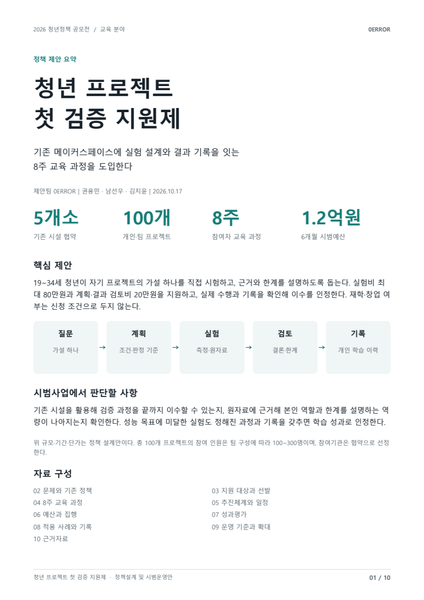
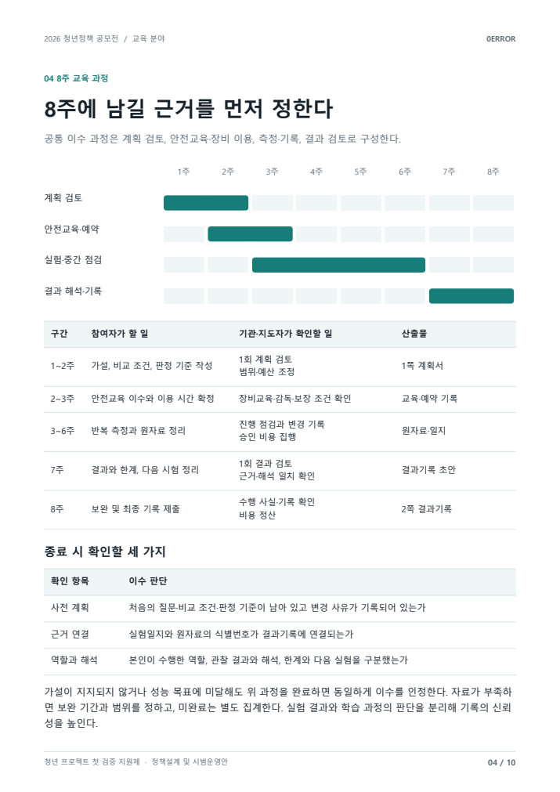
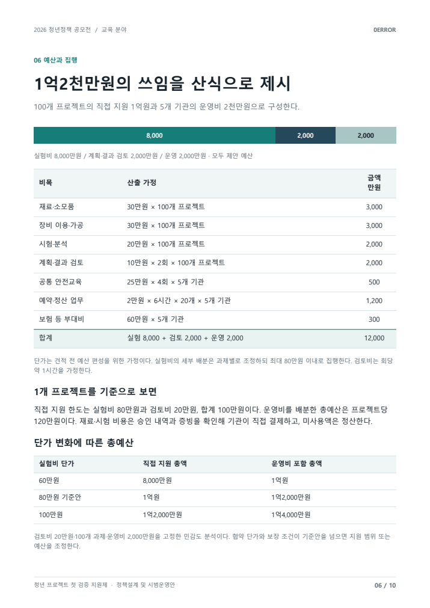

# 아이디어 다음에, 첫 검증을 지원하다

[포트폴리오 처음으로](../../README.md) · [웹 상세](https://yongmin-engineering-portfolio-oct26.gardengnat12.chatgpt.site/cases/youthvalidation/) · [상세 PDF · 8쪽](../../site/downloads/youthvalidation.pdf) · [English summary](README.en.md)

> IDEAS / YOUTH EDUCATION POLICY · 정책 원고·10쪽 추가자료 / 실제 접수 미확인

청년정책 공모전을 위한 「청년 프로젝트 첫 검증 지원제」 제안입니다. 아이디어를 만든 청년이 시설과 검토 기회를 얻고, 직접 확인한 내용을 근거로 설명할 수 있도록 운영 과정을 설계했습니다.

| 항목 | 내용 |
|---|---|
| 10쪽 | 정책설계·시범운영안 |
| 8주 | 제안한 교육 과정 |
| 기록 | 계획 → 실험 → 결과 검토 |

## 01장. 아이디어 이후 첫 검증의 장벽

## 정책이 지원하려는 순간
청년정책 공모전을 위해 아이디어를 가진 청년이 시설과 검토 기회를 얻고, 가설 하나를 실제로 확인하도록 돕는 “청년 프로젝트 첫 검증 지원제”를 제안했습니다. 결과가 성공적으로 보이는지보다 무엇을 확인했고 어디까지 말할 수 있는지 설명하는 경험을 교육의 중심에 두었습니다.

## 새로운 시설보다 기존 자원의 연결
메이커스페이스와 청년센터를 활용해 실험 계획, 예약·안전교육, 측정과 기록, 결과 검토를 잇는 8주 과정을 설계했습니다. 장비 지원만으로 실험의 질문과 기록이 완성되지는 않으므로, 기관의 검토와 참여자의 결과 설명을 함께 연결했습니다.

## 제안의 산출물
온라인 접수용 원고와 10쪽 정책설계·시범운영안을 작성했습니다. 대표 권용민과 공동 제안자가 기재된 팀 자료입니다. 세부 문단·도식별 개인 분담은 확인 자료만으로 확정하지 않고 팀의 정책 설계 결과로 소개합니다.

## 이수와 성공을 분리한 기준
성능 목표를 달성하지 못해도 계획과 원자료, 역할과 한계를 설명할 수 있다면 학습의 이수 여부를 별도로 판단하도록 제안했습니다. 좋은 결과만 남기는 지원 체계보다 검증 과정의 신뢰성을 남기려는 정책 설계입니다.

## 선발 기준을 완성품에서 검증 질문으로

19~34세 개인 또는 3인 이하 팀이 아직 시험하지 못한 핵심 가설 하나와 측정 방법을 1쪽으로 신청하는 정책을 제안했습니다. 재학·창업 여부를 요구하지 않고 청년센터가 학교 밖 참여자의 신청을 돕도록 했습니다. 수상·특허·매출보다 질문의 명확성, 학습 필요성, 안전성과 8주 내 실행 가능성을 선발 기준으로 둡니다.

같은 실험비를 이미 지원받았다면 중복 지원을 막되, 다른 사업으로 제작한 결과물에 아직 수행하지 않은 검증 과제가 남아 있다면 신청할 수 있게 했습니다. 제작시설을 새로 짓기보다 기존 메이커스페이스와 장비교육을 ‘측정하고 설명하는 과정’으로 잇는 것이 제안의 중심입니다. 현재 운영 실적이나 지원기관 협약이 아니라 문서로 완성한 정책 설계입니다.

> 근거: 청년정책공모전_2026/01_청년정책공모전_접수원고_0ERROR.docx (제안배경/내용/실현가능성); 청년정책공모전_2026/03_추가자료_청년프로젝트첫검증지원제_0ERROR.pdf (10쪽)

## 02장. 8주 과정·평가·예산의 구체화

*청년 첫 검증 지원제 · 실제 정책설계 자료 요약 · 규모·목표는 제안값*

## 문서로 만든 운영 과정
10쪽 자료에는 기관의 수용량, 대상과 선발, 실험 계획 검토, 예약·안전교육, 중간 검토와 최종 기록을 담았습니다. 중도 포기와 정산, 평가표와 결과 기록도 포함해 제안이 실제 운영 검토로 이어질 수 있도록 구성했습니다.

## 세 장의 실제 문서 이미지
아래 요약 페이지는 정책의 전체 구성을, 8주 일정은 활동과 남길 근거를, 예산 페이지는 금액과 산식을 보여 줍니다. 화면에 적힌 기관·팀 수와 비용은 모두 제안한 규모입니다. 이미 수행한 사업의 실적 표가 아닙니다.

## 예산과 규모의 관계
원고의 5개 기관·100개 프로젝트·8주·총 1억2,000만원은 시범사업 설계안입니다. 지원 한도와 기관의 운영비를 나누고 규모가 바뀔 때의 검토 조건을 적었습니다. 예산 확보·지원금 수령이나 실제 참여자 수로 소개하지 않습니다.

## 기록 체계의 목적
원자료 식별번호, 개인 역할과 확인 범위를 남겨 결과가 누구의 어떤 작업인지 이어 볼 수 있게 했습니다. 예쁜 최종 보고서뿐 아니라 과정과 한계를 설명할 수 있는 자료를 남기는 것이 정책의 핵심 산출 방향입니다.

*청년 첫 검증 지원제 · 8주 과정·활동·남길 근거의 운영 계획 · youth-p4.png*

*청년 첫 검증 지원제 · 계획 예산의 산식과 규모별 검토 · 실제 집행 아님 · youth-p6.png*

## 8주 과정과 2쪽 결과기록

운영안은 실험계획 검토 → 안전교육·장비 예약 → 측정·기록 → 결과 검토입니다. 지도자가 비교 조건과 판정 기준을 사전에 확인하고 종료 시 원자료·실험일지·해석의 일치를 살피도록 했습니다. 결과기록은 질문, 본인 역할, 시험 조건, 관찰 결과, 한계와 다음 실험을 2쪽에 담는 형식입니다.

목표 성능에 미달해도 계획한 과정을 수행하고 근거를 남기면 같은 이수로 인정합니다. 기관은 실제 수행과 검토 사실을 확인하며 제품 성능을 인증하지 않습니다. 공개 여부는 참여자의 별도 동의를 받게 했습니다. 냉각계 시험의 2상태×3조건×3반복=18회는 이러한 교육에 적용할 수 있는 계획 예시이며 이미 시행한 실험이나 수혜자 실적이 아닙니다.

## 교육의 질을 보는 12점 평가표

추가자료7쪽에는 가설, 조건·절차, 근거·결론, 한계·다음 실험의4항목을 각0~3점으로 보는 평가표를 넣었습니다.0점은 미제시,1점은 단편 제시,2점은 설명 가능,3점은 근거 연결입니다. 교육 전후에는 난이도가 동등한 짧은 실험 사례를 주고 같은 척도로 평가하며 사례 난이도와 평정 차이도 기록하도록 했습니다. 단순 자기 만족도보다 ‘무슨 근거로 어디까지 말할 수 있는가’를 비교하려는 설계입니다.

기관별 수용량도20개 과제라는 숫자만 쓰지 않고 계획20회+결과20회의 지도자 검토40회, 공통 안전교육4회와 예약·정산 시간을 예산에 연결했습니다. 실험비80만원의 기준안은 재료·소모30만원, 장비·가공30만원, 시험·분석20만원이고, 실험비 단가60/80/100만원에 따라 총예산1억/1.2억/1.4억원이 되는 민감도표를 제시했습니다. 이수 확인은 학습 수행의 확인이며 제품 인증을 대신하지 않는다는 운영 기준까지 문서에 연결했습니다.

> 근거: 청년정책공모전_2026/01_청년정책공모전_접수원고_0ERROR.docx (제안배경/내용/실현가능성); 청년정책공모전_2026/03_추가자료_청년프로젝트첫검증지원제_0ERROR.pdf (10쪽)

## 03장. 제안 상태와 정책 효과의 검증

## 현재 단계
접수용 원고와 추가자료가 완성되어 있습니다. 실제 온라인 제출 완료나 정책 채택·사업 운영·수상은 확인되지 않았습니다. 문서에 적힌 이수 목표와 참여 규모를 실현한 성과로 바꾸어 설명하지 않습니다.

## 기대효과와 측정의 차이
청년의 실험 접근성과 결과 설명 능력을 높이려는 목적은 정책의 방향입니다. 실제 효과를 확인하려면 참여 전후의 과제, 원자료와 설명의 대응, 기관의 검토 부담과 중도 포기 이유를 함께 살펴야 합니다. 이번 자료에는 시행 후 효과 측정 결과가 없습니다.

## 다음 시범운영에서 볼 기준
계획한 실험이 안전·예약·재료 조건 안에서 가능한지, 기관이 감당할 수 있는 검토량은 얼마인지 확인해야 합니다. 이수율 하나만으로 평가하지 않고 과정 기록의 완결성과 역할 설명, 결과의 재확인 가능성을 검토하는 방향입니다. 후속 실행을 위한 기준이며 현재 달성한 성과는 아닙니다.

## 남긴 기획 경험
프로젝트 경험을 교육 정책의 운영 구조로 옮기고 대상·시설·예산·평가를 한 문서 안에서 연결했습니다. 실패를 감추지 않고 확인한 범위를 설명하도록 지원하는 제도를 구체화한 작업으로 소개합니다.

## 숫자를 집행 가정과 평가 기준으로 쓰기

제안 규모는 기관5곳×20개 프로젝트=100개, 시범기간6개월입니다. 프로젝트당 실험비80만원과 계획·결과 검토20만원을 잡아 8,000만원+2,000만원, 안전·보험·예약·정산2,000만원을 더해 총 1억 2,000만원을 산정했습니다. 실험비는 현금 지급 대신 기관이 업체에 직접 결제하고 증빙을 확인하는 방식입니다. 모두 정책 예산안이며 확보·집행 내역이 아닙니다.

협약·모집2개월, 기수별8주 과정3개월, 성과평가1개월로 나누고 이수율, 원자료가 있는 결과기록 비율, 역할·한계 설명 역량의 전후 변화, 학교 밖 청년 비율과 프로젝트당 비용을 평가하도록 했습니다. 취업·창업 건수를 곧바로 성과로 잡기보다 실제로 설명 가능한 학습이 남았는지를 보자는 설계입니다. 운영 경험이 없는 상태에서 80개 이상 이수 같은 목표를 완료 인원으로 표현하지 않습니다.

> 근거: 청년정책공모전_2026/01_청년정책공모전_접수원고_0ERROR.docx (제안배경/내용/실현가능성); 청년정책공모전_2026/03_추가자료_청년프로젝트첫검증지원제_0ERROR.pdf (10쪽)

---

## 기록의 근거

근거: 청년정책공모전_2026의 접수 원고, 온라인폼 입력본, 「청년 프로젝트 첫 검증 지원제」 10쪽 추가자료.

2026-10-20 기준. 개인 담당과 팀 기여, 해석·계획과 실측·완료 결과를 구분했습니다.
