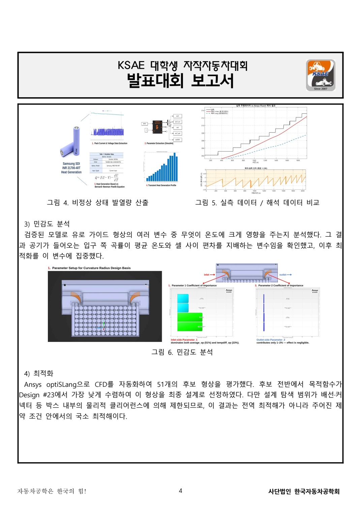
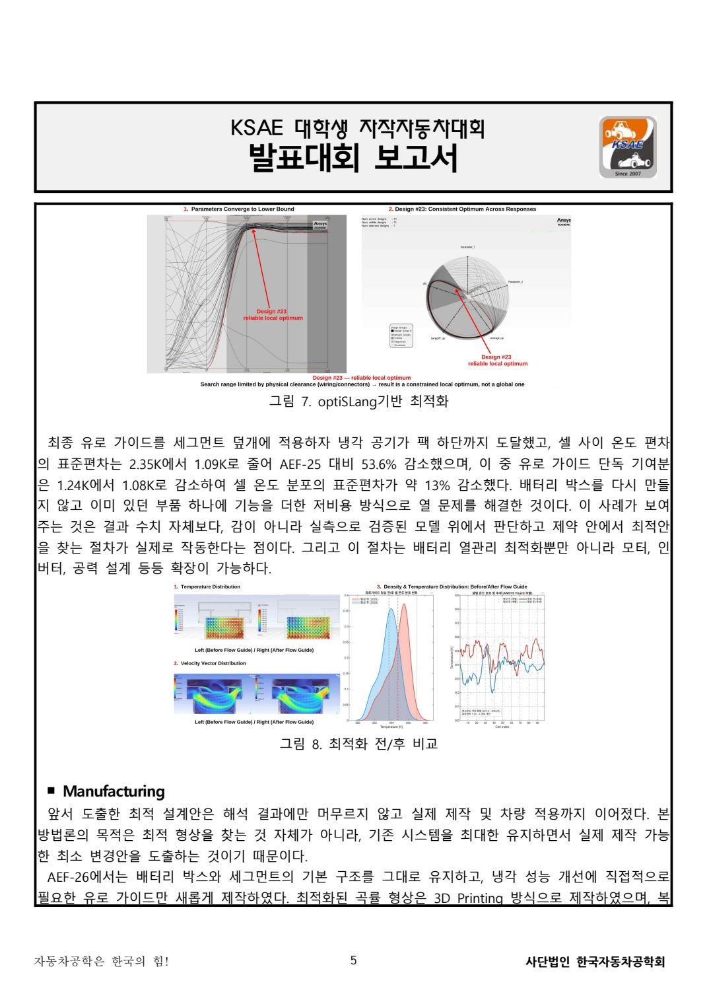

# 51개 후보 검토와 실제 부품 적용

[전체 상세 기록](README.md) · [PDF 7쪽](../../site/downloads/battery.pdf)

*실물 유로 가이드 시제품과 배터리 팩 장착 · 팀 보고서 그림 9*

## 팀의 해석 과정
팀은 실주행 전류 기반의 열원을 적용하고 모델을 실측 온도와 비교했습니다. 배선·커넥터 제약을 반영한 공간 안에서 51개 후보 형상을 평가하고, 공기가 전달되는 위치와 온도 분포를 비교했습니다. 이 수는 팀의 형상 평가 범위이며 제가 51개를 독자적으로 해석했다는 뜻은 아닙니다.

## 계산에서 부품으로 옮기는 과정
선택한 유로를 3D프린팅 부품으로 제작하고 배터리 팩에 장착해 배선·커넥터와의 간섭을 확인했습니다. 실제 적용 사진은 출력물 자체와 팩 내부에서의 위치를 함께 보여 줍니다. 계산 그림만으로 장착 가능성을 설명하기 어려운 부분을 실물 결과물이 보완합니다.

## 결과 이미지를 읽는 방법
해석 페이지의 색상 분포와 온도 비교는 시뮬레이션 결과입니다. 유로 가이드와 배터리 팩 적용 이미지는 실제 제작·장착 결과입니다. 두 자료를 같은 검증으로 묶지 않고, 어떤 단계까지 진행했는지 나누어 설명했습니다.

## 자료 통합 산출물
보고서 초안과 기술·비용 자료를 통합하며 분량과 제출 형식을 다듬었습니다. 장치의 기능뿐 아니라 기존 박스를 재사용하고 필요한 가이드를 더하는 방향의 자원 활용과 제작 가능성을 설명했습니다. 제출용 보고서가 팀의 실제 역할과 결과를 일관되게 담도록 정리한 작업도 최종 산출물의 일부입니다.

*팀 배터리 보고서 · 모델·민감도·후보 평가 · CFD와 자동화는 담당 팀원의 작업 · 실주행 데이터 기반 검증과 CFD 자동화를 통한 배터리 팩 저비용 열관리 최적화.pdf · 4쪽*

*팀 배터리 보고서 · 최적화 전후 해석 비교와 제작 전환 · 장착 후 주행 실측 아님 · 실주행 데이터 기반 검증과 CFD 자동화를 통한 배터리 팩 저비용 열관리 최적화.pdf · 5쪽*

## 실측 비교·민감도·형상 탐색을 연결한 팀 과정

팀은 주행 전류를 Batemo 셀 모델에 입력해 시간별 발열량을 산출하고 Ansys Fluent의 열원으로 사용했습니다. 보고서는 해석 온도와 기존 실측 온도의 차이가 해당 비교에서 1.5 K 이내였다고 설명합니다. 이는 팀 보고서에 기록한 모델 비교이며 제가 원시 모델을 독립적으로 재실행해 검증한 결과와는 구분합니다.

민감도 분석에서 입구 곡률을 주요 설계변수로 검토하고, optiSLang으로 51개 후보를 평가해 Design #23을 선택했습니다. 탐색 범위는 배선·커넥터 등 팩 내부 공간으로 제한되어 있으므로 모든 가능한 형상을 평가한 전역 최적해가 아닙니다. 해당 해석과 자동화는 담당 팀원의 작업이고 저는 기계 설계·제작과 보고서 통합에서 이를 실제 부품과 연결했습니다.

최종 형상은 세그먼트 덮개에 더하는 3D프린팅 가이드로 만들었습니다. 별도 금형 없이 곡률을 구현하고 기존 구조를 유지한 채 수정할 수 있다는 제작 방향입니다. 실제 팩에 장착한 뒤 배선과 커넥터의 공간 간섭을 확인한 사진이 아래 결과물입니다.

> 근거: 「실주행 데이터 기반 검증과 CFD 자동화를 통한 배터리 팩 저비용 열관리 최적화」 2~6쪽.
