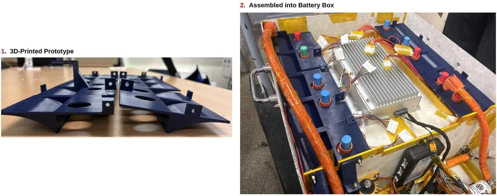

# Turning the analysis into a physical part.

[Portfolio home](../../README.en.md) · [한국어](README.md) · [Live portfolio](https://yongmin.gardengnat12.chatgpt.site/#battery-project)

> 03 / THERMAL MANAGEMENT · TEAM PROJECT · As of October 2026

For A-FA’s battery thermal-management project, I contributed component design, 3D printing, welding and static analysis. I helped translate the team’s flow-guide geometry into a part that could fit inside the battery pack.

| Item | Details |
|---|---|
| 3D | Flow-guide printing |
| FIT | Wiring and connector clearance |
| Award | KSAE Excellence · Team award |

*Flow-guide prototypes and installation in the AEF-26 battery pack, from the team report*

## Getting air to the right place

Track records from the earlier car showed uneven temperatures across cell locations. The team investigated adding a flow guide to the segment cover to direct air toward the bottom of the pack while retaining the battery-box structure.

## My fabrication contribution

- Contributed component design, 3D printing, welding and static analysis.
- The team installed the printed guides and checked interference with wiring and connectors, considering fabrication and assembly together.
- CFD analysis, optiSLang automation and the competition presentation were performed by the responsible teammates.

## Bringing the technical record together

I drafted the presentation report and integrated design, fabrication and cost materials. I helped explain the minimal-change approach around reusing the enclosure, connected the physical case with business value and resource use, and refined the length and submission format.

## The team’s engineering process

The team used track-current-based heat inputs, compared the model with measured temperatures and evaluated 51 geometries within wiring and connector clearances. The selected geometry was printed and checked for fit in the pack. Temperature-distribution improvements in the report are simulation comparisons, rather than a post-installation track measurement of the new guide.

---

Sources: team report on track-data validation and CFD automation for battery thermal management, pages 1 and 3–6; report-drafting and role-allocation correspondence, September 2–9, 2026; and my experience record. Image: Figure 9, page 6.

This document mirrors the verified public portfolio. Individual responsibilities, team work, proposals, submissions, awards and completed work are distinguished.

<!-- detailed-casebook -->

## Full technical record

[Three-chapter detailed case study in Korean](README.md) · [Detailed Korean PDF · 7 pages](../../site/downloads/battery.pdf) · [Web case study](https://yongmin.gardengnat12.chatgpt.site/cases/battery/)

The expanded record includes original report figures, design reasoning, deliverables, personal and team roles, and the limits of the evidence.
