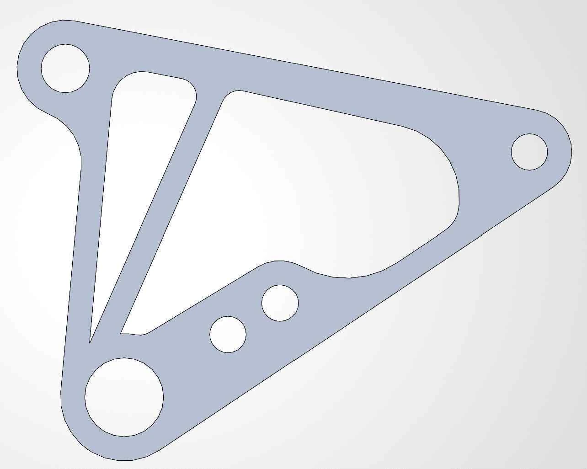
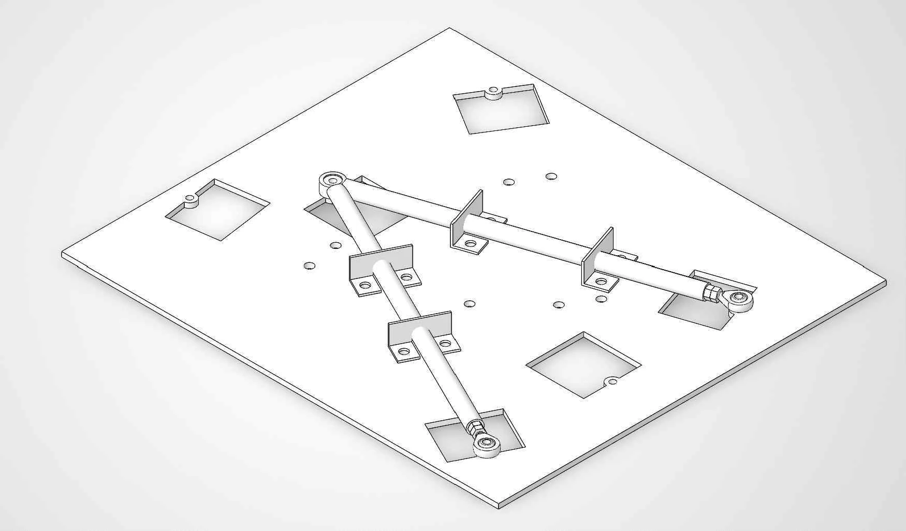

# From an optimized shape to a real part

[Portfolio home](../../README.en.md) · [한국어](README.md) · [Live portfolio](https://yongmin-engineering-portfolio-oct26.gardengnat12.chatgpt.site/#work)

> 02 / DESIGN & FABRICATION · As of October 2026

An optimized shape is not automatically a manufacturable component. I reviewed the bellcrank plate’s load paths and mounting regions, then redesigned it for fabrication.

| Item | Details |
|---|---|
| −48.7% | Front plate CAD mass |
| −51.4% | Rear plate CAD mass |
| 25 / 28 g | Mass of fabricated front / rear plate |

*Redesigned front bellcrank plate based on topology-optimization results*

## From analysis to fabrication

- Reviewed load paths based on Altair Inspire topology-optimization results.
- Preserved material around the mounting holes and refined the geometry for plate fabrication.
- Developed the geometry in SolidWorks, checked the structure in ANSYS and fabricated the component.

## Keeping the measurements distinct

The CAD mass comparison is 51.21 → 26.25 g for the front plate and 58.13 → 28.27 g for the rear. Scale photographs show fabricated plate masses of 25 g and 28 g respectively. The CAD reduction percentages are not presented as before-and-after physical measurements.

## Carrying the design into a fabrication jig

Retaining the jig and rod-end approach used in AEF-25, I reviewed how the mounting arrangement carries hardpoints into fabrication. The report documents fixing the mounting regions on a 5 mm steel-plate jig, tack welding, checking dimensions and completing the welds. It also describes pushrod adjustment using right- and left-hand-threaded rod ends.

*Suspension-arm jig CAD on a 5 mm steel plate · My chassis report, page 225, Figure 2.2.11.5-1*

## What I learned

The useful design balances the analysis result with load-transfer regions, fabrication and assembly conditions. It was an opportunity to see how design reasoning appears in a finished component.

---

Source: my chassis design report, pages 200–204 (bellcranks), 218–219 (length adjustment), and 225–227 and 234 (jig and retained fabrication method). CAD mass and scale photographs are on pages 203 and 204. Images come from the same report.

This document mirrors the verified public portfolio. Individual responsibilities, team work, proposals, submissions, awards and completed work are distinguished.

<!-- detailed-casebook -->

## Full technical record

[Three-chapter detailed case study in Korean](README.md) · [Detailed Korean PDF · 17 pages](../../site/downloads/bellcrank.pdf) · [Web case study](https://yongmin-engineering-portfolio-oct26.gardengnat12.chatgpt.site/cases/bellcrank/)

The expanded record includes original report figures, design reasoning, deliverables, personal and team roles, and the limits of the evidence.
